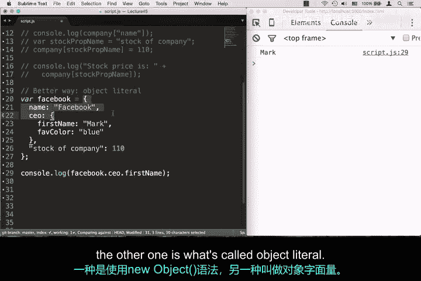

# 077：第2部分 使用对象字面量语法创建对象 🏗️


在本节课中，我们将学习如何使用**对象字面量**语法来创建JavaScript对象。这是一种比使用 `new Object()` 更简洁、更易读的方法。

## 概述

上一节我们介绍了如何使用 `new Object()` 语法创建对象并设置其属性。本节中，我们来看看如何使用**对象字面量**语法来简化这一过程。

## 对象字面量语法

对象字面量语法允许我们直接使用花括号 `{}` 来定义对象及其属性，无需调用 `new Object()`。

以下是创建对象的基本结构：
```javascript
var objectName = {
  property1: value1,
  property2: value2
};
```

## 创建对象示例

让我们创建一个名为 `Facebook` 的对象，其中包含公司名称、CEO信息和股价。

```javascript
var Facebook = {
  name: "Facebook",
  CEO: {
    firstName: "Mark",
    favoriteColor: "blue"
  },
  stock: 110
};
```

在这个例子中：
*   `name` 是一个属性，其值为字符串 "Facebook"。
*   `CEO` 是一个属性，其值本身是另一个对象（嵌套对象）。
*   `stock` 是一个属性，其值为数字 110。

## 访问对象属性

创建对象后，我们可以像之前一样访问其属性：

```javascript
console.log(Facebook.CEO.firstName); // 输出: Mark
```

## 使用字符串作为属性名

对象字面量的一个优势是，可以使用包含空格的字符串作为属性名，这在点表示法中是无法直接设置的。

```javascript
var Facebook = {
  name: "Facebook",
  CEO: {
    firstName: "Mark",
    favoriteColor: "blue"
  },
  "stock of company": 110 // 使用字符串作为属性名
};
```

要访问此类属性，需要使用方括号表示法：

```javascript
console.log(Facebook["stock of company"]); // 输出: 110
```

## 编码技巧

在编写对象字面量时，一个实用的技巧是先写好结束符号（如右花括号 `}` 和分号 `;`），然后再填充内容。这有助于避免语法错误，并使代码结构更清晰。

例如，可以这样开始：
```javascript
var company = {
  // 光标在这里开始添加属性
};
```

然后逐步添加属性：
```javascript
var company = {
  CEO: {
    // 子对象属性
  }, // 注意这里的逗号
  "stock of company": 110
};
```

## 总结

本节课中我们一起学习了：
1.  **对象字面量语法**：使用 `{}` 直接创建对象，这是一种更简洁、更常用的方法。
2.  **定义属性**：在花括号内使用 `属性名: 值` 的格式定义属性，不同属性间用逗号分隔。
3.  **嵌套对象**：属性值可以是另一个对象，从而创建复杂的数据结构。
4.  **特殊属性名**：可以使用引号包裹的字符串作为属性名，以包含特殊字符或空格。
5.  **访问属性**：创建的对象与之前用 `new Object()` 创建的对象在属性访问方式上完全一致。




对象字面量是JavaScript中最常见和推荐的对象创建方式，因为它书写快捷，结构一目了然。