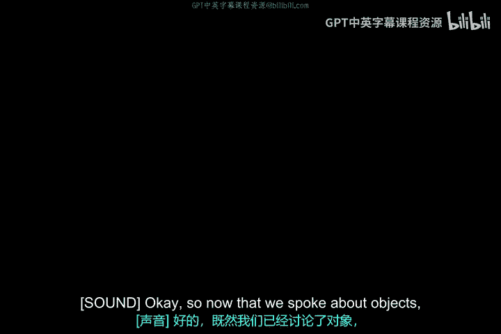
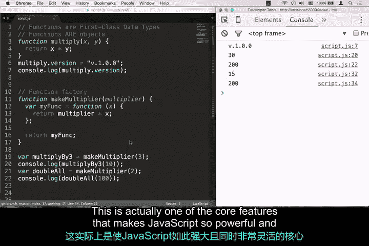

# 078：函数详解



## 概述
在本节课中，我们将要学习 JavaScript 中函数的本质。我们将了解到，函数在 JavaScript 中是一种“一等公民”数据类型，这意味着它们可以像变量和对象一样被传递、赋值和操作。通过理解函数的对象特性，我们可以实现更高级的编程模式，例如函数工厂和将函数作为参数传递。

---

## 函数是对象

上一节我们介绍了对象的基本概念，本节中我们来看看 JavaScript 中函数的真实身份。在 JavaScript 中，函数实际上是一种特殊的对象。

```javascript
function multiply(x, y) {
    return x * y;
}
```

这意味着，你可以对函数做任何可以对对象做的事情，例如为函数设置属性。

```javascript
multiply.version = "v1.0.0";
console.log(multiply.version); // 输出：v1.0.0
```

每个对象都有一个内置的 `toString` 方法，函数也不例外。当我们直接输出函数时，实际上调用的是它的 `toString` 方法。

```javascript
console.log(multiply); // 输出函数本身的代码
```

---

## 函数工厂

既然函数是对象，我们可以创建返回函数的函数，这被称为“函数工厂”。

以下是创建一个函数工厂的步骤：

1.  定义一个名为 `makeMultiplier` 的函数，它接收一个参数 `multiplier`。
2.  在 `makeMultiplier` 函数内部，定义并返回一个新的函数。
3.  这个新函数接收一个参数 `x`，并返回 `multiplier * x` 的结果。

```javascript
function makeMultiplier(multiplier) {
    var myFunc = function (x) {
        return multiplier * x;
    };
    return myFunc;
}
```

现在，我们可以使用这个工厂来创建特定的乘法函数。

```javascript
var multiplyBy3 = makeMultiplier(3);
console.log(multiplyBy3(10)); // 输出：30

var doubleAll = makeMultiplier(2);
console.log(doubleAll(100)); // 输出：200
```

---

## 将函数作为参数传递

函数作为“一等公民”，可以被传递给其他函数作为参数。这极大地增加了代码的灵活性。

让我们创建一个名为 `doOperationOn` 的函数，它接收一个数值 `x` 和一个函数 `operation` 作为参数。

```javascript
function doOperationOn(x, operation) {
    return operation(x);
}
```

现在，我们可以将之前创建的 `multiplyBy3` 和 `doubleAll` 函数传递给 `doOperationOn`。

```javascript
var result = doOperationOn(5, multiplyBy3);
console.log(result); // 输出：15

result = doOperationOn(100, doubleAll);
console.log(result); // 输出：200
```

请注意，我们传递的是函数引用（`multiplyBy3`），而不是函数调用的结果（`multiplyBy3()`）。这样，`doOperationOn` 函数内部才能够在合适的时机执行传入的操作。

---



## 总结
本节课中我们一起学习了 JavaScript 函数的核心特性。我们了解到函数是“一等公民”数据类型，本质上是特殊的对象。因此，我们可以为函数设置属性，可以将函数作为值从另一个函数中返回（创建函数工厂），也可以将函数作为参数传递给其他函数。正是这些特性，使得 JavaScript 如此强大和灵活。掌握这些概念是理解高阶函数、回调函数和函数式编程的基础。