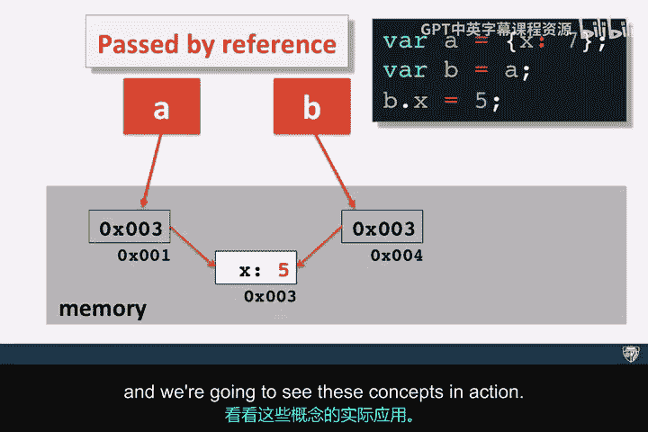

# 079：传值 vs 传址 📚


在本节课中，我们将要学习JavaScript中一个至关重要的概念：**传值**与**传址**。理解这两者的区别对于掌握变量赋值、函数参数传递以及对象操作至关重要。

## 概述

首先，我们来明确一下这两个术语的含义。当我们谈论“传值”或“传址”时，通常指的是在赋值或传递变量时，数据是如何被处理的。

*   **传值**：将变量`a`的内容复制给变量`b`（即 `b = a`）。这意味着，之后改变`b`的值**不会**影响`a`的值，反之亦然。它们是两个独立的副本。
*   **传址**：同样是将变量`a`的内容复制给变量`b`。但此时，改变`b`的值**会**影响`a`的值，反之亦然。因为它们实际上指向内存中的同一个位置。

在JavaScript中，规则可以概括为：**基本类型通过传值操作，而对象通过传址操作**。更准确地说，基本类型是**按值复制**，对象是**按引用复制**。其根本原因在于它们是如何在内存中存储的。

## 基本类型：传值操作 🔢

让我们通过一个具体的例子来理解基本类型的传值过程。

假设我们有以下代码：
```javascript
let a = 7;
let b = a; // 将 a 的值复制给 b
b = 5; // 修改 b 的值
console.log(a); // 输出：7
console.log(b); // 输出：5
```
在这个例子中，`a`的值是`7`，`b`的值也是`7`。当我们把`b`改为`5`后，`a`的值仍然是`7`。这说明`a`和`b`是相互独立的。

为了更直观地理解，我们可以看看内存中发生了什么：

1.  声明 `let a = 7;`：内存中分配一个位置（例如地址`001`），并存入值`7`。
2.  执行 `let b = a;`：内存中为`b`分配一个新位置（例如地址`002`），并将`a`的值`7`**复制**到这个新位置。
3.  执行 `b = 5;`：将地址`002`中的值从`7`**替换**为`5`。

此时，地址`001`（`a`）的值依然是`7`，地址`002`（`b`）的值是`5`。`a`和`b`互不影响。这种机制就是**传值**。

## 对象：传址操作 🏗️

上一节我们介绍了基本类型的传值机制，本节中我们来看看对象是如何通过传址进行操作的。

考虑以下代码：
```javascript
let a = { x: 7 };
let b = a; // 将 a 的“引用”复制给 b
b.x = 5; // 通过 b 修改对象属性
console.log(a.x); // 输出：5
console.log(b.x); // 输出：5
```
在这个例子中，`a`是一个对象。当我们把`a`赋值给`b`后，通过`b`修改了属性`x`，结果`a.x`的值也变成了`5`。这说明`a`和`b`操作的是同一个对象。

让我们深入内存层面看看这个过程：

1.  声明 `let a = { x: 7 };`：
    *   为变量`a`分配一个内存地址（例如`001`）。
    *   对象`{ x: 7 }`本身被存储在内存的另一个位置（例如`003`）。
    *   地址`001`中存储的值，实际上是对象所在地址`003`的**引用**（可以理解为一个指向`003`的指针）。
2.  执行 `let b = a;`：
    *   为变量`b`分配一个新地址（例如`002`）。
    *   将`a`的值（即地址`003`的引用）**复制**到地址`002`中。
    *   现在，`a`（地址`001`）和`b`（地址`002`）存储着相同的值——都是指向地址`003`的引用。
3.  执行 `b.x = 5;`：
    *   通过`b`找到它指向的地址`003`。
    *   修改地址`003`中对象属性的值（将`x`从`7`改为`5`）。

由于`a`和`b`都指向同一个内存地址（`003`），所以通过任何一个变量去修改这个地址里的内容，另一个变量“看到”的内容也会随之改变。这种机制就是**传址**。

## 核心区别总结

以下是传值与传址的核心区别对比：

*   **传值**：复制的是数据的**实际值**。创建的是原始数据的一个完全独立的副本。修改副本不影响原始数据。
*   **传址**：复制的是数据的**内存地址引用**。创建的是指向同一块内存空间的另一个“别名”。通过任何一个“别名”修改数据，都会影响所有指向该数据的变量。

## 本节课总结

本节课中我们一起学习了JavaScript中**传值**与**传址**的核心概念。我们了解到：

1.  **基本类型**（如数字、字符串、布尔值等）是通过**传值**进行复制和传递的。操作的是数据的独立副本。
2.  **对象**（包括数组、函数等）是通过**传址**进行复制和传递的。操作的是对同一内存位置的引用。



理解这一区别，能帮助我们避免在编程中产生意想不到的副作用，例如无意中修改了本不想改变的对象。在下一部分，我们将进入代码编辑器，通过实际例子来观察这些概念是如何运作的。