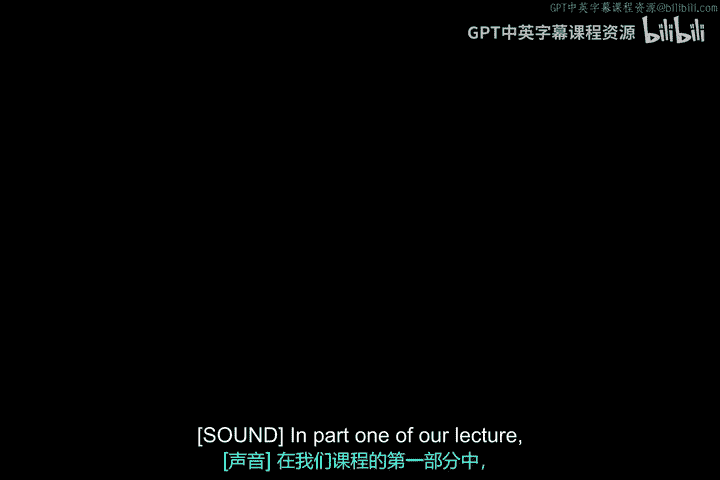
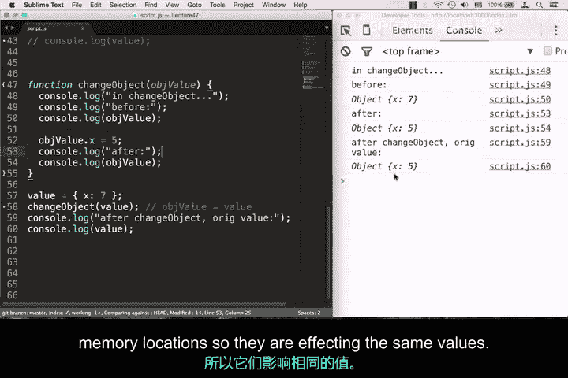
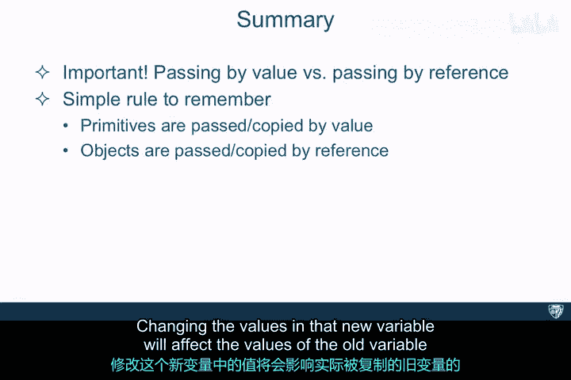
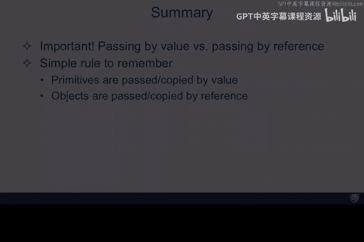

# 080：传值 vs 传址



在本节课中，我们将通过具体的代码示例，深入理解JavaScript中“传值”与“传址”这两个核心概念。我们将看到原始类型和对象类型在复制和传递时的不同行为。

## 概述

理解“传值”与“传址”是掌握JavaScript编程的基础。简单来说，原始类型（如数字、字符串）通过“传值”方式操作，而对象类型（如对象、数组）则通过“传址”方式操作。本节将通过代码演示这两种方式的区别。

## 传值示例

首先，我们来看一个原始类型“传值”的例子。当我们复制一个原始类型的变量时，新变量会获得原始值的一个独立副本。

```javascript
let a = 7;
let b = a; // 此时 b 是 a 值的一个独立副本
console.log(a); // 输出：7
console.log(b); // 输出：7

b = 5; // 修改 b 的值
console.log(a); // 输出：7 (a 的值未受影响)
console.log(b); // 输出：5
```

在上面的例子中，`b` 最初获得了 `a` 的值（7）。当我们将 `b` 修改为 5 时，`a` 的值保持不变，因为 `a` 和 `b` 指向内存中两个独立的存储位置。

## 传址示例

接下来，我们看看对象类型“传址”的例子。当我们复制一个对象变量时，新变量实际上获得的是对同一内存地址的引用，而不是一个独立的对象副本。

```javascript
let a = { x: 7 };
let b = a; // b 现在指向 a 所指向的同一个对象
console.log(a); // 输出：{ x: 7 }
console.log(b); // 输出：{ x: 7 }

b.x = 5; // 通过 b 修改对象的属性
console.log(a); // 输出：{ x: 5 } (a 指向的对象也被修改了)
console.log(b); // 输出：{ x: 5 }
```

在这个例子中，`a` 和 `b` 都指向内存中的同一个对象。因此，通过 `b` 修改对象的 `x` 属性后，通过 `a` 访问该属性也会看到变化。

## 函数参数传递

“传值”和“传址”的概念在函数参数传递时同样适用。将变量作为参数传递给函数，本质上也是一种复制操作。

### 向函数传递原始类型（传值）

当向函数传递一个原始类型的值时，函数内部得到的是该值的一个独立副本。

```javascript
function changePrimitive(primValue) {
    console.log('函数内部，修改前:', primValue);
    primValue = 5; // 修改函数内的局部变量
    console.log('函数内部，修改后:', primValue);
}

let value = 7;
changePrimitive(value);
console.log('函数外部，原始值:', value); // 输出：7 (原始值未变)
```

函数 `changePrimitive` 接收了 `value` 的一个副本。在函数内部修改 `primValue` 不会影响外部的 `value` 变量。

### 向函数传递对象类型（传址）

当向函数传递一个对象时，函数内部得到的是对该对象的引用。因此，在函数内部修改对象会影响原始对象。

```javascript
function changeObject(objValue) {
    console.log('函数内部，修改前:', objValue);
    objValue.x = 5; // 修改传入对象的属性
    console.log('函数内部，修改后:', objValue);
}

let value = { x: 7 };
changeObject(value);
console.log('函数外部，原始对象:', value); // 输出：{ x: 5 } (原始对象被修改)
```

函数 `changeObject` 接收了 `value` 对象的引用。在函数内部修改 `objValue.x` 实际上修改了 `value` 所指向的同一个对象。

## 核心规则总结



以下是需要牢记的核心规则：

*   **原始类型**（如 `Number`, `String`, `Boolean`, `null`, `undefined`, `Symbol`）在**赋值**或**作为参数传递**时，采用的是 **传值** 方式。
*   **对象类型**（如 `Object`, `Array`, `Function`）在**赋值**或**作为参数传递**时，采用的是 **传址** 方式。

## 本节课总结





本节课我们一起学习了JavaScript中“传值”与“传址”的关键区别。我们通过代码示例明确了：原始类型的操作互不影响，因为它们拥有独立的数据副本；而对象类型的变量可能指向同一个内存地址，修改其中一个会影响所有指向该地址的变量。深刻理解这一概念对于避免程序中的意外错误至关重要。