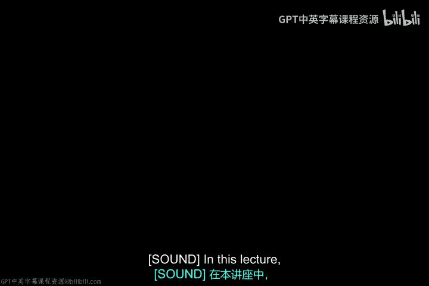
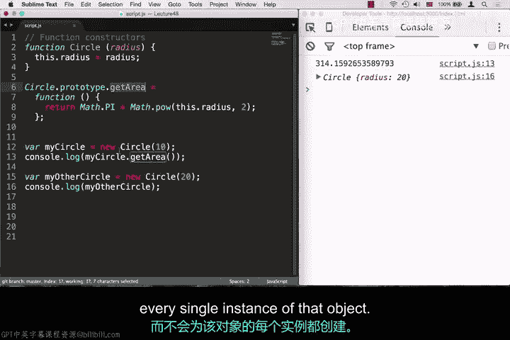

# 081：函数构造器、原型与this关键字 🏗️



在本节课中，我们将学习在 JavaScript 中创建对象的另一种非常常见的方法。这种方法特别适用于需要将功能与对象封装在一起的情况，类似于 Java 中的类。我们将重点探讨函数构造器、`prototype` 属性以及 `this` 关键字的工作原理。

---

## 函数执行与 `this` 关键字

上一节我们提到了对象创建的不同方式。在深入新的方法之前，我们先来探讨一个特定的主题：函数执行时 `this` 关键字的行为。

我们创建一个简单的函数：

```javascript
function test() {
    console.log("Hello Coursera");
}
test();
```

当我们调用一个函数时，JavaScript 引擎会创建一个新的执行上下文。这个执行上下文包含一个特殊的变量 `this`。让我们看看在普通函数调用中，`this` 指向什么：

```javascript
function test() {
    console.log(this);
}
test();
```

执行上述代码，你会发现 `this` 指向全局的 `window` 对象。这意味着，在函数内部，我们可以通过 `this` 为全局对象添加属性：

```javascript
function test() {
    this.myName = "Yaakov";
    console.log(window.myName); // 输出 "Yaakov"
}
test();
```

然而，如果我们希望将数据封装在特定对象内部，并让 `this` 指向那个新对象，就需要使用函数构造器。

---

## 使用函数构造器创建对象

函数构造器提供了一种创建具有特定结构和方法的对象的方式。以下是创建函数构造器的步骤：

1.  **定义构造器函数**：使用大写字母开头命名函数（这是一种约定，表示它是一个构造器）。
2.  **使用 `new` 关键字调用**：这会改变 `this` 的指向。
3.  **在函数内部使用 `this`**：为正在创建的新对象设置属性。

让我们创建一个 `Circle` 构造器：

```javascript
function Circle(radius) {
    console.log(this);
    this.radius = radius;
}

var myCircle = new Circle(10);
console.log(myCircle);
```

当你使用 `new` 关键字调用 `Circle` 函数时：
*   JavaScript 引擎会创建一个新的空对象。
*   这个新对象的 `this` 被设置为指向这个新创建的对象。
*   执行构造器函数体内的代码（这里将 `radius` 属性赋给 `this`）。
*   构造器函数**不能有返回值**（除非返回另一个对象）。`new` 操作符会自动返回这个新创建的对象。

因此，`myCircle` 现在是一个拥有 `radius` 属性的对象。

---

## 为对象添加方法

一个只有属性的对象是不够的，我们还需要方法。方法就是附加在对象属性上的函数。

以下是直接为每个实例添加方法的做法（**不推荐**）：

```javascript
function Circle(radius) {
    this.radius = radius;
    this.getArea = function() {
        return Math.PI * Math.pow(this.radius, 2);
    };
}

var myCircle = new Circle(10);
console.log(myCircle.getArea()); // 输出面积
```

这种方法的问题在于，每次使用 `new Circle()` 创建一个新圆时，都会在内存中创建一个全新的 `getArea` 函数。如果创建成千上万个圆，就会浪费大量内存，因为每个圆的 `getArea` 函数逻辑是完全相同的。

---

## 使用 `prototype` 共享方法

为了解决上述问题，JavaScript 提供了 `prototype` 属性。每个函数都有一个 `prototype` 对象。通过构造器创建的所有对象实例，都可以访问其构造器的 `prototype` 对象上的属性和方法。这样，方法只需定义一次，所有实例即可共享。

以下是使用 `prototype` 的正确方式：

```javascript
// 1. 定义构造器，只初始化属性
function Circle(radius) {
    this.radius = radius;
}

// 2. 将方法添加到构造器的 prototype 上
Circle.prototype.getArea = function() {
    return Math.PI * Math.pow(this.radius, 2);
};

// 3. 创建实例
var myCircle = new Circle(10);
var myOtherCircle = new Circle(20);

console.log(myCircle.getArea()); // 输出第一个圆的面积
console.log(myOtherCircle.getArea()); // 输出第二个圆的面积
console.log(myCircle.getArea === myOtherCircle.getArea); // true，证明是同一个函数
```

现在，`getArea` 方法只存在于 `Circle.prototype` 上。当你调用 `myCircle.getArea()` 时，JavaScript 引擎会先在 `myCircle` 对象本身查找 `getArea` 方法。如果没找到，它会沿着原型链（通过 `__proto__` 属性）向上查找，最终在 `Circle.prototype` 上找到并执行它。

查看对象，你会发现 `getArea` 不在对象自身，而在其 `__proto__` 中。

---

## 重要注意事项

在使用函数构造器和原型时，有两点需要特别注意：

1.  **`prototype` 方法应定义在构造器函数外部**
    不要将 `Circle.prototype.getArea = ...` 这行代码放在 `Circle` 函数内部。因为构造器函数每次被 `new` 调用时都会执行，如果放在内部，会导致每次创建实例时都重新定义（覆盖）`prototype` 上的方法，造成不必要的性能开销。

2.  **调用构造器时不要忘记 `new` 关键字**
    如果忘记使用 `new`，`Circle` 就只是一个普通函数。此时函数内的 `this` 会指向全局对象（如 `window`），并且函数默认返回 `undefined`，导致变量无法获得预期的对象。

    ```javascript
    var myCircle = Circle(10); // 错误！没有使用 new
    console.log(myCircle); // undefined
    console.log(window.radius); // 10，属性被泄露到全局
    ```
    使用大写字母开头的函数名（如 `Circle`）有助于提醒你这是构造器，必须与 `new` 一起使用。

---

## 总结

本节课我们一起学习了 JavaScript 中创建和封装对象的强大工具：

*   **函数构造器**：通过 `function Circle(radius) { ... }` 定义，并使用 `new` 关键字调用，用于初始化对象属性。
*   **`this` 关键字**：在构造器函数内部，`this` 指向正在创建的新实例对象。
*   **`prototype` 属性**：用于存放应由所有实例共享的方法（如 `getArea`）。这避免了为每个实例重复创建相同函数，优化了内存使用。
*   **原型链**：当实例自身没有某个属性或方法时，JavaScript 会通过 `__proto__` 查找其构造器的 `prototype` 对象。




通过结合使用函数构造器和原型，我们可以创建出结构清晰、高效且易于维护的对象，这是理解 JavaScript 面向对象编程的基础。