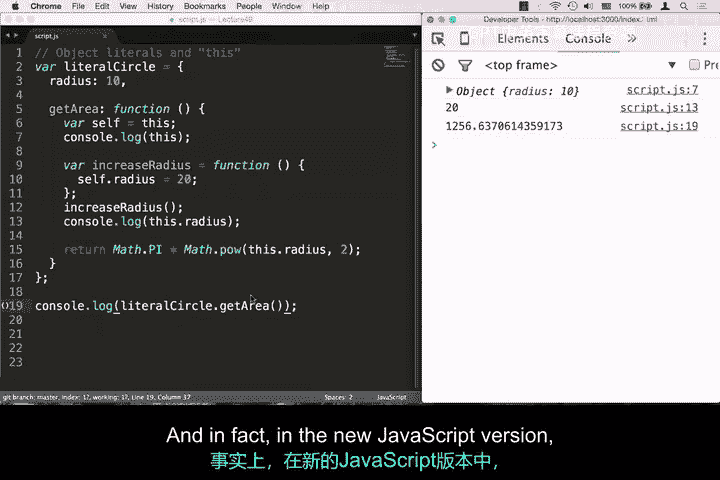

# 082：对象字面量与 `this` 关键字


在本节课中，我们将要学习对象字面量的创建方式，并深入探讨 `this` 关键字在对象字面量内部的行为。我们将通过实例来理解 `this` 的指向规则，以及如何处理一个常见的 JavaScript 行为。

---

## 概述

上一节我们介绍了在函数构造器中 `this` 关键字的行为，即当函数与 `new` 关键字一起调用时，`this` 指向函数自身或新创建的对象。本节中，我们来看看在对象字面量内部，`this` 关键字是如何表现的。

## 创建对象字面量

首先，我们创建一个简单的对象字面量。对象字面量由一对花括号 `{}` 定义，并以分号结尾。

以下是创建一个名为 `literalCircle` 的对象字面量的步骤：

```javascript
var literalCircle = {
    radius: 10
};
```

我们为这个对象添加了一个 `radius` 属性，其值为 10。

## 为对象添加方法

接下来，我们为这个对象添加一个方法。方法是对象的一个属性，其值是一个函数。

以下是添加 `getArea` 方法的代码：

```javascript
var literalCircle = {
    radius: 10,
    getArea: function () {
        console.log(this);
    }
};
```

在这个方法内部，我们使用 `console.log(this)` 来查看 `this` 关键字当前指向什么。

## 调用方法并观察 `this`

现在，我们调用 `getArea` 方法，观察控制台的输出。

```javascript
literalCircle.getArea();
```

执行后，你会发现 `this` 不再指向全局的 `window` 对象，而是指向我们创建的 `literalCircle` 对象本身。这是因为在对象字面量中，`this` 自动绑定到该对象。

## 在方法中使用 `this`

既然 `this` 指向对象本身，我们就可以在方法中安全地使用它来访问对象的其他属性。

以下是修改后的 `getArea` 方法，它使用 `this.radius` 来计算圆的面积：

```javascript
var literalCircle = {
    radius: 10,
    getArea: function () {
        return Math.PI * Math.pow(this.radius, 2);
    }
};

console.log(literalCircle.getArea());
```

执行这段代码，控制台会输出正确的圆面积（约 314.16）。这证明了 `this` 在对象方法中按预期工作。

## 理解 `this` 的绑定原理

你可能会问，为什么这里的 `this` 会指向对象而不是全局对象？原因在于，对象字面量的创建在底层等价于使用 `new Object()`。`new` 关键字的存在使得函数内部的 `this` 被绑定到新创建的对象上，而不是外部环境。

## 嵌套函数中的 `this` 问题

然而，JavaScript 中存在一个常见的行为（有些人认为这是一个设计上的缺陷）。当在一个对象方法内部定义另一个函数（嵌套函数）时，内部函数中的 `this` 会重新指向全局对象（如 `window`），而不是外层对象。

以下是一个演示此问题的例子：

```javascript
var literalCircle = {
    radius: 10,
    getArea: function () {
        console.log(this); // 指向 literalCircle

        var increaseRadius = function () {
            this.radius = 20; // 这里的 this 指向 window！
        };
        increaseRadius();

        console.log(this.radius); // 输出仍然是 10
        console.log(window.radius); // 输出是 20
        return Math.PI * Math.pow(this.radius, 2);
    }
};

console.log(literalCircle.getArea());
```

运行这段代码，你会发现 `this.radius` 的值没有改变，而 `window.radius` 被设置成了 20。这是因为 `increaseRadius` 函数内部的 `this` 指向了全局对象。

## 解决方案：使用 `self` 变量

为了解决这个问题，一个常见的模式是在外层方法开始时，将 `this` 保存到一个变量（通常命名为 `self` 或 `that`）中。然后在内部函数中使用这个变量来引用外层对象。

以下是使用 `self` 变量修复问题的代码：

```javascript
var literalCircle = {
    radius: 10,
    getArea: function () {
        var self = this; // 将 this 保存到 self

        var increaseRadius = function () {
            self.radius = 20; // 使用 self 而不是 this
        };
        increaseRadius();

        console.log(this.radius); // 现在输出是 20
        return Math.PI * Math.pow(this.radius, 2);
    }
};

console.log(literalCircle.getArea());
```

现在，`increaseRadius` 函数正确地修改了 `literalCircle` 对象的 `radius` 属性，面积计算也基于新的半径值。

## 关于此行为的说明

关于这个行为是否是 JavaScript 的缺陷存在一些争论。无论如何，对于开发者来说，它可能带来困惑。值得注意的是，在更新版本的 JavaScript（如 ECMAScript 6）中，通过箭头函数等特性，这个问题已经得到了改善。

---

## 总结



本节课中我们一起学习了对象字面量的基本结构，并深入探讨了 `this` 关键字在其中的行为。我们了解到，在对象方法中，`this` 通常指向对象本身。然而，在嵌套函数内部，`this` 会指向全局对象，这是一个需要注意的常见陷阱。我们通过引入 `self` 变量的模式，有效地解决了这个问题，确保了代码的正确性。理解 `this` 的绑定规则对于编写可靠的 JavaScript 代码至关重要。