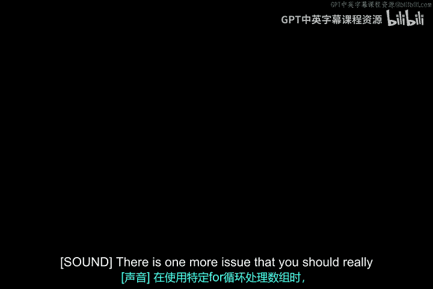
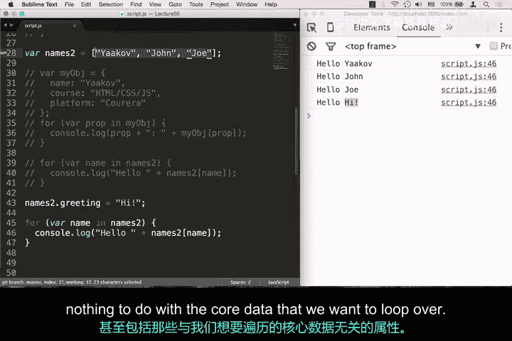

# 084：18_第50讲 第2部分 数组



在本节课中，我们将要学习在使用特定类型的`for`循环遍历数组时需要注意的一个重要问题。我们将通过对比数组和对象的遍历方式，理解JavaScript中数组的本质，并掌握如何正确选择循环方法。

上一节我们介绍了数组的基本遍历方法，本节中我们来看看一个在使用`for...in`循环遍历数组时可能遇到的陷阱。

## 数组与对象的相似性

在JavaScript中，数组本质上是一种特殊类型的对象。数组的索引（如0, 1, 2）实际上是对象的属性名。这意味着某些用于遍历对象属性的循环方法也可以用于数组，但这并不总是理想的做法。

让我们通过一个例子来理解这一点。首先，我们创建一个数组和一个对象：

```javascript
// 创建一个数组
let names2 = ["Yaov", "John", "Joe"];

// 创建一个对象
let myObj = {
    name: "Yakov",
    course: "HTML, CSS, JavaScript",
    platform: "Coursera"
};
```

## 使用for...in循环遍历对象

对于对象，我们可以使用`for...in`循环来遍历其所有属性。这种循环非常方便，因为对象没有像数组那样的数字索引，而是具有属性名。

以下是使用`for...in`循环遍历对象的示例：

```javascript
for (let prop in myObj) {
    console.log(prop + ": " + myObj[prop]);
}
```

这段代码会输出对象的所有属性名和对应的值。`prop`变量在每次循环中代表对象的一个属性名，我们可以使用点表示法或方括号表示法来访问属性值。

## 尝试用for...in循环遍历数组

既然数组也是对象，理论上我们也可以使用`for...in`循环来遍历数组。让我们尝试一下：

```javascript
for (let name in names2) {
    console.log("Hello " + names2[name]);
}
```

这段代码确实会输出"Hello Yaov"、"Hello John"和"Hello Joe"，看起来工作正常。然而，这里存在一个潜在问题。

## 问题的根源

数组作为对象，可以拥有除数字索引之外的其他属性。让我们给数组添加一个自定义属性：

```javascript
names2.greeting = "Hi";
```

现在，如果我们再次使用相同的`for...in`循环：

```javascript
for (let name in names2) {
    console.log("Hello " + names2[name]);
}
```

输出结果将包括"Hello Hi"，这是因为`greeting`属性也成为了数组对象的一部分，而`for...in`循环会遍历对象的所有可枚举属性，包括我们添加的自定义属性。

## 推荐的做法

对于数组遍历，更安全、更明确的方法是使用标准的`for`循环或`forEach`方法：

```javascript
// 使用标准for循环
for (let i = 0; i < names2.length; i++) {
    console.log("Hello " + names2[i]);
}

// 使用forEach方法
names2.forEach(function(name) {
    console.log("Hello " + name);
});
```

这些方法只会遍历数组的实际元素，而不会包括可能添加的其他属性。

## 关键要点总结

以下是本节课的核心要点：

1. **数组是对象**：在JavaScript中，数组是特殊类型的对象，索引是属性名
2. **for...in循环的局限性**：`for...in`循环会遍历对象的所有可枚举属性
3. **自定义属性的影响**：添加到数组的自定义属性会被`for...in`循环包含
4. **推荐的数组遍历方法**：使用标准`for`循环或`forEach`方法更安全可靠




本节课中我们一起学习了数组与对象遍历的重要区别。我们了解到，虽然数组在JavaScript中是对象，但使用`for...in`循环遍历数组可能存在风险，因为它会包含所有可枚举属性，而不仅仅是数组元素。对于数组遍历，建议使用专门设计的方法，如标准`for`循环或`forEach`方法，以确保只处理预期的数据。