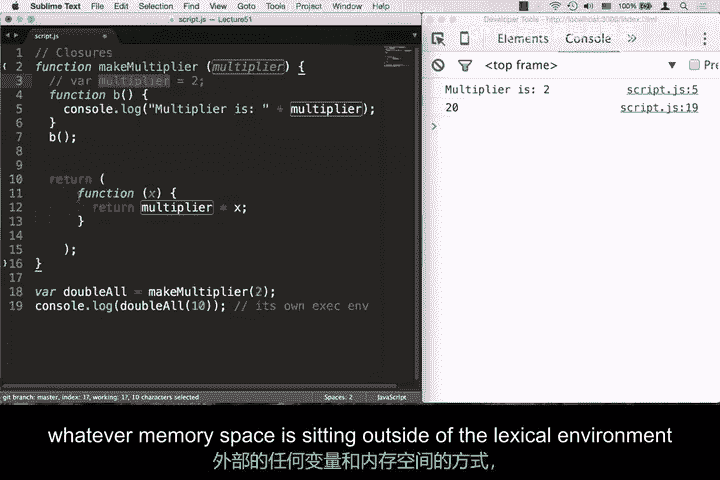
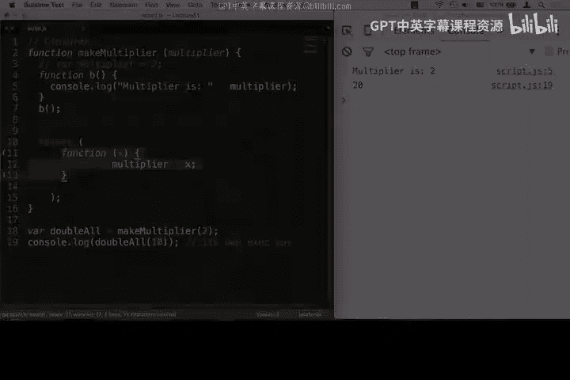

# 085：理解闭包


在本节课中，我们将要学习 JavaScript 中的一个核心概念——闭包。闭包对于理解 JavaScript 的高级功能至关重要，例如实现 Ajax 等功能。实际上，你已经在不知不觉中接触过闭包了。

## 概述

闭包允许一个函数访问并记住其外部作用域中的变量，即使该外部函数已经执行完毕。这为创建具有私有状态或记忆功能的函数提供了可能。

## 一个闭包的例子

让我们通过一个具体的例子来理解闭包。我们将创建一个名为 `makeMultiplier` 的函数。

```javascript
function makeMultiplier(multiplier) {
    return function (x) {
        return multiplier * x;
    };
}
```

这个函数接收一个参数 `multiplier`，并返回一个新的函数。这个返回的函数接收一个参数 `x`，并返回 `multiplier` 乘以 `x` 的结果。

现在，我们来使用这个函数。

```javascript
var doubleAll = makeMultiplier(2);
console.log(doubleAll(10)); // 输出：20
```

当我们调用 `makeMultiplier(2)` 时，它返回了一个新的函数，并将其赋值给变量 `doubleAll`。随后，当我们调用 `doubleAll(10)` 时，它正确地计算出了 `2 * 10 = 20`。

## 闭包是如何工作的

上一节我们介绍了闭包的基本用法，本节中我们来看看其背后的工作原理。关键在于理解 JavaScript 的执行上下文和词法作用域。

当一个函数（如 `makeMultiplier`）被执行时，它会创建一个执行上下文。这个上下文包含了函数的参数（如 `multiplier`）和局部变量。当函数返回另一个函数时，返回的函数会“记住”它被创建时所处的词法环境。

即使 `makeMultiplier` 函数已经执行完毕并从执行栈中弹出，其内部变量 `multiplier` 所占用的内存空间也不会被立即回收。这是因为返回的函数（`doubleAll`）仍然保留着对其外部词法环境（即 `makeMultiplier` 的作用域）的引用。这种机制就是闭包。

以下是其工作流程的简化描述：
1.  调用 `makeMultiplier(2)`，创建执行上下文，其中 `multiplier = 2`。
2.  `makeMultiplier` 返回一个新的函数，该函数内部引用了变量 `multiplier`。
3.  `makeMultiplier` 执行完毕，但其作用域（包含 `multiplier`）被返回的函数“关闭”在内，得以保留。
4.  调用 `doubleAll(10)` 时，新函数创建自己的执行上下文。
5.  新函数在其自身作用域中找不到 `multiplier`，于是沿着作用域链向上查找，在闭包保留的 `makeMultiplier` 作用域中找到了 `multiplier = 2`，并完成计算。

## 闭包的关键特性

以下是闭包的一些核心特性：

*   **函数嵌套**：闭包通常涉及一个函数内部定义另一个函数。
*   **内部函数引用外部变量**：内部函数引用了其外部函数作用域中的变量。
*   **外部函数已执行完毕**：即使外部函数已经返回，内部函数仍能访问那些外部变量。

## 总结





本节课中我们一起学习了 JavaScript 的闭包。我们了解到，闭包是一个函数与其周围状态（词法环境）的引用捆绑在一起的现象。这使得内部函数可以访问外部函数的作用域，即使外部函数已经执行结束。通过 `makeMultiplier` 的例子，我们看到了闭包如何创建具有记忆功能的函数。理解闭包是掌握 JavaScript 异步编程、模块模式等高级主题的基础。