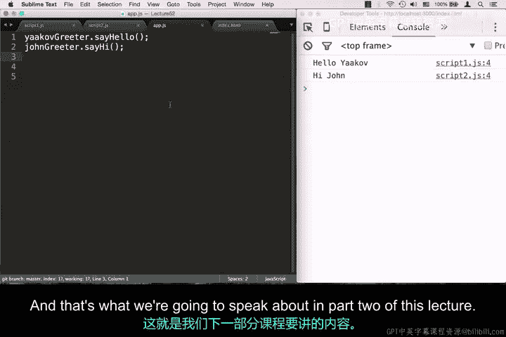

# 086：伪命名空间（第一部分）


在本节课中，我们将学习一个在JavaScript开发中非常常见的场景：全局变量冲突。我们将探讨这个问题的成因，并学习如何使用“伪命名空间”模式来解决它，从而让不同的脚本模块能够和谐共存。

## 概述：全局变量冲突问题

当我们加载多个JavaScript文件时，如果这些文件都在全局作用域中声明了相同名称的变量或函数，就会发生冲突。后加载的脚本会覆盖先加载的脚本中的同名变量，导致程序行为与预期不符。

上一节我们介绍了课程背景，本节中我们来看看一个具体的冲突案例。

## 案例分析：变量覆盖

我们有一个HTML文件，它按顺序加载了三个脚本文件。

```html
<script src="script1.js"></script>
<script src="script2.js"></script>
<script src="app.js"></script>
```

以下是各个脚本文件的内容：

*   **`script1.js`**：声明了一个全局变量 `name` 和一个函数 `sayHello`。
    ```javascript
    var name = ‘Yaakov’;
    function sayHello() {
        console.log(‘Hello ‘ + name);
    }
    ```

*   **`script2.js`**：也声明了一个同名的全局变量 `name` 和一个不同的函数 `sayHi`。
    ```javascript
    var name = ‘John’;
    function sayHi() {
        console.log(‘Hi ‘ + name);
    }
    ```

*   **`app.js`**：尝试调用前两个脚本中定义的函数。
    ```javascript
    sayHello(); // 预期输出：Hello Yaakov
    sayHi();    // 预期输出：Hi John
    ```

然而，实际运行后，控制台的输出是：
```
Hello John
Hi John
```

**问题根源**：`script2.js` 中的 `var name = ‘John’;` 覆盖了 `script1.js` 中定义的 `var name = ‘Yaakov’;`。因此，当 `app.js` 调用 `sayHello()` 时，函数内部引用的 `name` 已经是 ‘John’，而不是预期的 ‘Yaakov’。

## 解决方案：使用伪命名空间

JavaScript本身没有像其他语言那样的内置命名空间。但是，我们可以利用对象来模拟命名空间，为每个脚本模块创建一个专属的容器。

以下是创建和使用伪命名空间的步骤：

1.  **创建命名空间对象**：为每个脚本模块定义一个唯一的全局对象。
2.  **将变量和函数挂载到对象上**：将原本暴露在全局的变量和函数，改为这个对象的属性。
3.  **通过对象访问功能**：在其他脚本中，通过这个命名空间对象来访问其内部的变量和函数。

让我们应用这个方案来修改之前的脚本。

### 修改 script1.js

我们将创建一个名为 `yaakovGreeter` 的命名空间对象，并将 `name` 和 `sayHello` 作为其属性。

```javascript
// 创建命名空间对象
var yaakovGreeter = {};

// 将变量和函数定义为对象的属性
yaakovGreeter.name = ‘Yaakov’;
yaakovGreeter.sayHello = function () {
    console.log(‘Hello ‘ + yaakovGreeter.name);
}
```

### 修改 script2.js

同样，我们为第二个脚本创建 `johnGreeter` 命名空间。

```javascript
// 创建命名空间对象
var johnGreeter = {};

// 将变量和函数定义为对象的属性
johnGreeter.name = ‘John’;
johnGreeter.sayHi = function () {
    console.log(‘Hi ‘ + johnGreeter.name);
}
```

### 修改 app.js

现在，我们需要通过命名空间对象来调用函数。

```javascript
yaakovGreeter.sayHello(); // 输出：Hello Yaakov
johnGreeter.sayHi();      // 输出：Hi John
```

经过这样的修改，两个脚本中的 `name` 变量被分别隔离在 `yaakovGreeter` 和 `johnGreeter` 对象内部，互不干扰。程序输出了正确的结果。

## 本节总结

本节课中我们一起学习了如何解决JavaScript中的全局变量冲突问题。核心方法是使用**伪命名空间**模式，即通过创建一个唯一的全局对象，将每个模块的变量和函数封装在该对象内部。这有效地隔离了不同模块的代码，避免了命名冲突。




然而，目前的命名空间对象及其所有属性仍然是公开的、可被直接访问和修改的。在下一部分，我们将探讨如何进一步保护命名空间内的“私有”变量，实现更精细的封装和控制。