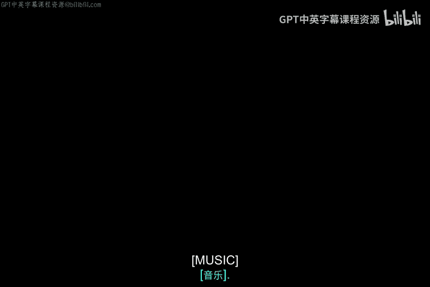
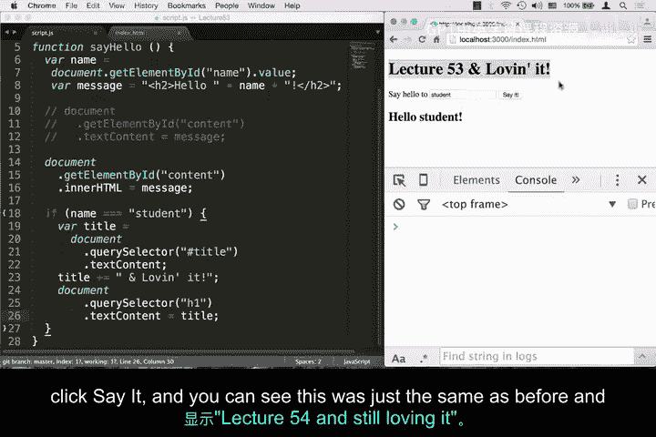

# 091：DOM操作实战



在本节课中，我们将学习如何使用JavaScript的`document`对象来操作网页内容。我们将通过一个简单的“打招呼”示例，学习如何获取用户输入、更新页面元素以及动态修改HTML结构。

上一节我们介绍了`document`对象的基本概念，本节中我们来看看如何实际运用它来与网页进行交互。

## 获取用户输入

首先，我们需要为页面上的按钮添加一个点击行为。在HTML中，我们可以使用`onclick`属性来调用一个JavaScript函数。

以下是HTML代码片段：
```html
<p>Say hello to: <input type="text" id="name"> <button onclick="sayHello()">Say It!</button></p>
<div id="content"></div>
```

接下来，我们定义`sayHello`函数。这个函数的第一步是获取用户在文本框中输入的值。

以下是获取输入值的代码：
```javascript
function sayHello() {
    var name = document.getElementById('name').value;
    console.log(name);
}
```
在这段代码中，`document.getElementById('name')`用于获取ID为`name`的输入框元素，`.value`属性则用于读取用户在其中输入的内容。

## 更新页面内容

获取到用户名后，我们的目标是生成一条问候语，并将其显示在页面上预留的`div`区域中。

以下是生成并显示问候语的步骤：
1.  组合问候消息。
2.  找到目标容器元素。
3.  将消息插入到该容器中。

以下是实现代码：
```javascript
function sayHello() {
    var name = document.getElementById('name').value;
    var message = "Hello " + name + "!";
    document.getElementById('content').textContent = message;
}
```
这里，我们使用`textContent`属性将纯文本消息`message`设置到ID为`content`的`div`元素内部。

## 插入HTML元素

如果我们希望问候语以`<h2>`标题的形式显示，而不仅仅是纯文本，就需要使用不同的属性。

以下是使用`innerHTML`插入HTML代码的方法：
```javascript
function sayHello() {
    var name = document.getElementById('name').value;
    var message = "<h2>Hello " + name + "!</h2>";
    document.getElementById('content').innerHTML = message;
}
```
`innerHTML`属性会将字符串解析为HTML代码并渲染，因此`<h2>`标签会被正确识别为标题元素。

## 实现条件逻辑与高级选择器

现在，我们为程序添加一点“智能”：当用户输入“student”时，我们不仅显示问候语，还要修改页面的主标题。

以下是实现条件逻辑的步骤：
1.  判断输入的用户名。
2.  如果用户名是“student”，则修改页面标题。
3.  使用更通用的`querySelector`方法来选择元素。

以下是完整的条件逻辑代码：
```javascript
function sayHello() {
    var name = document.getElementById('name').value;
    var message = "<h2>Hello " + name + "!</h2>";
    document.getElementById('content').innerHTML = message;

    if (name === "student") {
        var title = document.querySelector('h1').textContent;
        title += " and loving it";
        document.querySelector('h1').textContent = title;
    }
}
```
在这段代码中，`document.querySelector('h1')`使用CSS选择器语法选中页面上的第一个`<h1>`元素。我们获取其文本内容，追加字符串，然后再重新设置回去，从而更新了页面标题。



本节课中我们一起学习了DOM操作的核心技能：通过`getElementById`和`querySelector`获取页面元素，使用`.value`读取输入内容，以及通过`textContent`和`innerHTML`属性来修改元素内的文本或HTML结构。利用这些基础方法，你已经可以开始让网页动态地响应用户的操作了。