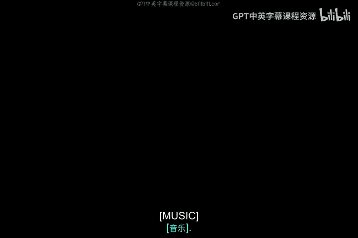
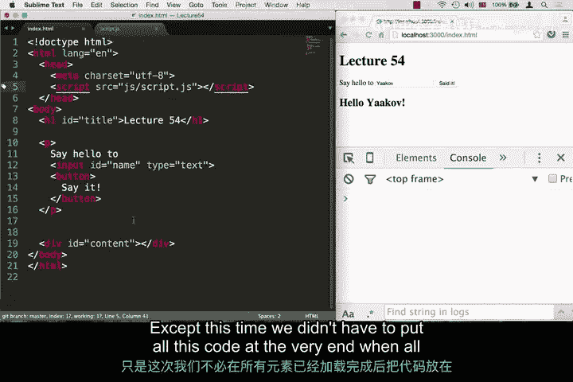

# 092：26_第54讲 事件处理

## 概述
在本节课中，我们将学习如何为网页元素绑定事件处理器。我们将探讨几种不同的绑定方法，理解它们的区别，并学习如何利用事件对象来编写更灵活、更易于维护的代码。

---

我们已经看到了一个如何将事件处理器绑定到特定元素的简单示例。

我现在位于第54讲的文件夹中的 `index.html` 文件里。

让我关闭文件浏览器以便看得更清楚。

你记得这个HTML文档，我们在中间有一个按钮，上面写着 `onclick="sayHello()"`。你可以回想一下，当我们在输入框中输入名字并点击“Say It”按钮时，它会使用 `sayHello` 函数显示“Hello Yaakov”。

现在我想探讨几种可以为元素分配事件处理器的不同方法。

首先，什么是事件处理器？事件处理器本质上是函数，你可以使用特定的方法将它们绑定到浏览器中发生的特定事件上。这些事件可能由页面的生命周期触发，例如页面加载完成，也可能由用户交互触发，例如用户输入字符或点击了某个元素。

为特定元素分配事件处理器最简单的方法之一，就是直接在该元素上使用 `on` 开头的属性。在这里，我们可以看到我们使用了 `onclick`，并让它执行JavaScript函数 `sayHello`。但事实上，如果你查看一下，会发现有很多这类属性，它们主要与键盘、鼠标事件以及焦点事件相关。例如，`onblur` 意味着当这个特定元素失去焦点时触发。我实际上可以在这里的输入字段上添加 `onblur="sayHello()"`。

那么，当我在这里输入内容时，同样的函数也会被执行。让我们刷新浏览器。假设我输入“Yaakov”，一旦我让这个输入框失去焦点，就像这样，`sayHello` 函数就会被执行，并显示“Hello Yaakov”。让我们先清除这个，以免界面显得拥挤。

直接在HTML上使用 `onclick`、`onblur` 或类似的 `on` 事件属性是一种选择。然而，这种方法会带来一些副作用。一个副作用是你必须在HTML中混杂这些 `onclick`、`onblur`、`onkeydown` 等事件属性。通常，正如我们之前讨论过的，HTML应该专注于内容，而不是行为，这是其一。

第二个区别是，如果我们查看 `sayHello` 函数，也就是当有人点击“Say It”按钮时执行的函数，我们在其中添加 `console.log(this)`。这个 `this` 指向什么？让我们保存并点击“Say It”按钮，即使不输入任何内容。显然，它指向的是 `window` 对象。为什么会这样？因为 `sayHello` 函数是在全局上下文中定义的，所以当我们说 `this` 时，它再次指向全局上下文，也就是 `window` 对象。在这里，我们通过 `onclick` 属性分配函数时，并没有做任何事情来改变 `sayHello` 函数的上下文，我们只是在这里执行它，所以上下文保持不变。

然而，有另一种方法可以实现同样的事情，即将这个函数绑定到点击事件上。让我们来看看另一种方法，这种方法被称为“非侵入式事件绑定”。之所以这样称呼，是因为HTML不需要知道任何关于你的JavaScript的信息。

让我们回到HTML，删除这里的 `onclick` 属性。现在HTML对点击处理器一无所知。保存后，转到脚本部分。我们在这里做的是：`document.querySelector('button')`，我们选中了那个元素，然后调用一个名为 `addEventListener` 的函数。我们告诉它监听 `click` 事件，当事件发生时，使用这个函数表达式或函数值，也就是指向我们 `sayHello` 函数的 `sayHello`。

现在当我们这样做时，让我们看看 `this` 现在指向什么。保存脚本，然后点击“Say It”。显然我们没有提供任何输入，但你可以看到，现在 `this` 指向的是实际的按钮元素。这完全合理，因为我们把这个函数的值传递给了这个特定的元素。这个按钮元素调用了 `addEventListener`，在这个调用中，我们以某种方式将 `sayHello` 分配给了它的事件。因此，`this` 变量现在指向包含它的对象，也就是按钮元素。

还有一种类似的方法来分配点击处理器，那就是使用 `onclick` 属性。让我们注释掉 `addEventListener` 这行，取消注释下面这行。这里有个拼写错误，应该是 `onclick`。关键是，元素本身可用的任何 `onclick`、`onblur` 等属性，你都可以将其作为你选中的对象的一个属性来使用。在这个例子中，我们再次选中元素对象，并将其 `onclick` 属性设置为函数 `sayHello` 的值。再次强调，这只是一个值，我们在函数后面没有加括号，我们不是在执行它，只是将它的值赋给属性。

那么，你认为当我们执行 `console.log(this)` 时，`sayHello` 函数会输出什么？由于这是在按钮对象内部执行的，当我们点击“Say It”时，它再次指向按钮对象。

虽然这种方式可能看起来比直接在HTML上写 `onclick` 稍微复杂一点，但它确实为我们提供了更多的灵活性。让我展示一下我的意思。让我注释掉 `onclick` 属性这行，只保留 `addEventListener` 的方式来绑定点击事件。

现在我想做的是：当我输入“Yaakov”并点击“Say It”时，我希望按钮的标签改变。如果事件处理器内部的 `this` 变量已经直接指向你正在操作的目标元素，那么这很容易做到。让我们在这里添加代码：`this.textContent = 'Set It'`。我们将把按钮的文本内容改为“Set It”。保存后，当我输入“Yaakov”并点击“Say It”时，按钮的文本会变成“Set It”。

这是一种更方便的做法，因为你不需要再次使用查询API来选中这个按钮并更改它的标签。这是因为在这个JavaScript代码中，我不需要知道是什么触发了点击事件。如果我必须用另一种方式做，我就必须知道是按钮触发了点击事件。而在这里，我不需要知道这一点，我只需要知道某个具有 `textContent` 属性的元素触发了那个特定事件。

让我们再讨论一个事件，它是页面的一个生命周期事件，它允许我们在页面元素加载完成之后、但在任何其他资源（如图像、CSS等）加载之前，为这些元素分配事件。由于我们将监听这个事件，我们不再需要将脚本放在页面底部。我们可以将脚本从这里剪切出来，轻松地放在 `<head>` 部分。保存后，我们现在需要做的是监听浏览器生命周期中的一个特定事件。这个事件叫做 `DOMContentLoaded`。

我们需要做的是：`document.addEventListener('DOMContentLoaded', function(event) { ... })`。在这个函数内部，我们现在可以开始分配不同的事件。所以，我们现在可以做的是，创建一个函数 `hello`，把之前的所有代码剪切出来，放在这里。现在，整个函数都位于 `addEventListener` 内部，它将在 `DOMContentLoaded` 事件触发时执行。这个事件会在任何图像、CSS或其他脚本加载之前发生。

如果我们保存它，输入“Yaakov”，点击“Say It”，你可以看到，我们的功能仍然像以前一样正常工作。但这次，我们不必等到所有元素都加载完毕才将代码放在页面底部。相反，我们监听所有元素加载完成的事件，在这种情况下，我们能够执行这些函数，使用 `getElementById` 等，并确保这些元素已经存在于文档对象模型中。

---

## 总结
本节课中，我们一起学习了事件处理的基础知识。我们比较了在HTML中直接使用 `on` 属性绑定事件与在JavaScript中使用 `addEventListener` 或 `onclick` 属性进行绑定的区别。我们了解到，非侵入式绑定（使用 `addEventListener`）不仅使HTML更简洁，专注于内容，还提供了更灵活的上下文（`this` 指向触发事件的元素），并且允许我们在页面内容加载完成后、其他资源加载前安全地执行脚本。这些知识是构建交互式网页应用的重要基石。