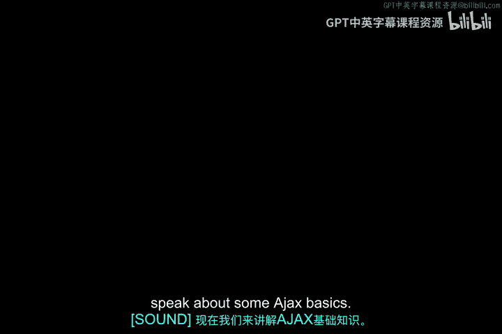
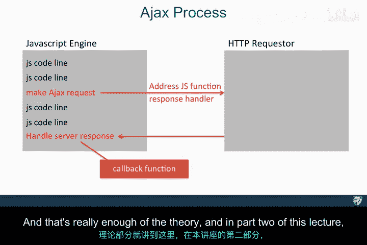

# 095：第57讲 第1部分 AJAX基础

在本节课中，我们将要学习AJAX的基础知识。AJAX是一种允许网页在不重新加载整个页面的情况下，与服务器交换数据并更新部分网页内容的技术。理解AJAX的工作原理对于构建现代、响应迅速的Web应用至关重要。

## 什么是AJAX？

AJAX这个词最初代表“异步JavaScript和XML”。虽然它始于XML作为浏览器与服务器之间传输的数据格式，但如今很少有应用真正使用XML。相反，现在大多数时候使用纯文本、HTML，或者我们稍后会讨论的JSON来替代XML。

## 传统Web应用与AJAX应用流程对比

要理解AJAX存在的意义，我们可以先看看传统Web应用的工作流程。

在传统Web应用流程中，用户从一个网页开始，通常会点击一个按钮。这个操作会生成一个HTTP请求发送到服务器。服务器则响应一个全新的页面。这个新页面可能与原始页面99%相同，可能只有一个字符串发生了变化。然而，在传统流程中，即使只是为了显示一个微小的更新，也必须返回包含所有相同元素的整个页面。

在AJAX Web应用流程中，同样从一个网页开始，它也会发出一个HTTP请求，但这个请求通常由JavaScript发起。服务器回复时，其响应是一小段数据，这通常会被插入到当前页面中。发生变化的只是一小部分数据。

显然，AJAX方式更快。响应速度更快，使用的带宽更少，因为只返回一小段数据，并且用户体验也更好。

## 同步与异步执行

在深入AJAX工作原理之前，我们先回顾一下同步与异步执行的区别，因为AJAX的第一个词就是“异步”。

同步执行是指一次执行一条编程指令。这意味着在第一条指令完成其执行之前，不能开始执行另一条指令。

另一方面，异步执行是指同时执行多个编程结构。异步指令会立即返回。它发出指令后，立即准备执行下一条指令。该异步指令的实际执行是在一个单独的线程或进程中完成的。

此时你可能会想，如果JavaScript是一种同步语言，其中的一切都是同步执行的，那么AJAX怎么可能实现异步呢？让我们通过一个图表来理解。

## 浏览器中的JavaScript引擎与AJAX

虽然JavaScript引擎运行在浏览器中，但它并不是浏览器中唯一的组件。浏览器中还有其他软件组件。例如，有一个事件队列负责处理和排队事件，如鼠标点击或浏览器加载。有一个HTML渲染引擎负责获取HTML并知道如何在浏览器网页中显示它。还有WebGL，它允许JavaScript进行一些高级图形工作。此外，还有一个我们可以称之为“HTTP请求器”的组件，它负责发出HTTP请求。

虽然JavaScript引擎本身是同步的，但HTTP请求器组件肯定不是。HTTP请求是异步的。基于这个认识，让我们来看看AJAX的流程。

## AJAX基本流程

我们有JavaScript引擎和HTTP请求器组件。JavaScript引擎将执行一些JavaScript代码行，然后最终遇到执行AJAX请求的JavaScript代码行。

此时会发生什么？AJAX请求使用一个特殊的JavaScript对象来访问HTTP请求器组件。请注意，幻灯片上指示的是，下一行JavaScript代码会立即执行，我们不会等待HTTP请求器的响应。相反，当我们发出实际的AJAX请求并访问这个HTTP请求器组件时，除了请求本身，我们还会传入一个JavaScript函数的地址。这个函数将作为响应处理器，用于处理当来自服务器或HTTP请求器的响应返回时的情况。

与此同时，我们继续执行后续代码，JavaScript引擎继续一次一行地执行代码。在某个时刻，它执行了所有能执行的代码，其执行栈为空。如果此时HTTP请求器已经完成并从我们的服务器收到了响应，它就可以使用我们之前提供的那个JavaScript函数的地址，回访JavaScript引擎，开始执行响应的处理。这就是回调函数，也就是那个将处理服务器响应的函数。

以上就是AJAX的基本流程。理论部分就介绍到这里。在本讲座的第2部分，我们将跳转到代码编辑器，看看如何实际操作。

## 总结

本节课中我们一起学习了AJAX的基础知识。我们了解了AJAX的含义，对比了传统Web应用与AJAX应用在数据交换和页面更新流程上的根本区别，这解释了AJAX在速度和用户体验上的优势。我们明确了同步与异步执行的核心概念，并揭示了AJAX异步特性的实现原理：它依赖于浏览器中异步的HTTP请求器组件，通过回调函数机制，使得JavaScript能在不阻塞主线程的情况下与服务器通信。下一节我们将进入实践环节，在代码编辑器中具体实现AJAX功能。