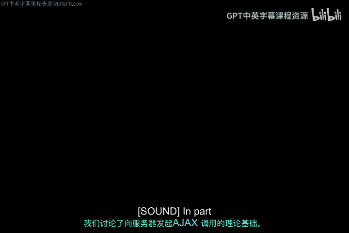
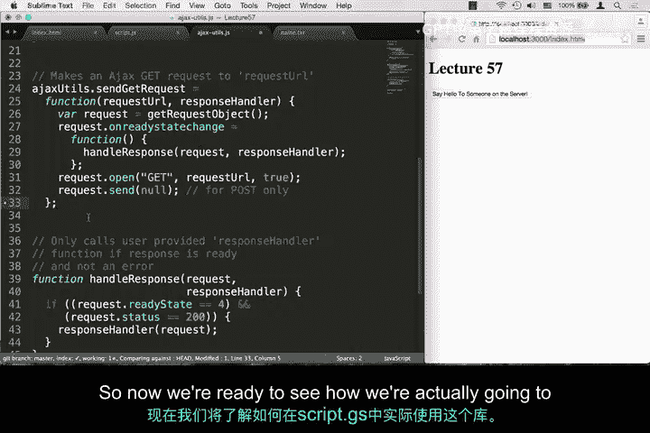

# 096：AJAX基础实践



## 概述
在本节课中，我们将学习AJAX的实际应用，并查看实现AJAX请求的代码。我们将分析一个封装了AJAX功能的JavaScript工具库，理解其工作原理，并了解如何避免异步编程中的常见陷阱。

---

## 代码结构与准备

在上一节中，我们介绍了AJAX的理论基础。本节中，我们来看看具体的代码实现。

我们位于第57讲的文件夹中。这里有几个新文件需要注意。第一个是 `ajax-utils.js`。这个文件包含了用于执行AJAX请求的JavaScript代码。我们将AJAX功能分离到这个独立文件中，以便清晰地查看整个AJAX流程，然后在主脚本中调用它。

在HTML文件 `index.html` 中，我将 `ajax-utils.js` 的引用放在了 `script.js` 之上。这是因为 `script.js` 会使用 `ajax-utils.js` 中的功能，所以必须确保浏览器先加载它。

与之前点击按钮后向文本框中的名字问好的例子不同，这次我们希望在点击后，从服务器获取要问候的人的名字。为此，我在服务器的 `data` 文件夹中准备了一个简单的数据文件 `name.txt`，其内容仅为“Yaakov”。这是一个纯文本文件。

为了验证在浏览器同步运行时能否访问这个文件，我们可以在地址栏输入URL：`data/name.txt`。按下回车后，可以看到返回的正是这个简单的字符串。这证明我们可以通过浏览器获取该文件的数据。

---

## 分析 AJAX 工具库

现在，让我们关闭文件浏览器，深入查看 `ajax-utils.js` 文件。

首先，我使用了一个IIFE（立即调用函数表达式）来包裹所有代码。我将全局对象 `window` 作为参数传入（在函数内部称为 `global`）。这样做的目的是创建一个命名空间来管理我们的工具函数。

以下是创建命名空间的代码：
```javascript
var ajaxUtils = {};
```
我将所有想要对外暴露的功能都附加到这个 `ajaxUtils` 对象上。第一个函数 `getRequestObject` 并没有附加到 `ajaxUtils` 上，这意味着它不会直接暴露给这个IIFE外部的使用者。

---

### 创建请求对象

`getRequestObject` 函数的作用是返回一个HTTP请求对象。它检查当前浏览器支持哪种类型的AJAX对象。

以下是其核心逻辑：
```javascript
function getRequestObject() {
  if (window.XMLHttpRequest) {
    return (new XMLHttpRequest());
  }
  else if (window.ActiveXObject) {
    // 为旧版IE浏览器
    return (new ActiveXObject("Microsoft.XMLHTTP"));
  }
  else {
    window.alert("Ajax is not supported!");
    return(null);
  }
}
```
*   第一个 `if` 语句检查现代浏览器普遍支持的 `XMLHttpRequest` 对象，这是最重要的部分。
*   第二个 `else if` 是为非常旧版本的Internet Explorer浏览器准备的，它们使用 `ActiveXObject`。
*   最后的 `else` 块是用于处理完全不支持AJAX的浏览器（这种情况现在极为罕见），它会弹出警告并返回 `null`。

我们将这个创建对象的逻辑单独封装成一个函数，是为了避免在主函数中混杂大量的条件判断语句，使代码更清晰。

---

### 发送GET请求的主函数

接下来，我们来看真正核心的函数，它被附加到了 `ajaxUtils` 对象上。

以下是该函数的定义：
```javascript
ajaxUtils.sendGetRequest = function(requestUrl, responseHandler) {
  var request = getRequestObject();
  request.onreadystatechange = function() {
    handleResponse(request, responseHandler);
  };
  request.open("GET", requestUrl, true);
  request.send(null);
};
```
这个 `sendGetRequest` 函数期望接收两个参数：
1.  `requestUrl`：要发送GET请求的服务器URL。
2.  `responseHandler`：一个回调函数，用于处理服务器返回的响应结果。

函数内部执行以下步骤：
1.  **获取请求对象**：调用 `getRequestObject()` 来获得一个新的 `XMLHttpRequest` 对象。
2.  **设置状态变更监听器**：将请求对象的 `onreadystatechange` 属性设置为一个函数。这个函数会在浏览器与服务器通信状态发生改变时被调用，包括最终完成通信的时刻。在这个监听函数内部，我们调用了 `handleResponse` 函数，并传入了当前的 `request` 对象和用户提供的 `responseHandler` 回调函数。
3.  **配置并打开请求**：使用 `request.open` 方法配置请求。参数 `"GET"` 指定请求方法，`requestUrl` 是目标地址，`true` 表示这是一个**异步**请求。如果设置为 `false`，请求会变成同步的，浏览器将冻结并等待响应，这不是我们想要的。
4.  **发送请求**：最后，`request.send(null)` 执行并发送请求。前面的步骤都是在设置请求的参数，这一行才是真正触发网络通信。对于GET请求，参数通常通过URL传递，所以 `send` 方法的参数为 `null`。如果是POST请求，则需要将请求参数作为字符串放在这里发送。

---

### 处理服务器响应

现在，让我们看看 `handleResponse` 函数是如何工作的。

以下是该函数的代码：
```javascript
function handleResponse(request, responseHandler) {
  if ((request.readyState == 4) && (request.status == 200)) {
    responseHandler(request);
  }
}
```
这个函数接收两个参数：`request` 对象和用户提供的 `responseHandler` 回调函数。它的职责是进行“脏活累活”的检查，确保在正确的时机调用用户的处理函数。

它检查两个关键条件：
1.  `request.readyState == 4`：这表示请求已经完成，所有数据都已就绪。`readyState` 有多个状态，但状态 `4` 是我们最关心的“完成”状态。
2.  `request.status == 200`：这表示HTTP状态码为200，即“成功”。服务器处理请求一切正常。

**只有当这两个条件同时为真时**，我们才会调用用户传入的 `responseHandler` 回调函数，并将 `request` 对象传递给它。用户可以从这个 `request` 对象中提取服务器返回的响应数据（例如通过 `request.responseText`）。

---

### 暴露工具库到全局

最后，我们需要将这个工具库暴露给全局作用域，以便在页面其他脚本中使用。

以下是暴露代码：
```javascript
global.$ajaxUtils = ajaxUtils;
```
我将本地变量 `ajaxUtils` 赋值给了全局对象的一个属性 `$ajaxUtils`。使用美元符号 `$` 是为了模仿像jQuery这样的流行库的命名风格，使其看起来更“酷”。

---

## 理解异步与闭包的重要性

你可能会好奇，为什么 `onreadystatechange` 的设置如此复杂？我们为什么不直接写成 `request.onreadystatechange = handleResponse;` 呢？

原因在于参数传递和异步执行环境。

如果我们直接赋值，将无法把 `request` 对象和 `responseHandler` 函数作为参数传递给 `handleResponse`。因为赋值时我们传递的是函数引用，而不是执行函数，所以不能带括号和参数。

一种常见的错误解决方案是将 `request` 变量声明在更外层（成为全局或函数作用域变量），这样 `handleResponse` 似乎就能访问到它了。但这样做会引发一个严重问题：**竞态条件**。

由于AJAX是异步的，从发送请求到收到响应可能需要几秒钟。在这段时间内，用户或其他代码可能再次调用 `sendGetRequest` 函数。如果 `request` 变量是共享的，那么第二个请求就会覆盖第一个请求的 `request` 对象。当服务器的响应陆续返回时，它们可能会被错误的回调函数处理，或者数据被相互覆盖，导致程序逻辑混乱。

我们当前的实现——通过闭包（即在 `onreadystatechange` 的回调函数内部引用外层函数的 `request` 和 `responseHandler` 变量）——为**每一次**AJAX调用都创建了一个独立的上下文环境。这样，每个请求及其对应的处理函数都被完美地封装在一起，互不干扰，从而避免了竞态条件。

---

## 总结
本节课中，我们一起学习了AJAX的实际编码实现。我们分析了一个结构良好的AJAX工具库，它包含了创建请求对象、发送GET请求和处理响应的完整流程。我们重点理解了：
*   如何使用 `XMLHttpRequest` 对象。
*   如何设置异步请求和状态监听。
*   如何正确地检查请求状态和HTTP状态码以确保成功。
*   **最重要的是**，我们了解了为什么需要通过闭包来管理异步请求中的变量，以避免危险的竞态条件，确保每个请求和响应的独立性。




在下一部分，我们将看到如何在主脚本 `script.js` 中实际使用这个 `$ajaxUtils` 工具库来从服务器获取数据并更新页面。