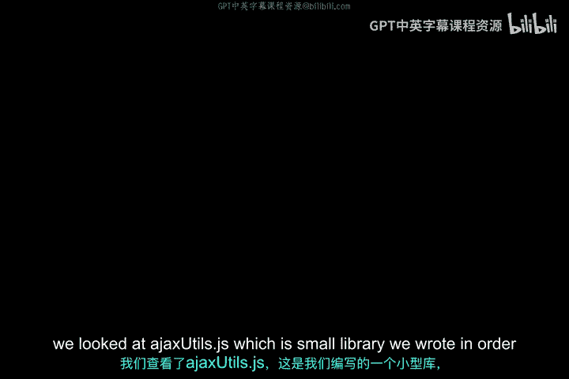
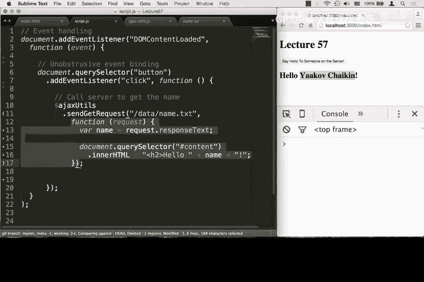

# 097：31_第57讲 第3部分 AJAX基础



## 概述
在本节课中，我们将学习AJAX的基础知识，特别是如何处理异步请求。我们将通过一个具体的例子，演示如何向服务器发送请求，并在收到响应后更新网页内容。我们将重点关注异步调用的特性，以及为什么必须在回调函数中处理服务器返回的数据。

---

## 回顾AjaxUtils库
上一节我们介绍了AjaxUtils.js，这是一个我们编写的小型库，用于向服务器发送AJAX请求并处理响应。这个库的核心是`sendRequest`方法，它允许库的使用者（目前就是我们自己）传入一个函数，这个函数将在服务器返回响应时被调用。

让我们快速回顾一下`AjaxUtils.js`中的关键代码。我们定义了一个`AjaxUtils`对象，它有一个`sendGetRequest`方法。这个方法期望接收两个参数：一个请求URL和一个响应处理函数。

```javascript
// AjaxUtils.js 中的核心结构
var AjaxUtils = {
    sendGetRequest: function(requestUrl, responseHandler) {
        // ... 创建XMLHttpRequest对象并发送请求的代码 ...
        // 当请求完成时，调用传入的 responseHandler 函数
    }
};
```

## 分析script.js中的初始代码
现在，让我们看看`script.js`文件中的代码。这个文件位于lecture57文件夹中。

首先，我们为`DOMContentLoaded`事件添加了一个监听器。这意味着下面的代码只会在页面加载了所有HTML内容（但可能尚未加载CSS或图片）后执行。

```javascript
document.addEventListener('DOMContentLoaded', function(event) {
    // 代码在这里执行
});
```

接下来，我们查看HTML文件，发现其中只有一个按钮。我们通过JavaScript“非侵入式”地为此按钮绑定了一个点击事件监听器。

```javascript
document.querySelector('button').addEventListener('click', function() {
    // 点击按钮时执行的函数
});
```

在点击事件的回调函数中，我们做了以下几件事：
1.  将`this`的引用保存在变量`self`中。
2.  声明一个变量`name`并初始化为空字符串。
3.  使用`AjaxUtils.sendGetRequest`向服务器发送请求，获取名字数据。
4.  在请求的回调函数中，将服务器返回的响应文本赋值给`self.name`。
5.  在AJAX调用**之后**，我们尝试用`self.name`更新页面内容。

以下是初始的问题代码逻辑：
```javascript
var self = this;
var name = '';
AjaxUtils.sendGetRequest('/data/name.txt', function(request) {
    self.name = request.responseText; // 从服务器获取名字
});
// 注意：这行代码在服务器响应返回前就执行了！
document.querySelector('#content').innerHTML = '<h2>Hello ' + self.name + '!</h2>';
```

## 遇到的问题与调试
当我们保存代码并在浏览器中点击按钮时，页面显示的是“Hello !”，名字部分为空，这并不是我们期望的结果。

为了调试，我们首先验证服务器通信是否成功。我们在回调函数中添加了`console.log(self.name)`来打印获取到的名字。结果显示，`self.name`确实成功地从服务器获取到了“Yaakov Chaikin”这个值。

那么问题出在哪里？为什么名字没有显示在页面上？

## 理解异步调用的本质
问题的根源在于我们忘记了AJAX调用是**异步**的。当我们执行`AjaxUtils.sendGetRequest`时，JavaScript会立即发送请求，但**不会等待**服务器响应。它会立刻继续执行下一行代码，也就是尝试用`self.name`更新HTML的那一行。

在发送请求时，`self.name`仍然是空字符串（或未定义），因为服务器的响应还没有返回。因此，页面被更新为“Hello !”。稍后，当服务器响应返回时，回调函数被执行，`self.name`被正确赋值，但此时更新页面的代码早已执行完毕，所以页面上看不到名字。

## 正确的解决方案
要解决这个问题，我们必须将所有**依赖于服务器响应**的操作，都放到响应处理函数（即回调函数）内部执行。

以下是修改后的正确代码：
```javascript
document.querySelector('button').addEventListener('click', function() {
    // 发起异步请求
    AjaxUtils.sendGetRequest('/data/name.txt', function(request) {
        // 所有处理响应的逻辑都在这里
        var name = request.responseText; // 从服务器获取名字
        // 在这里更新页面内容
        document.querySelector('#content').innerHTML = '<h2>Hello ' + name + '!</h2>';
    });
    // 在这里不能执行依赖响应的操作
});
```

我们移除了外部的`self`和`name`变量，因为不再需要它们。我们将更新`#content`元素内容的代码直接移到了回调函数内部。这样，只有当服务器响应返回、`name`变量被赋值后，页面才会被更新。

保存修改后，再次点击按钮，页面成功显示“Hello Yaakov Chaikin!”。这个名字字符串正是从服务器动态获取的。

---

## 总结
本节课我们一起学习了AJAX异步调用的核心概念。我们通过一个实例演示了：
1.  如何使用工具库发送GET请求。
2.  异步代码的执行顺序：发送请求后，后续代码会立即执行，而不会等待响应。
3.  **关键点**：所有依赖于服务器响应数据的逻辑，都必须放在传递给AJAX方法的回调函数内部处理。
4.  我们修复了因错误放置响应处理逻辑而导致的页面更新问题，确保了数据在获取后才被使用。




通过这个完整的流程，我们实现了从设置AJAX工具、发起调用，到正确处理异步响应并更新页面的闭环。理解并正确处理异步性是现代Web开发的基础。