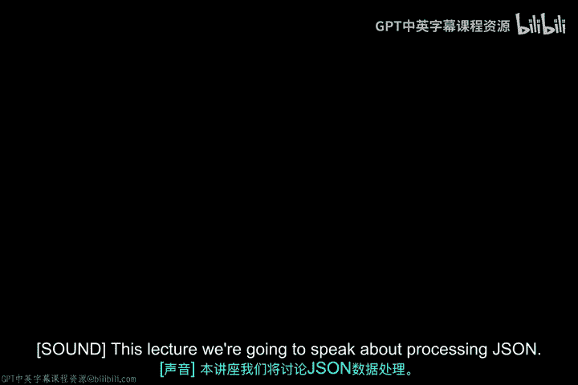
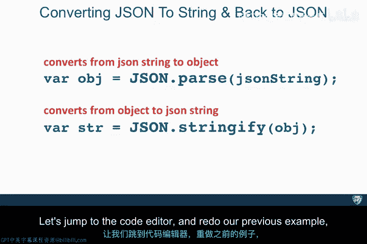
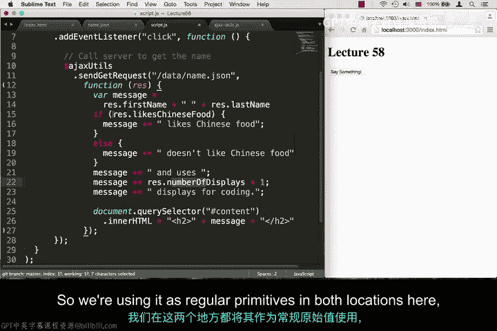
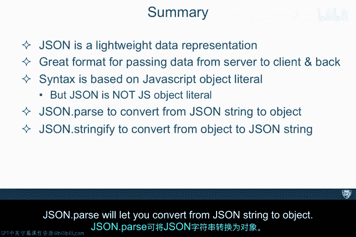
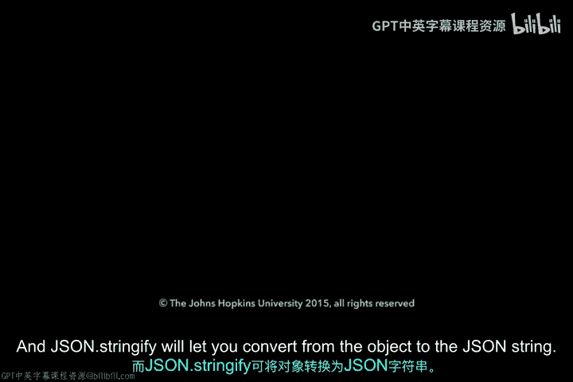

# 098：第58讲 JSON数据处理 📚



在本节课中，我们将要学习JSON数据处理。JSON是一种广泛使用的数据格式，尤其在服务器与客户端之间传递数据时非常常见。

## 什么是JSON？ 🤔

JSON代表JavaScript对象表示法。它是一种轻量级的数据交换格式。JSON是数据的简单文本表示，其优点在于易于人类读写，同时也易于机器解析和生成。在许多方面，JSON与XML类似，但JSON的语法更简单、更简短。最重要的是，与XML一样，JSON完全独立于任何编程语言。

## JSON语法规则 📝

JSON的语法规则非常简单。它是JavaScript对象字面量语法的子集，但有两点例外：
1.  属性名称必须包含在双引号中。
2.  字符串值也必须使用双引号。

除此之外，其他语法与JavaScript对象字面量完全相同。

让我们来看一个例子：
```json
{
  "firstName": "Yaakov",
  "lastName": "Chaikin",
  "likesChineseFood": false,
  "numberOfDisplays": 2
}
```
这是一个典型的JSON字符串，可以从服务器发送到客户端。即使你在浏览器的JavaScript程序中，也可以将这个字符串存储在一个变量中，只需在其外部加上单引号即可。这是因为字符串内部已经使用了双引号。



这里需要澄清一个常见的误解：**JSON不是JavaScript对象字面量，它只是一个字符串**。JSON的语法基于对象字面量，但两者并不等同。

## JSON与JavaScript对象的转换 🔄

如果你想在JavaScript中获得一个对象，需要将JSON字符串转换为对象。反之，如果你想获得JSON字符串，则需要将对象转换回JSON字符串。JavaScript提供了两个实用工具函数来实现这种转换：
*   将JSON字符串转换为对象：`JSON.parse()`
*   将对象转换为JSON字符串：`JSON.stringify()`

## 实践：在代码中处理JSON 💻

上一节我们介绍了JSON的基本概念和转换方法，本节中我们来看看如何在代码中实际应用。

我们将重构之前的示例，使其从服务器获取JSON数据，而不是普通字符串。

首先，我们有一个名为 `namethat.json` 的JSON文件，其内容与上面例子中的对象类似，但它是一个存储在服务器上的字符串。

接下来，我们需要更新我们的 `ajaxutils.js` 工具函数，使其能够预处理JSON响应。我们为 `sendGetRequest` 函数添加一个名为 `isJsonResponse` 的可选参数。这样，调用者可以指定是否期望JSON格式的响应。

在 `handleResponse` 函数中，我们进行如下处理：
1.  如果没有提供 `isJsonResponse` 参数，则默认其为 `true`。
2.  如果 `isJsonResponse` 为 `true`，则使用 `JSON.parse()` 将响应的文本解析为JavaScript对象，然后将这个对象传递给回调函数。
3.  如果 `isJsonResponse` 为 `false`，则将原始的响应文本传递给回调函数。

现在，让我们看看 `script.js` 中的变化。调用 `sendGetRequest` 的方式与之前相同，但这次在响应处理函数中，我们收到的 `response` 参数已经是一个由JSON字符串转换而来的JavaScript对象。

因此，我们可以像使用普通JavaScript对象一样使用它：
```javascript
var message = response.firstName + " " + response.lastName;
if (response.likesChineseFood) {
    message += " likes Chinese food.";
} else {
    message += " does not like Chinese food.";
}
message += " and uses " + response.numberOfDisplays + " displays for coding.";
```
我们可以直接访问 `response` 对象的属性，如 `firstName`、`likesChineseFood` 等。`likesChineseFood` 属性在JSON中是一个布尔值 `false`，因此可以在 `if` 语句中直接使用。`numberOfDisplays` 是一个数字，我们也可以对其进行运算。

最后，我们将构建好的 `message` 显示在网页上。

通过修改服务器上的JSON文件（例如将 `likesChineseFood` 改为 `true`，或将 `numberOfDisplays` 加1），然后重新点击按钮，可以看到页面上的信息会相应更新，这证明了我们成功地解析并使用了JSON数据。



## 总结 ✨





本节课中我们一起学习了JSON数据处理。总结如下：
*   JSON是一种轻量级的数据表示格式，非常适合在服务器和客户端之间传递数据。
*   JSON的语法基于JavaScript对象字面量，但请记住，**JSON本身只是一个字符串**。
*   使用 `JSON.parse()` 可以将JSON字符串转换为JavaScript对象。
*   使用 `JSON.stringify()` 可以将JavaScript对象转换为JSON字符串。
*   在实际开发中，我们经常需要从服务器获取JSON数据，解析后在前端使用，这大大增强了Web应用处理结构化数据的能力。