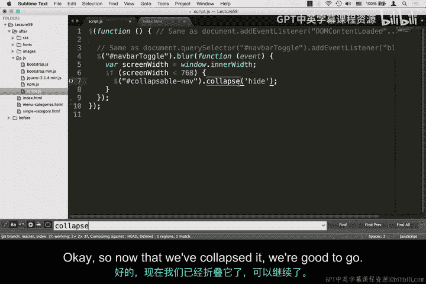

# 099：修复移动端导航菜单自动折叠


在本节课中，我们将学习如何使用JavaScript修复一个移动端导航菜单的交互问题。具体来说，我们将为David Chohu's China Bistro网站的导航菜单添加一个功能：当菜单展开后，如果用户点击页面其他区域，菜单会自动折叠收起。

## 概述

上一节我们介绍了JavaScript的基础知识，本节中我们来看看如何应用这些知识来解决一个实际的网页交互问题。我们将修复移动端视口下，导航菜单按钮在失去焦点后不会自动折叠的行为。

## 问题分析

目前，当浏览器窗口宽度小于特定断点时，导航菜单会变成一个可折叠的按钮。点击此按钮可以展开菜单，但点击页面其他区域时，菜单不会自动收起。这影响了移动端用户的体验。

我们需要为这个按钮添加一个事件处理器，监听其“失去焦点”的事件。在JavaScript中，这被称为 `blur` 事件。

## 实现步骤

以下是实现自动折叠功能的具体步骤。

### 1. 确定执行时机

我们显然不希望在大屏幕状态下为所有按钮添加此行为，而只希望在出现可折叠按钮的断点下生效。

通过浏览器开发者工具可以观察到，这个按钮大约在宽度为768像素的断点处出现。这与我们之前设定的CSS媒体查询断点一致。

### 2. 编写JavaScript代码

我们需要在 `script.js` 文件中添加代码。由于Bootstrap的折叠插件依赖于jQuery库，因此我们在此处也必须使用jQuery。

首先，我们需要确保代码在DOM加载完成后执行。在jQuery中，`$(function() { ... })` 等同于原生JavaScript的 `DOMContentLoaded` 事件监听器。

```javascript
$(function() {
  // 代码将在此处执行
});
```

接下来，我们需要为导航切换按钮绑定 `blur` 事件。

```javascript
$(function() {
  $('#navbarToggle').blur(function(event) {
    // 事件处理逻辑
  });
});
```

上面的代码使用jQuery选择器 `$('#navbarToggle')` 选中ID为 `navbarToggle` 的按钮元素，这等同于原生代码 `document.querySelector('#navbarToggle')`。`.blur()` 方法用于绑定失去焦点事件。

### 3. 添加条件判断与折叠逻辑

在事件处理函数中，我们需要先判断当前屏幕宽度是否小于768像素，即是否处于移动端断点。如果是，则找到可折叠的导航菜单元素并将其隐藏。

```javascript
$(function() {
  $('#navbarToggle').blur(function(event) {
    var screenWidth = window.innerWidth;
    if (screenWidth < 768) {
      $('#collapsable-nav').collapse('hide');
    }
  });
});
```

*   `window.innerWidth` 用于获取浏览器窗口的内部宽度。
*   `if (screenWidth < 768)` 判断是否处于移动端视图。
*   `$('#collapsable-nav')` 选中ID为 `collapsable-nav` 的导航菜单容器。
*   `.collapse('hide')` 是Bootstrap折叠插件提供的方法，用于隐藏元素。

### 4. 代码整合与解释

将以上步骤整合，完整的代码如下所示：

```javascript
// 等待DOM加载完成
$(function() {
  // 为导航切换按钮绑定失去焦点事件
  $('#navbarToggle').blur(function(event) {
    // 获取当前窗口宽度
    var screenWidth = window.innerWidth;
    // 仅在移动端断点下执行折叠操作
    if (screenWidth < 768) {
      // 使用Bootstrap的collapse方法隐藏导航菜单
      $('#collapsable-nav').collapse('hide');
    }
  });
});
```

这段代码的含义是：当页面加载完成后，为导航按钮设置一个监听器。一旦该按钮失去焦点（即用户点击了其他地方），就检查当前窗口宽度。如果宽度小于768像素，则调用Bootstrap插件的方法将导航菜单折叠起来。

## 效果验证

保存代码并刷新浏览器页面。将浏览器窗口宽度调整至小于768像素，点击导航按钮展开菜单，然后点击页面其他任意区域。可以观察到，菜单会如预期般自动折叠收起。

## 总结




本节课中我们一起学习了如何利用JavaScript和jQuery来增强网页的交互性。我们通过监听 `blur` 事件，并结合屏幕宽度判断，成功修复了移动端导航菜单的自动折叠功能。这个实例展示了如何将JavaScript事件处理与现有的CSS框架（如Bootstrap）结合，以解决具体的用户体验问题。