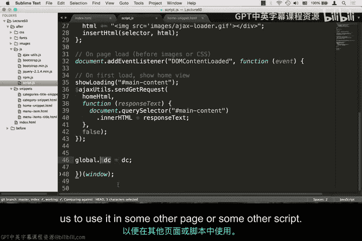
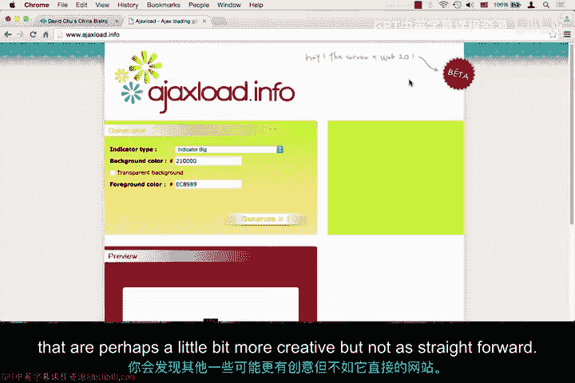
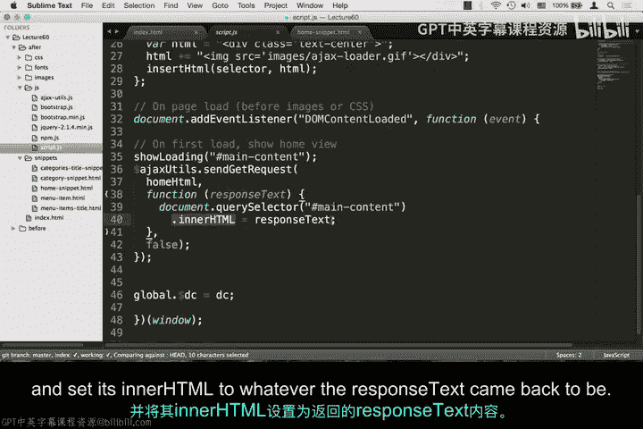
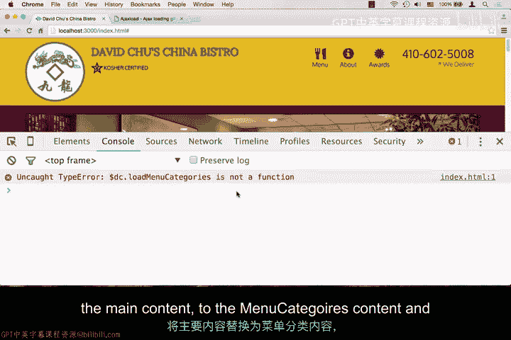
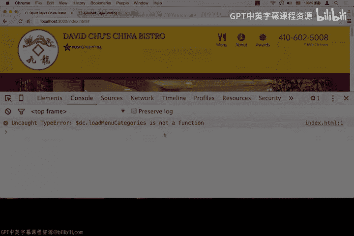

# 100：34_第60讲 动态加载首页内容


在本节课中，我们将学习如何动态加载单页应用（SPA）的首页内容。我们将通过Ajax技术，在不刷新整个页面的情况下，仅更新页面的核心区域，从而提升用户体验和页面性能。

---

上一节我们介绍了单页应用的基本概念。本节中，我们来看看如何具体实现首页内容的动态加载。

首先，我们需要理解为何要采用动态加载。我们正致力于构建一个单页应用（SPA）。这种现代Web开发技术依赖于Ajax，它允许我们只动态插入页面主体内容，而保持页面的其他部分（如导航栏、页脚）不变。这样做的好处是页面加载更快，并且避免了整个页面的刷新，从而提供更流畅的用户体验。

现在，让我们进入代码编辑器。我们位于 `lecture 60` 的 `after` 文件夹中，查看 `index.html` 文件。为了实现整个主体内容的动态化，我们实际上需要清空原有的静态内容。这正是我们已经完成的工作。

在 `index.html` 中，主体内容区域已不再包含具体的HTML代码，取而代之的是一个占位符：
```html
<div id="main-content"></div>
```
那么，原有的内容去了哪里呢？我们新增了一个名为 `snippets` 的文件夹。打开它，里面有一个 `home-snippet.html` 文件。这个文件包含了我们首页的全部内容，包括巨幕横幅（jumbotron）、首页磁贴（tiles）等。我们预先修改了其中的一些链接，例如菜单项现在不再是一个普通的超链接，而是一个带有 `onclick` 事件处理器的链接，为后续步骤做准备。

本节课的目标是：将 `home-snippet.html` 中的内容动态插入到 `index.html` 的 `#main-content` 占位符中。



让我们转到 `scripts` 文件夹，查看预先编写好的代码。首先，顶部的代码是上一讲编写的，用于在菜单失去焦点时折叠响应式按钮。

接下来，我们设置了一个立即调用的函数表达式（IIFE），它将 `window` 对象作为参数传入。我们在内部创建了一个命名空间 `$dc`（代表 David Cho），并将它暴露给全局的 `window` 对象，以便在其他脚本中使用。

以下是代码的核心部分：

首先，我们定义了首页HTML片段的URL路径：
```javascript
var homeHtmlUrl = "snippets/home-snippet.html";
```

接着，我们编写了一个便捷函数 `insertHtml`。它的作用是：给定一个CSS选择器和一段HTML字符串，它将找到对应的目标元素，并将其 `innerHTML` 设置为提供的HTML字符串。
```javascript
function insertHtml(selector, html) {
  var targetElem = document.querySelector(selector);
  targetElem.innerHTML = html;
}
```

然后，我们需要一个函数来显示加载图标 `showLoading`。在Ajax异步请求数据时，我们希望向用户显示一个动画图标，而不是空白区域。这个函数会构建一个包含加载GIF图片的 `div` 元素，并利用上面定义的 `insertHtml` 函数将其插入到指定的选择器元素中。
```javascript
function showLoading(selector) {
  var html = "<div class='text-center'>";
  html += "</div>";
  insertHtml(selector, html);
}
```
这里使用的 `ajax-loader.gif` 图标可以从 `ajaxload.info` 等网站免费生成和下载。



现在，我们设置当页面DOM内容加载完毕后的执行逻辑。我们使用 `document.addEventListener(‘DOMContentLoaded‘, ...)` 来确保DOM就绪后再执行脚本。

在事件监听器内部，我们首先调用 `showLoading(‘#main-content‘)`，在内容区域显示加载动画。紧接着，我们发起Ajax请求（使用 `$ajaxUtils.sendGetRequest` 函数）来获取 `home-snippet.html` 文件的内容。我们将最后一个参数设为 `false`，表示返回的不是JSON，而是纯文本（HTML代码）。

当请求成功返回后，在回调函数中，我们再次使用 `insertHtml` 函数，将获取到的HTML响应文本插入到 `#main-content` 元素中，替换掉加载图标。
```javascript
document.addEventListener("DOMContentLoaded", function (event) {
  showLoading("#main-content");
  $ajaxUtils.sendGetRequest(
    homeHtmlUrl,
    function (responseText) {
      insertHtml("#main-content", responseText);
    },
    false
  );
});
```

保存代码并刷新浏览器，现在首页内容应该通过Ajax动态加载并显示出来。




为了验证，我们可以打开浏览器的开发者工具，切换到“Network”（网络）面板，并过滤“XHR”请求。刷新页面后，你会看到一个对 `home-snippet.html` 的Ajax请求，这证实了我们的动态加载机制正在工作。

目前，点击页面上的“Menu”按钮会报错，提示 `$dc.loadMenuCategories` 不是一个函数。这是因为我们还没有定义这个函数，它的功能是加载并显示菜单分类页面。这将是下一讲的内容。

---





本节课中我们一起学习了单页应用（SPA）中动态加载内容的基本原理。我们通过Ajax技术，将首页的HTML片段从独立文件异步加载并插入到主页面中，实现了无刷新更新页面内容。我们还创建了显示加载状态的函数，以改善用户体验。在下一讲，我们将继续完善SPA，实现页面间的动态导航。