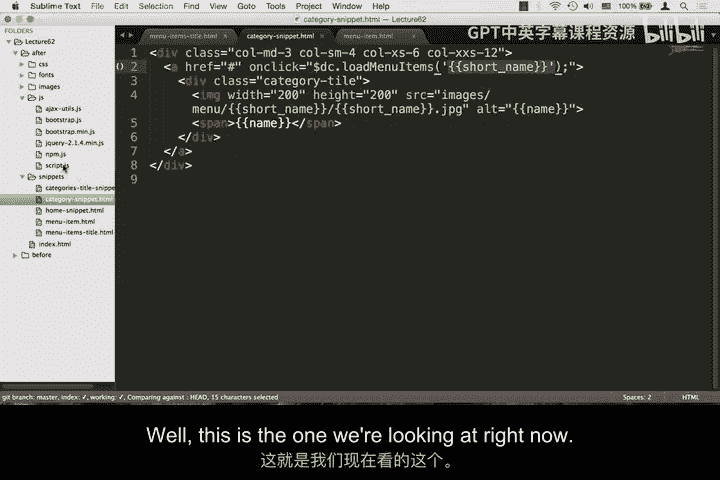

# 103：动态加载单个分类视图 🍽️

在本节课中，我们将学习如何动态加载并展示餐厅菜单中单个分类下的所有菜品。我们将通过Ajax请求从服务器获取特定分类的数据，并使用JavaScript模板动态构建和渲染页面。

---

在上一讲中，我们实现了从服务器动态获取数据来填充菜单分类页面。该服务器是一个基于Ruby on Rails实现的Heroku应用。本节中，我们将进行非常类似的操作，但这次我们将获取**特定分类**以及该分类下的**所有菜单项**。

现在，我们来看一下 `category-snippet.html` 文件，它位于 `lecture62/after` 文件夹中。回顾这个我们在上一讲中实现的代码片段，是为了仔细查看我们设置的“钩子”。这个钩子使我们能够点击单个分类，进而获取该分类的菜单项。

这个钩子就在这里：`onclick="$dc.loadMenuItems('{{short_name}}')"`。`loadMenuItems` 函数我们稍后会详细查看。但 `short_name` 属性至关重要，因为它似乎是我们获取特定分类数据的关键。

让我们回到浏览器，打开我们的“David's Restaurant”应用。可以看到另一个REST API端点（endpoint）：`menu_items.json`。这正是我们需要的。我们向它传递一个名为 `category` 的请求参数，根据这个参数值（字母或字母组合），我们会得到不同的结果。

例如，如果我们传入 `VG`（代表蔬菜），并查看返回的JSON字符串，它会转换为一个包含两个属性的对象：`category` 和 `menu_items`。`category` 本身又是一个对象，而 `menu_items` 是一个包含多个菜单项对象的数组。如果我们传入 `L`（代表午餐），返回的数据就会变成午餐分类及其所有菜品。

关键在于，`short_name` 对我们非常重要，因为我们将把它附加到基础URL上。基础URL是 `menu_items.json?category=`，我们将把用户点击的分类的短名称（如 `VG` 或 `L`）附加在后面，从而获取特定分类的数据。

---

让我们回到代码编辑器，看看我们将用于本节的几个代码片段。第一个是 `menu-items-title.html`。为了理解最终效果，我们可以先看看实际页面：在首页点击“菜单”，进入分类页面，再点击“午餐”，就会进入“午餐菜单”的特定分类页面。可以看到，这里有许多带图片的菜品。

这个页面由两个主要组件构成：
1.  标题组件，显示“午餐菜单”以及该分类的特殊说明。
2.  列表组件，逐一列出该分类下的每个菜品。

以下是 `menu-items-title.html` 的内容概要。我们可以看到，菜单名称（如“午餐菜单”）和特殊说明都将通过双花括号 `{{ ... }}` 绑定到对应的属性值上。从上一讲我们知道，这能让我们轻松地将属性值插入到这些占位符中。

---

接下来，我们查看 `script.js` 文件，了解如何实现这一功能。

首先，我们定义了几个新的URL：
*   `menuItemsUrl`：基础URL，即 `menu_items.json?category=`，我们将在运行时把分类短名称附加在后面。
*   `menuItemsTitleHtmlUrl` 和 `menuItemHtmlUrl`：分别对应标题和单个菜品项的HTML模板片段。

向下滚动，我们会看到 `loadMenuItems` 函数。它看起来与上一讲的 `loadMenuCategories` 函数非常相似。主要区别在于，当我们发起Ajax请求时，我们组合了 `menuItemsUrl` 和传入的 `shortName` 参数（这个参数来自HTML片段中的 `onclick` 事件）。这样，我们就构建出了完整的请求URL。

请求成功后，会调用 `buildAndShowMenuItemsHTML` 函数来处理返回的数据。这个函数位于文件底部。

`buildAndShowMenuItemsHTML` 函数的工作流程与之前的类似，但这次我们需要处理两个Ajax请求：
1.  获取 `menu-items-title.html` 模板片段。
2.  `menu-item.html` 模板片段。

`menu-item.html` 片段内容较多，它实际上是从我们之前编写的静态单个分类页面中提取出来的。它的作用是将菜品对象的各个属性（如名称、描述、价格、图片路径）放置到HTML模板中正确的位置。

例如，它需要构造图片的URL（图片位于 `images/menu/` 目录下，按分类短名称和菜品编号组织），处理价格（有时只有一种价格，没有大/小份之分），以及插入菜品名称和描述。

在 `script.js` 中，我们构建最终的 `menuItemsViewHtml` 时，传入了三个东西：从服务器返回的 `categoryMenuItems` 数据对象、标题HTML片段和单个菜品HTML片段。

然后，我们将构建好的完整HTML插入到ID为 `main-content` 的元素中，页面就渲染完成了。

---

现在，让我们仔细看看 `buildMenuItemsViewHtml` 函数。与之前类似的函数不同，我们这次也需要在标题片段中插入值（即分类名称和特殊说明）。这些值来自 `categoryMenuItems.category` 对象。

因此，我们首先处理标题片段，将分类名称和特殊说明插入进去，得到一个已经包含正确数据的标题HTML字符串。我们将以此作为最终HTML的开头。

接着，我们开始遍历 `categoryMenuItems.menu_items` 数组中的每一个菜品项。对于每一项，我们使用 `menuItemHtml` 片段，并插入对应的属性值，如菜品名称、描述、价格等。

这里有两个特殊的辅助函数：`insertItemPrice` 和 `insertItemPortionName`。之所以需要它们，是因为并非每个菜品都有“大份价格”和“小份价格”。我们需要检查某个价格属性是否存在。如果不存在，我们就用空字符串替换掉模板中的对应占位符，而不是向用户显示 `{{price_large}}` 这样的文本。如果存在，我们还会使用 `.toFixed(2)` 方法将价格格式化为标准的美元金额（如 `$10.00`）。

---

最后，还有一个重要的布局问题需要处理。我们无法控制每个菜品描述框的高度，有些可能很长，有些可能很短。为了确保我们的网格布局不被破坏，我们需要在**每两个菜品项之后**添加一个清除浮动的HTML元素（`

`）。

我们在遍历菜品数组时实现这一点。利用JavaScript的取模运算符 `%`，我们检查当前项的索引 `i`。如果 `i % 2 != 0`（即索引为奇数，对应第2、4、6...项，因为数组索引从0开始），就在该项的HTML后面追加清除浮动的代码。这样就能确保每行只显示两个菜品，布局保持整齐。

最终，所有拼接好的HTML被保存到 `menuItemsViewHtml` 变量中，并插入到页面的 `main-content` 区域。这就是当我们点击一个分类时，能够动态加载并显示该分类下所有菜品页面的全过程。

---

**本节课总结**
在本节课中，我们一起学习了如何动态加载单个菜单分类的视图。我们回顾了如何通过 `short_name` 参数构造特定的API请求URL，以获取单个分类及其所有菜品的数据。我们分析了用于构建页面的两个HTML模板片段（标题和单个菜品），并详细讲解了 `script.js` 中的核心函数 `loadMenuItems` 和 `buildMenuItemsViewHtml` 是如何工作的。关键点包括：处理可能缺失的价格数据、格式化金额，以及通过计算索引来插入清除浮动元素以维护网格布局的完整性。通过这一系列步骤，我们实现了从用户点击到完整页面渲染的动态数据加载流程。