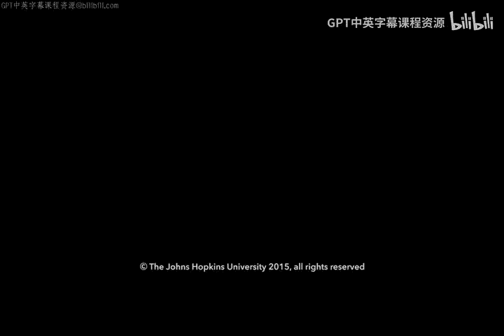

# 105：39_课程总结

## 概述
在本节课中，我们将对《Web开发者的HTML, CSS, and Javascript》课程进行总结，回顾学习成果，并为你的后续学习路径提供建议。

---

你已经完成了这门课程。恭喜你，也感谢你在这段学习旅程中一直坚持。我希望你喜欢这门课程并学到了很多知识。

那么，接下来你该做什么呢？如果我可以建议，本专业系列课程的下一门是《使用Angular JS开发单页Web应用》。

由Google支持的Angular是当今最流行的前端框架之一。它之所以流行是有原因的：你可以用很少的代码实现非常丰富的功能。

因此，请查看相关课程并报名学习。整个约翰霍普金斯大学的团队都非常努力地制作了这门课程，并以最佳的方式呈现给你。

如果你喜欢这门课程，我想请你花几分钟时间，给这门课程一个五星评价。这对我们来说意义重大。

最后，请保持联系。你可以在Twitter上关注我，在LinkedIn上与我建立联系，并加入我们专门为本专业前端课程创建的Facebook页面。所有这些链接都在本视频下方。

感谢你的观看，并祝你一切顺利。