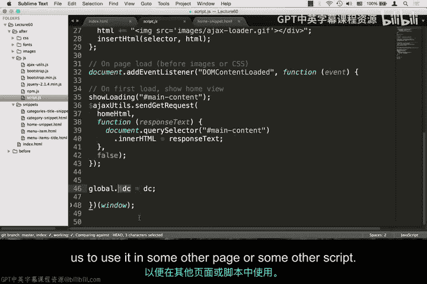
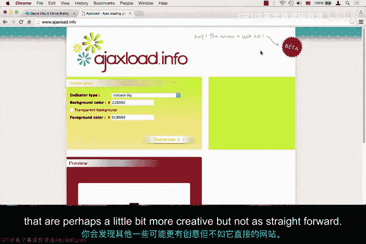
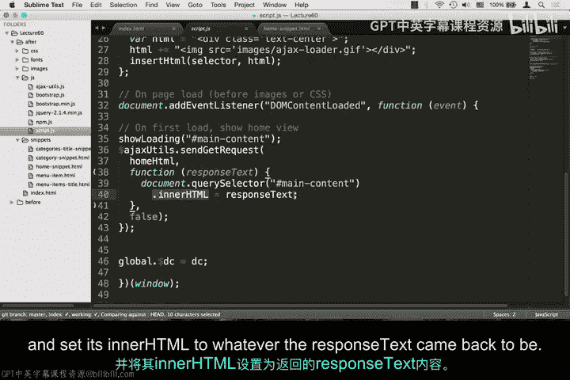
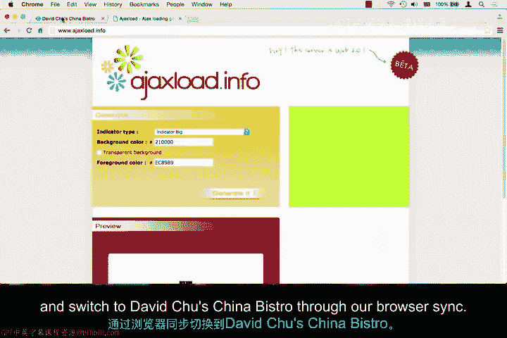
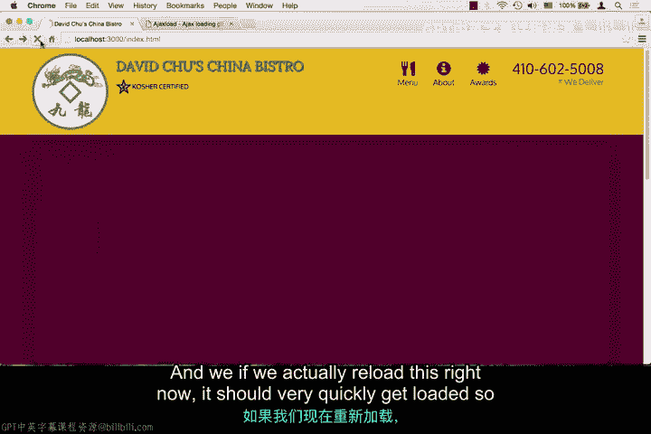
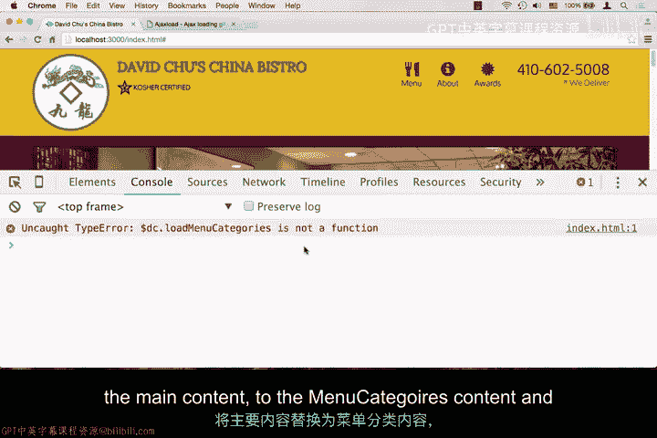
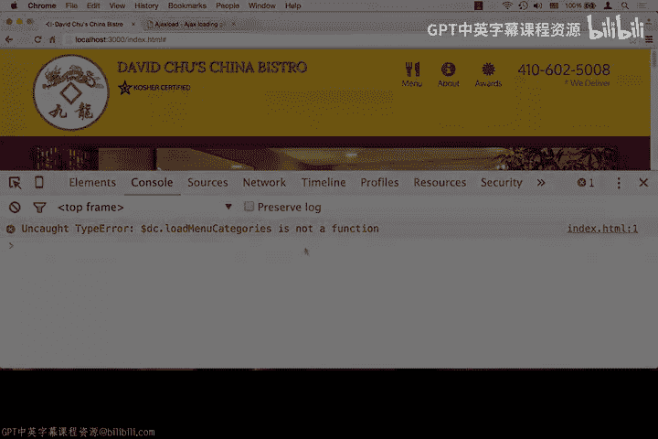

# 约翰霍普金斯大学《Web开发者的HTML, CSS, and Javascript》中英字幕 - P100：34_第60讲 动态加载首页内容.zh_en - GPT中英字幕课程资源 - BV1WzY6z9EUd

Yeah。

Okay so in this lecture we're ready to move on and our next task is to load this entire content。

 this main content of the front page to load this whole content dynamically Now first of all why do we want to do that The reason we want to do this because we're trying to move towards what's called an Sp or spa and stands for single page application so single page web application and besides for being a pretty popular web coding technique nowadays since spas heavily rely on AjaX this whole content right here is going to be inserted dynamically but the rest of the content is going to stay so we're going to basically update the least amount of the page possible to make it functional and that's very advantageous because obviously it's going to be faster and also is not going to refresh the page for the user is going to be a much much nicer user experience So let's go ahead and go to our code editoritor and right now we're located in lecture 60 in the after。

Folder and we're looking the index that H。 Well， for that purpose in order to make the entire content。

 the main content dynamic。 we actually need to wipe it out。 And this is exactly what we did。

 We don't have any more in the index that HTMLtm the main content There's only just a placeholder for the main content with I main content Now where did all of that stuff go。

 Well， we have a new folder here called snippets。 And if we open that up。

 there is a file called home snippet that h。 So if we open that up the entire content of our home page are really contained right here。

 So you could see there's our jumotron home tiles and so on。 we did change a couple of links。

 As you notice the menu item here is no longer just a link。

 it's actually a link to basically nowhere with onclick event handler and we'll talk about that a little bit later。

 but we just kind prepped it for the next step because obviously we're gonna have to then display our menu categories page and then an individual。

Single category page and we're still going have to do this using this spot technique or using Ajax that is we'll need to take that content and dynamically insert it in the index at HTML right here at the placeholder main content but for this lecture all we need to do is figure out how to insert our previous main page content inside the main content placeholder so let's go to our scriptgs where I've prewritten some code and let's go over that so first of all you could see this code up top。

 this is what we just wrote in the previous lecture this is just to make the collapsible button collapsed the menu when it loses focus Okay so what we're going to do is first of all we're going to set up and immediately invoked function function expression is you could see here we're starting with Pars global and going all the way down here we're executing this function passing it the window object so our global right here is really just the window object。

And we're setting up in namespacedes DC and just probably for David Cho that's how I named it and as you could see we're exposing this thing right before the end of this whole function。

 we're saying global which is really window that dollar sign DC that's what we're want to expose this as and DC our internal namespace So whatever we attach to the DC as a property is going to get exposed to the global object in order for us to use it in some other page or some other script Okay so let's take a look as to what we're doing here first of all we're setting up our home HTML that's nothing more than just the URL as to where that snippet is going to sit。

And then we're going to have a convenience method here so we' don't have to write this from scratch every time because we're going to have to do this several times is if you give me a selector and you give me the HTML I will go ahead and take select that selector take that argument。

 take that element I should say grab that element the target element and set its inner HTML to whatever the HTML string that you send me so this is just a convenience method to say insert HTML pass it a selector and the HTML string and it will insert it into the target element。

😊，Another function that we need is show loading icon thats says show loading here So obviously an Ajax request is going to be done asynchronously and it will go out to the server and bring us back some content but meanwhile what is going to be displayed to the user well we obviously want to display nothing we don I't want to display a blank we'd rather display some sort of an animated icon that is going to show the user that something is going on Well AjaX loader that G is an animated G and I'm going to tell you in a minute where I got that from but let me go over the code first so show loading basically says give me a selector to which I should attach this loading icon and I'm going to set up a very simple div I'm going to put an image inside of that div and close the div so this's just a building up an HTML string and it's pointing to this images AX loader that g and then I'm reusing my inserted HTML that I just defined and basically inserting that into this particular selector so。

To then display this rotating or whatever it is Ajax loader icon inside this selected that I pass in Now where did I get this index or Ax loader that Let me go back to the browser for a second There's a great website called Ax load that info and it allows you to basically choose different types of icon loading icons that you could choose and then set whatever background color you want and whatever foreground color you want and generate that icon for yourself and there it is and then you could click to download that gift and you could use it a new website and absolutely free。

 So it's a great website for this type of activities but it's not the only one。

 there are others out there and definitely Google for it and you'll see some others that perhaps a little bit more creative but not as straightforward So let's go back to our code editor and keep going here So we want to set up an onp load we're doing here is we're waiting till the Dom content has been。

And in that case once it is loaded we're able to start executing things and basically executing queries。

 the selector queries that will actually find things since we need the HTML to be loaded at that point in order to execute query selectors and here what we're about to do is we're about to make that Ax call that we've seen before well before we make the AX call we want to go ahead and turn on that show loading and the show loading is going to insert in the main content ID that element is going to insert our rotating AX loader so it's going to place it right here as the inner HTML of the element。

Once it's done it's going to issue our AjaX request the AX request is going to be a fairly simple one is going to give us the home URL or the home HTML URL and that's something we've defined right here previously that's just the URL as to where that snippet is sitting。

And since we're passing false is the last argument， as you remember。

 false means I don't want you to preproces this as JSON and we don't want this as JON because all it is is just an HTML snippet。

 what is going to come back in our handler function is just some text actually just the response HTML and once it does come back we're going to select our element with ID main content and set its inner HTML to whatever the response text came back to be and that's about it so once we're done with this we could save this go to our browser and switch to David Choose China Bistro or through our browser syncnc and if we actually reload this right now。

 it should very quickly get loaded so the entire content is here so let's actually take a look at the Chrome developer tools。

To make sure that what we think is going on is， in fact， going on。

 let's go ahead and open it up and leave it on X HR， which stands for XMl HP request。

 that's the AjaX request。 So we don't want to see all the requests。

 We just want to see the Ajax request only。 So let's go ahead and refresh the browser。

It's gonna give us a whole bunch of requests here because we have Google Mas embedded in as well。

 So there's definitely lots of things going on here。

 but one of the things as you see is there's an Ajax request for home snippet。

 that HTML and that's exactly what we get we get that little snippet over here and that happens once the page loads and kicks off this whole Ajax process which then goes ahead and fills in the content。

 the main content of our page So if we take a look right now and try to click on this menu button right here。

 nothing' is really gonna happen and iss just gonna to sit right here but if we open the Chrome developer tools and look at our console we're gonna see you as an error。

 the DC load menu categories is not a function。 Well。

 that's true it's not a function because we haven't defined it yet that function is supposed to swap the content of our HTML page。

 the main content to the menu categories content and that's what we're going to do in the next lecture。

