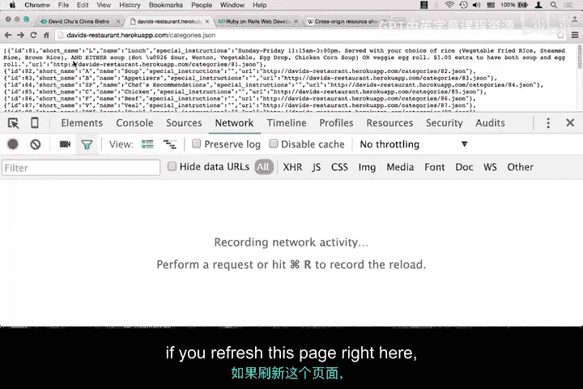

# 约翰霍普金斯大学《Web开发者的HTML, CSS, and Javascript》中英字幕 - P101：35_第61讲 第1部分 动态加载菜单分类视图.zh_en - GPT中英字幕课程资源 - BV1WzY6z9EUd

。

In the previous lecture we dynamically inserted the contents on the main page so there they are right here。

 including the menu special and the map tiles in this lecture we would like to dynamically insert the menu categories when the user clicks on the menu tile and actually I already have this implemented so let's take a look as to what happens when I click on this button I see that the menu categories come up with all the pictures and these things are also clickable so very similar to before except now we actually have all the pictures for the right categories as opposed to just placeholders so these are dynamically being filled in obviously at this point we need the data to fill up these menu categories and also to point to these pictures that are specific to each categories So how do we do that first of all how do we get the data Well there's an app that we've deployed on Hirocoab co and the app is called Davidsrerant。

 herorocoab。 co s whatever and basically。What that is is a rest API that provides us JO data that we need for our application and even though the actual website is going to be hosted on GitHub pages so it's going to be GiHub pages。

Iio or something like that， the data is actually going to sit as this app is this restaurant。

 David's restaurant app on Heroku。And I'm going to have to interrupt this lecture for a little bit of an update on November 28。

 2022， Hiroku is going to discontinue the free tier as one of their offerings。

 which means that we're no longer going to be able to deploy our applications for 100% free on Hiroku co instead we're going to deploy our data as a rest API using Google Firebase。

 So update number one is instead of the Hirokuab co URL that you're seeing on your screen we're going to use Firebase io co as our URL for categories and also for the menu items that we're going to get in a future lecture。

 So for the correct URL to use take a look at your screen right now and I will also documented in the FAQ in the Github repository that you have been using up until now all the code in that Gitthub repository has been updated to use the new URL。

 So if you need a reference， you can always go look at the。

Lectures and the example code that comes with them。So remember in the future lectures。

 when you see that I am using Davidreaurant。herrocoab。 co s something。

 it's actually not the correct URL and make sure to reference the correct URL that you're seeing on your screen now that is Firebase Io co The second update which might not affect you that much is that in this lecture I reference Rubyon Rail's web development courses that used to be part of this specialization and part of the five or six courses of this specialization。

 unfortunately， not of those courses are available anymore on Coursera。org。 however。

 Coursera delisting those courses does not affect this course and does not affect the Angularjs course that is designed to be a followup course to this one。

 So keep those two things in mind， and good luck with the rest of the course。

Now this app is actually a Ruyion Rails app and if you want to learn more about Ruion Rails and how to create these apps all by yourself。

 I highly suggest you go to Coursera。org and find the become arails developer or Ruion Rails full stack web application specialization and this is really this course right here that you're taking is actually part of that so if you scroll down you could see that you could get Ruionrails and introduction you could go to the second course and it will dive a little bit deeper into rubby and action pack and you could get to Mongodb with rubionrails and this is actually a course that you're taking right now HTMLlcs and JavaScriptscript for web developers that is also part of this specialization even though you're not required to know any Ru Rails knowledge for this course we're certainly going to use Ruion Rails as our backend to get the data so I would highly encourage you to enroll in this specialization Now the fact that this data is hosted on Hirokuab。

com and our application。Is hosted well locally right now for development purposes。

 it's being hosted on our browser sync。 so it's kind of a local host or eventually it will get hosted on Github。

 The fact that they're hosted on two different domain names is actually a problem and the reason that is a problem is because every browser comes with this security mechanism that's called same source or same origin rule and basically what that means is is if you load jascript that tries to reach out through Ajax to any other domain name other than the one that this particular HTML page will c from the browser will stop that activity and will not allow it and the reason it will stop that is because of the following the browser and the ja that runs in it runs as you has the same privileges on your computer as you do and if some remote script was allowed to reach out to other domain names other than the one you actually want to what it could do since you operating behind a firewall and the ja。

That's executing in the page is also executing behind the firewall because it is your computer after all if the jascript was allowed to reach out to other domain names other than the one it was served from or the HTML page that you went to was served from it could potentially reach out to internal websites and internal computers that it really shouldn't be able to even see so therefore what the browsers do is they enforce the same origin and same source rule they don't allow that to happen Now in that case how can we ever get this data。

 the browser is gonna to stop us Well comes this new technology called course otherwise known as cross originig resource sharing and if you actually go it could Google for it course。

Wikippedia page and you could see this explain to you in some detail how this works。

 Basically the idea， of course， is is there is going to be some Htp headers that the browser will know about and will tell the browser that it is actually safe to reach out to this particular domain name and this is exactly what's going on in the case of this David's restaurant app。

 it is actually communicating back to our browser and sending those HtP headers telling us that even though you really usually shouldn't be able to reach out with your jascript anywhere else you're allowed to reach out to me and it is a safe thing to do。

 So that's point number one， that is how we're going to be able to get our data from our server that is going to be hosted somewhere other than Heroku or even just locally through browser sync to this Heroku app that is going to grab our data That's point number one point number two is this is kind of hard to read what exactly this Json is。

 So one quick trick you could do。😊，You can open the Chrome developer tools and if you go network tab you can even click all and if you refresh this page right here。

 you will see that you will get this categories that JSN that's the URL we're interested in so if you click on that you could go to the preview tab and Chrome developer tools will be very happy to actually give you the preview of JSON in a very nicely formatted way such that you could open up each data item and look inside so you could see this categories that JSON is serving us JSON that is really an array of objects so JSON is this JSON this particular JSON string is an array of objects and you could see here each object has an ID as a name。

 short name special instructions for this particular category。😊。

Okay， so now that we know where to get the data and how we're going to get the data。

 how at least that's going to be possible in part two of this lecture。

 we're going to go ahead and execute the code， the AX code to pull this data。

 parse the data properly， and generate the dynamic HTML in order to insert it as our main content of our page。

