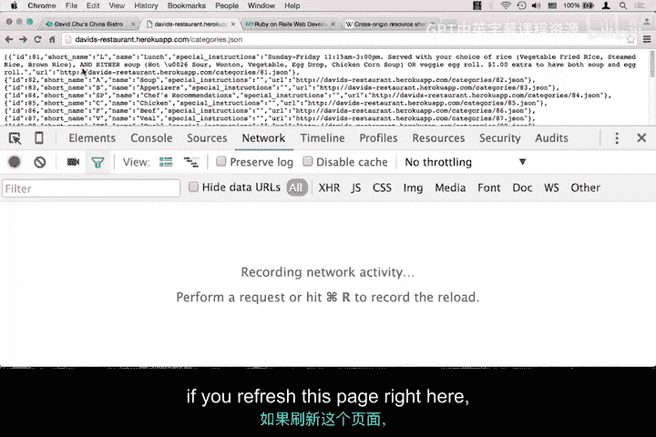

# Web开发者的HTML, CSS, and Javascript：P101：动态加载菜单分类视图（第一部分）

在本节课中，我们将学习如何动态地从远程服务器获取菜单分类数据，并将其插入到我们的网页中。我们将了解跨域资源共享（CORS）的概念，并查看我们将要使用的数据格式。

## 概述

上一节我们动态地插入了主页的内容，包括菜单特色和地图板块。本节中，我们将在用户点击菜单板块时，动态地插入菜单分类。我们已经实现了这个功能，让我们先看看效果：点击按钮后，菜单分类会显示出来，并带有所有图片，这些图片也是可点击的。这与之前类似，但现在我们拥有的是对应正确分类的真实图片，而非占位符。这些内容显然是动态填充的。

此时，我们需要数据来填充这些菜单分类，并指向每个分类特有的图片。

## 获取数据

那么，我们如何做到这一点呢？首先，如何获取数据？

我们有一个部署在Heroku上的应用，名为`davidsrestaurant`。这个应用本质上是一个REST API，为我们的应用提供所需的JSON数据。尽管实际的网站将托管在GitHub Pages上，但数据实际上将来自Heroku上的这个应用。

**重要更新（2022年11月28日）**：Heroku将取消免费套餐，这意味着我们将无法再在Heroku上免费部署应用。因此，我们将改用Google Firebase来部署我们的数据作为REST API。

以下是两个关键更新：

1.  我们将使用`firebase.io`作为获取分类和后续课程中菜单项的URL，而不是屏幕上显示的Heroku URL。正确的URL已更新在GitHub仓库的FAQ中，所有示例代码也已相应更新。
2.  本课程中引用的Ruby on Rails网络开发课程系列已不再在Coursera上提供，但这不影响本课程及其后续AngularJS课程的学习。

这个应用实际上是一个Ruby on Rails应用。如果你想了解更多关于如何自己创建这类应用，建议你查找相关的Ruby on Rails学习资源。

## 跨域资源共享（CORS）

数据托管在Heroku（或Firebase），而我们的应用目前为开发目的托管在本地（通过BrowserSync），最终将托管在GitHub。它们位于不同的域名下，这带来了一个问题。

每个浏览器都有一个称为“同源策略”的安全机制。这意味着，如果一个HTML页面中的JavaScript试图通过Ajax访问与该页面来源不同的域名，浏览器会阻止此行为。这是为了防止恶意脚本利用用户计算机在防火墙后的权限，访问不应访问的内部网络资源。

那么，我们如何才能获取数据呢？浏览器会阻止我们。

这时，一项名为“跨域资源共享”的新技术出现了。CORS通过一些HTTP标头来工作。服务器（如我们的David‘s Restaurant应用）会向浏览器发送这些标头，告知浏览器允许来自我们网页的JavaScript访问其数据是安全的。这就是我们能够从本地开发服务器或GitHub Pages访问Heroku/Firebase上数据的方式。

## 查看数据格式

了解数据来源和获取方式后，我们来看看具体的数据格式。直接阅读原始JSON可能比较困难。

这里有一个小技巧：你可以打开Chrome开发者工具，进入“Network”标签页，刷新页面。你会看到一个名为`categories.json`的请求，这就是我们感兴趣的URL。点击它，然后进入“Preview”标签页，Chrome会以格式良好的方式显示JSON预览。

你可以看到，`categories.json`返回的JSON实际上是一个对象数组。每个对象包含以下属性：

*   `id`
*   `name`
*   `short_name`
*   `special_instructions`

## 下节预告

现在我们已经知道从哪里获取数据以及如何（在CORS的帮助下）获取数据。在下一部分，我们将继续执行代码，使用Ajax拉取这些数据，正确解析数据，并生成动态HTML以将其插入为页面的主要内容。

## 总结

本节课我们一起学习了动态加载菜单分类视图的背景知识。我们了解了数据来自一个远程REST API，并遇到了因不同域名部署而产生的同源策略问题，以及CORS技术如何帮助我们解决这个问题。我们还查看了我们将要使用的JSON数据的具体结构。下一节，我们将动手编写代码来实现数据的获取与展示。