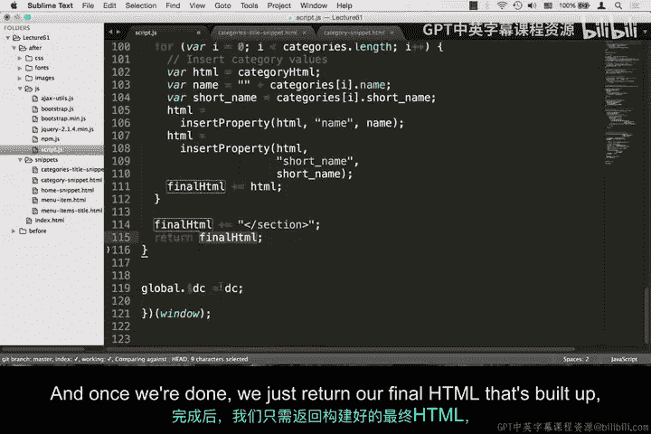

# 约翰霍普金斯大学《Web开发者的HTML, CSS, and Javascript》中英字幕 - P102：36_第61讲 第2部分 动态加载菜单分类视图.zh_en - GPT中英字幕课程资源 - BV1WzY6z9EUd

Yeah。

Okay so in part one of this lecture we spoke about course。

 the crossorig resource sharing and we spoke about where we're going to get the data that is we have a heroroku deployed app that is going to serve as JSUN with the data that we need in this lecture we're going to go over the code that actually makes the AjaX request to that app brings in the data as JSON parses it and populates an HTML snippet that is then able to be inserted inside of our index that HTML as the complete set of HTML tags that we need in order to display the menu categories page the first thing we're going to do is look at a couple of snippets so remember we took out the menu categories that HTML and we actually substituted them with a couple of snippets and I separated the menu categories page into two snippets one is categories title snippet that HTML and all it is is just as a heading of that particular page remember the heading two it's kind of the subheading already and it's just going to say menu categories。

The reason I separated that is if you look at category snippet that HTML it only has one category or HTML for just one category and the reason that is is because as we get an array of these categories we're going to loop over that array and every time we get a category with this information we're going to want to populate this little snippet and then make a copy of it and then insert it and keep building up our HTML so this is what the snippet is about this is really something that is more like a template and if you look closely I place these what they call must or these double curly braces that have properties that I'm going to want to insert into this HTML and there are actually many libraries out there that do this very very well but since we don't want to introduce more and more libraries to this course we're going to just stick to a very simple approach as we're going to have a string which is this HTML and we're going to look for this particular string inside of it using the property。

es and substitute this property name with the actual value。 So every time through the loop。

 we're going grab these values and substitute these particular property name placeholders。

 if you will into the HTML so we can get the real data so you could see here what I'm doing is every single menu category I'm going to create this onclick event and I'm going to call this DC David choose load menu items well we're not really going to write load menu items in this lecture yet but we're going to prep it right now anyway and what we need here is the short name of our particular category and if we take a look at the data that we have here let's open up this again and refresh so we could take a look at the actual data So if you look at the data here we have this short name for each category that is going to be very important because we're going to use that to pull out other data from the app so let's go back to the code editor and basically that's what it is it's really nothing more。

😊，Then we have obviously several different properties here that are the same because they show up in different places of the same snippet。

 Let's go to scriptjs and see how we're accomplishing that。 So first of all。

 we have some more URLs to deal with and here I declare them here at the top one is all categories URL that's the URL where you could get the Json from our serverside app that will return all the categories that we have in our menu as a Json string and we have a couple of URLs that are just paths to our snippets one is the categories title snippet and the other one is the category single snippet html insert HTMLtl you've seen before showing showloading you've seen before as well。

 one you haven't seen yet is insert property Well remember this snippet right here category snipptl somehow we're going to grab this as a string we're going grab that using Ajax request and then we have this entire HTMLls a string but we need to then substitute。

😊，Every property that has these mustache or curly braces around double curly braces around it。

 we need to substitute it with a value。 Well， this is the function that's going to do it。

 It's called insert property and I'm asking it for a string。

 The property name and the property value。 So this is the string where we're going to insert things into the property name property value and is' going to return as a return value is going to return the string already with those property values inserted instead of the property names there。

 So the way we're going to do this is we're going to set up first of all， the property name。

 remember those curly braces and what we're going to do is going to use a replace function of the string class and use a regular expression object。

 except we're not really going to use any kind of a fancy regular expression。

 It's just going to be the property to replace that property that we've set up So just the verbatim string that we've set up we want that replaced and the only reason we're using this regular expression is because were want to specify this flag g。

 we just tells us go ahead and replace it。😊，where you find in this in this string right here so not just the first place you find。

 but everywhere you find So since we have， for example， in this category snippet。

 we have this name property showing up quite a few places here。

 we don't want it to replace just the first one finds want to replace all of them and here's the property value with which you should replace that particular string once we're done with that we return the string and we're good to go So this is how we're going to take the string。

 the snippet and we're going to populate it with property values Okay so scrolll gone down。

We have the AXend request that is for the main content that we've seen before and here's our load menu categories function that is going to get triggered in order to pull all these categories into the page so the way we're doing it is again we're first going to show our loading icon and usually on these sites the server is going to be fast enough that you're probably not even going notice that loading icon kind of flashing and going away but if the sites get a little slower or the data comes back a little slower you will eventually see it。

And we're making our Ax request afterwards and we're using our all categories URL that's the URL to our Heroku app and we're passing build and show categories HTML that is a value of a function that is defined actually right here and since we don't really need the true right here。

 it is default which is going to go ahead and leave it off which means that this function right here we'll get categories we'll get whatever that is the first argument in the function is。

 it's going to be a object that is converted from the JO string so it's going to be a fullblown object So once to saygSCo is done and this function is called。

😊，Weed up here but we're not done with Ajax just yet right First we need to go ahead and request the category title HTML That is that snippet for OHt that just gets the category and we need that string to append it to the rest of it so once we get that string we really are not ready to do much with it yet we need to make yet another Ax request and notice that that AJX request is sitting inside of this one because it only makes sense to make the second one when the first one is actually over and were in the context such that we could grab the result of the first one So there it is so technically speaking this will be the third agex request we're making and we're making that request to get the category HTML and that's that snippet category snippet that HTML and once we're done we have all three pieces of data that we need we have the categories object that is lists all the categories we have the title of the page the snippet of the title of the page as a string and we have a single category HTML sni。

That we can now use so all we need to do now is maybe call some function like build categories view HTML so now we're actually building the view pass it the categories object。

 pass it our title snippet and pass it our actual category snippet and we're going to go ahead and build that view store it inside a variable and once we're done with that and that is a synchronous call there's nothing asynchronous about this it's just synchronous call we're going to use our insert HTML to place it inside the element with ID main content and there's that string that we're placing inside of it。

And notice both Ajax calls， this one and this one both pass false because we don't want the Ajax utility to try to process our snippet our HTML snippets as JSO So let's go ahead and take a look at this build categories view HTML Well it's a pretty simple function it goes ahead and builds up our final HTML snippet by grabbing the categories first remember we need to put that whole thing into a row So remember that section piece is not really here anymore because it only comes once and there's a whole bunch of these that is supposed to happen So that is what's happening here where're inserting a section with a class row and then we're looping over our categories object and every time we pull out the name the short name and all we're doing then is just insert property remember that insert property function we discussed。

 well this is what where it's coming very handy。 we're insert property and every place where there is a name property inside our snippet it gets replaced with a value。

namee same for short name finally we're done and we're looping over this every single time and notice that every time we're copying the category HTML that's that snippet that has the properties in it into HTML which means we're separating remember the pass by value pass by reference well this is copy by value which means this is a copy that is not connected to this anymore so every time through the loop we get a new copy of it right here and then we can insert the new values to it once again。

And once we're done， we just return our final HTML that's built up we close the section tag and then it goes back right here what we spoke about before and that just inserts that inside our main content and that's how we get to this place right here where when we go to the front page and click on this menu it executes a function that pulls in all of this right here into our page so now we're done with the menu category page and it's time to move on to a single category page so when a user clicks on a soup category or appetizers category and should be able to see all the menu items for that particular category and that's what we're going to code up next。

