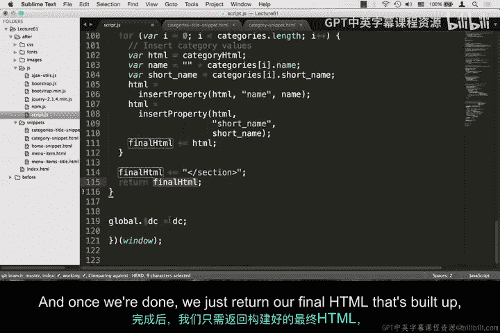

# Web开发者的HTML, CSS, and Javascript：P102：动态加载菜单分类视图

在本节课中，我们将学习如何通过Ajax请求从服务器获取JSON数据，解析数据，并使用这些数据动态生成和插入HTML内容，以构建一个完整的菜单分类页面。

---

在上一部分，我们讨论了跨源资源共享以及数据来源。我们有一个部署在Heroku上的应用，它将提供本课所需的JSON数据。本节中，我们将详细讲解如何编写代码，向该应用发起Ajax请求，获取JSON数据，解析数据，并填充一个HTML片段，最终将其插入到我们的主页中。这个HTML片段包含了显示菜单分类页面所需的所有完整标签。

首先，我们将查看几个代码片段。我们移除了原有的菜单分类HTML，并用几个片段替代。我将菜单分类页面分成了两个片段：一个是`categories-title-snippet.html`，它只包含该页面的标题；另一个是`category-snippet.html`，它只包含单个分类的HTML结构。

我将标题分离出来的原因是，`category-snippet.html`只包含一个分类的HTML。当我们获取到一个分类数组时，我们将遍历这个数组。每次获取到一个分类信息，我们就用这个片段作为模板，填充数据，复制它，然后插入到页面中，从而逐步构建我们的HTML。

如果你仔细观察`category-snippet.html`，会发现我使用了双花括号`{{}}`（Mustache语法）来标记需要插入数据的属性位置。虽然有很多库可以很好地处理这种模板，但为了不引入更多库，我们将采用一种简单的方法：将这个HTML当作字符串，然后查找并替换其中的属性占位符。

在循环中，我们将获取实际数据值，并用它们替换HTML字符串中对应的属性名占位符。

在这个片段中，我为每个菜单分类创建了一个`onclick`事件，它将调用一个函数（例如`loadMenuItems`）。我们需要传入分类的`short_name`属性。查看我们的JSON数据，每个分类都有一个`short_name`，这非常重要，因为我们将用它从应用中获取其他相关数据。

---

接下来，我们转到`script.js`文件，看看如何实现这一切。

首先，我们在文件顶部声明了一些URL：
*   `allCategoriesUrl`：指向我们服务器端应用的URL，用于获取包含所有菜单分类的JSON字符串。
*   `categoriesTitleHtml` 和 `categoryHtml`：指向我们两个HTML片段的路径。

我们之前见过`insertHtml`和`showLoading`函数。这里有一个新函数`insertProperty`。

`insertProperty`函数的作用是：接收一个字符串、一个属性名和一个属性值，然后将字符串中所有匹配该属性名（被双花括号包围）的地方替换为实际的属性值。它使用字符串的`replace`方法和一个简单的正则表达式（带有`g`标志），以确保替换所有出现的地方，而不仅仅是第一个。

这就是我们用来将数据填充到HTML片段模板中的方法。

---

向下滚动，我们看到用于主内容的`ajaxGetRequest`函数，以及我们的`loadMenuCategories`函数。当需要将分类加载到页面时，会触发这个函数。

其流程如下：
1.  首先显示加载图标。
2.  发起Ajax请求，使用`allCategoriesUrl`从Heroku应用获取数据。
3.  请求成功后，调用`buildAndShowCategoriesHTML`函数，并将获取到的JSON对象（已转换为JavaScript对象）作为参数传入。

但在完成Ajax请求之前，我们还需要获取标题HTML片段。因此，在第一个请求的回调函数中，我们发起了第二个Ajax请求来获取`categoriesTitleHtml`片段。接着，在第二个请求的回调函数中，我们又发起了第三个Ajax请求来获取`categoryHtml`片段。

这种嵌套是必要的，因为只有在第一个请求完成后，我们才能在正确的上下文中处理其结果并发起后续请求。

当这三个请求都完成后，我们就拥有了所需的所有数据：分类对象、标题片段字符串和单个分类的HTML片段字符串。

此时，我们调用`buildCategoriesViewHtml`函数，传入分类对象、标题片段和分类片段。这个函数将同步地构建出完整的视图HTML字符串。

构建完成后，我们使用`insertHtml`函数将这个完整的HTML字符串插入到ID为`main-content`的元素中。

请注意，这两个获取HTML片段的Ajax调用都传递了`false`参数，这是为了告诉Ajax工具不要尝试将这些HTML片段当作JSON来处理。

---

现在，让我们看看`buildCategoriesViewHtml`函数。这是一个相当简单的函数：
1.  它首先创建一个`section`元素，并为其添加`row`类。
2.  然后，它遍历传入的分类对象数组。
3.  对于数组中的每个分类，它复制一份分类HTML片段字符串。
4.  接着，它使用`insertProperty`函数，将片段中所有`{{name}}`占位符替换为实际的分类名称，将所有`{{short_name}}`占位符替换为实际的短名称。
5.  每次循环后，将处理好的单个分类HTML追加到最终的HTML字符串中。
6.  遍历结束后，关闭`section`标签，并返回构建好的完整HTML字符串。

这里的关键点是，每次循环都创建了分类片段的一个新副本（通过值复制），因此每个分类的数据都是独立插入的，互不干扰。

最终返回的HTML被传递回调用处，并插入到页面中。这就是当我们访问首页并点击“菜单”链接时，页面能够动态加载并显示所有菜单分类的过程。

---

本节课中，我们一起学习了如何通过多个Ajax请求获取数据和模板，如何使用简单的字符串替换来填充模板，以及如何将动态生成的HTML内容插入到页面中。现在，菜单分类页面的动态加载功能已经完成。

接下来，我们将进入单个分类页面的开发。当用户点击某个分类（如“汤”或“开胃菜”）时，页面应该能显示该分类下的所有菜单项。这将是我们下一步要编写代码实现的功能。