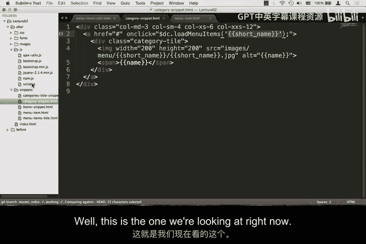

# 约翰霍普金斯大学《Web开发者的HTML, CSS, and Javascript》中英字幕 - P103：37_第62讲 动态加载单个分类视图.zh_en - GPT中英字幕课程资源 - BV1WzY6z9EUd

Yeah。

In the previous lecture， we populated our menu categories page dynamically from the server pulling the data for our menu categories page from the Hiroku app that is implemented rubby on Ras in this lecture we're going to do something very similar but this time we're going to pull the specific category in all the menu items for that specific category right now I'm looking at category snippet that HTML。

 which is located in lecture 62 folder in the after folder and the reason I'm looking at the category snippet。

 HTML， which is something we implemented in the previous lecture is because I want to take a closer look at the hook that we used in order to get or at least set up in order to get to the point where we could click on a single category and get the single category menu items Well the hook is right here it's oncl and we' saying DCc or dollar DCc load menu items and we're putting in this short name right here Well load menu items is something we're going to look at in a minute。

But the short name is very important is because that is seems to be at least the property which we use to get at the data for a particular category let's go back to our browser and go to our David's restaurant app and see that there's another rest API endpoint as they're called that says menu items JO that's what we want and we're passing it a request parameter called category and depending on what this letters our this letter or letters we're going to get different results so for example if we do VG and actually refresh that。

And click on that and take a look So here VG， it gives us an object or gives us a string Jason string that will be converted to an object that has two properties in it category and menu items category is yet another object and menu menu items is an array of objects。

 So if we open that up we could see all these object that are inside that menu items array。

 they're really just menu items for the category that was returned and the category is returned as a property called category。

 Now depending on what we place here， let's place here L， for example。

 for lunch and if we scroll back up here， we'll see that now we're in the lunch category and here all the items for the lunch category。

 So point is that short name is pretty important for us because that is what we're going to use to append to this base URL right here。

 this is going to be a base URL and we're going to append this whatever that they click on we're going to append that letter or number of letters like VG。

To be able to get at the particular data for that particular category。

 let's close up this extra window right here， let's go back to our code editor and let's take a look。

 let's close the snippet and take a look at the couple of snippets that we're going to use for this number one is menu items title HTML and since I have this implemented already。

 let's actually take a look at the end result。 So if we're in a front page and we click on our menu item here our menu tile we'll get to our menu categories page and if we click on let's say lunch we'll get to our specific menu category which is lunch menu and you could see that we have a whole bunch of menus here。

 a whole bunch of menu items with pictures and we have two components here。

 which is what I divide it over there into snippets1 is the component of the actual heading of it so which says lunch menu and give some sort of specific instructions for that category。

 special instructions and then we have a separate one。

 there's just lists every menu item in that category。

Let's go ahead and take a look Here is the menu items title。

 you could see here we're gonna to say whatever the menu name is menu like lunch menu or vegetable menu or something like that。

 and we're going to list the special instructions right under that and both are basically bound to this particular thing with these curly braces。

 double curly braces must， whatever you want to call them But from the previous lecture where you know how easy it is for us to insert our property values instead of these property name。

 So that's enough about that。 let's go to our script do js and take a look as to how we're accomplishing this Okay so we have a few more URLls to deal with。

 number one is we have the the menu item URL menu items URL and you could see is the URL is the same URL we use except category equals doesn't have anything equal to well that's because we're going to append the short name of the category on the fly and then there's the two。

It's the menu items， title HTML and the menu item HTML， so if we scroll down。

These are all the functions we've seen before。And we get to this this one that's called load menu items and it looks very。

 very similar to the one before it's basically almost the same except that when we make the Ajax request。

 were taking the menu items URL we're pending the short name that was passed to us through the HTML snippet remember the HTML snippet。

 the category snippet when it said DCc that load menu items and it passes the short name right here well this is the one that we are looking at right now that got closed for a second let me scroll back to that function load menu categories right here load menu items so this is the category short that's what got passed into us when the user clicked on that particular item so our URL that we're making Ajax request is now complete when we put those two together and we're also designating again a function that is going to process the results of that Ajax request and again it's going。

B Json so we don't need to put false in here we're actually going to default to JsonN processing。

 so build and show menu item items HTML let's go and take a look at that function， which is。Right。

 here。At the bottom of those two and basically we know that category menu items is going to be an object that is going to get returned because our JO is going to get processed and again we have these double Ajax request very similar first we're getting the menu items title HTML that's that snippet then we're going get the menu item HTML that's the single one if we take a look at here menu item HTML it's quite involved but this is exactly what we basically pulled out out of our single category that HTML page and all it is is just basically placing those properties in the proper places in order to construct for example a URL that we need for the JPG that is going to be sitting inside the images folder we have the price here and price small portion name sometimes the price small but sometimes there's only one price so we're gonna have to deal with the fact that sometimes we're not going to have a small portion name which is going have one price and no other price here and the name in the description。

or a particular item so in terms of formatting really there's nothing for us to do because we're already done all the formatting through Botrap in the previous lectures Okay。

 so if we go back to our script。 HTMLtml or script。js，😊。

All we're doing here is very similar construct is we're building up our menu items view HTML and again we're passing that object category menu items passing the HTML snippet for the title and passing the HTML snippet for their one single menu item once it gets built up and saved into menu items view HTML all we have to do is insert it into an element with an ID main content and we're done and again false here because both of those Ax request don't need to process this the snippets as JSON they need to process them as just a regular string let's take a look at this build menu items view HTML。

Unlike the previously similar function， we actually need to insert some values inside of our title as well。

 so in this case it' going to be name and special instructions and the name and special instructions come from category menu items that's that object that was returned for us from the Hiroku app as our JO that was converted into an object that category that's our property。

 that name and the same thing here menu items category menu items category special instructions so once we insert that our menu items title HTML is actually ready to be used for our final HTML so that's why we are starting this final HTML with this particular variable that's already kind of preinserted with the values of our object and again starting the section as a row this is something was stripped out out of that particular snippet because again this is only one of these lines and that snippet is going to get repeated。

😊，Over and over and over again for every single item in the menu category。

So once we're done with that， we are looping over the categories， we're looping over the menu items。

 all it essentially categories， really it's menu items。Here we go。

 this first mistake right here Okay so we're looping all the menu items and we pull out the short name because we're going to need that for constructing our URLs in order to get to our images because if you look at our images our menu items are inside the menu and then every single one has a letter that's the folder for particular menu category and inside that folder we have this a1。

 a2， a3 and so on that actually needs to be constructed using the short name of the category。

 not necessarily just of the menu item okay so that's basically a bunch of inserts that is going on here and the only difference here is is that we have a separate function for insert item price and insert item portion name and the reason we do that let's take a look at insert item price。

Is because not every time do we have a price。 For example。

 price for a smaller portion might not even exist。 So we first check whether that thing even exists。

 And if it doesn't exist what we insert instead of that obviously we can't just leave that curly brace curly brace small portion price value or property inside out snippet。

 we don't want that showing up to the user So what we're doing is we're inserting the property named price prop name which in this case I think is something like either small price or large price and we're substituting with an empty string。

 So basically just wiping it out so nothing is in that particular snippet with that value if that value doesn't actually exist and what we're doing next is we're actually if it's actually exists we're going to go ahead and use twofi two which basically means we're going to not have three or something like that we're gonna have dollar3。

00 and so we're formatting up。Price to be a dollar proper dollar amount。

 And then we're using our insert property as before in order to put that in。

 So that's in the case that it actually exists that price value actually exists。

 If not willll assert an empty string and the rest of the h is very。

 very similar we keep inserting the values the portion name is the same thing。

 sometimes portion doesn't exist in that particular particular value。

 So a large portion may not exist。 small portion name might not exist So that's why we need to send it through a special function and all this code is available so you could take a look at your leisure a little bit slower。

 the way I'm kind of flying through this a little bit。

 but I want to give you the concepts of it not necessarily go line by line。

 There's one more thing we need to do。 remember the clear fix right we can't control how large these menu descriptions are going to be。

 someone might be too large Some be too short。 and we don't want our grid to be messed up So what we need to do is after every second menu item after every second menu。

😊，after every second grid cell， we need to place this clearfi HTML and that's what we're doing here。

 We're using actually the remainder function or the remainder operator in jascript。

 So we're saying I remainder of two division of two and we're saying that if that's not equal to0 meaning there is a remainder so we have item0 we have item1 item 2 item3 and so on Well item 0 is our first item because it's a0 array our0 based item  zero is our first item item 1 is our second item and it's after the second item that we need to place our clearfi HTML Well。

 that means that every odd number and this is basically what we're saying that every odd number。

 every odd number index is what we need to append this clearfi HTMLl2 and if it is we do and we move on and finally produce our final HTML and that final HTML just like before gets inserted into our。

😊，Main content gets saved to this menu items view HTML and gets inserted into our main content and that's how we get when we get to our page and click on here and click one of these items。

 we get our single category items page。

