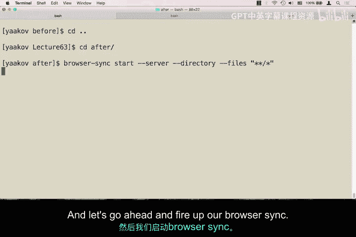
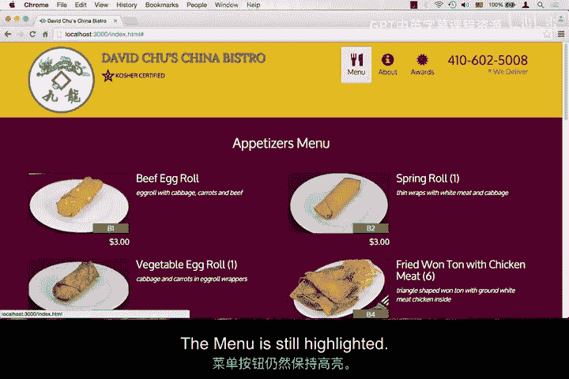

# 约翰霍普金斯大学《Web开发者的HTML, CSS, and Javascript》中英字幕 - P104：38_第63讲 通过JavaScript切换激活按钮样式.zh_en - GPT中英字幕课程资源 - BV1WzY6z9EUd

Yeah。

In the previous lecture we pretty much completed our David Cho China Bistro website except for one small thing and let me demonstrate that by going to the command line I'm actually going to go into the before folder of lecture 63 which is our current lecture and I'm going go ahead and start the browser sync to just to let us see what was before we started and implemented a change let's go back to the code editor or the browser and let's refresh the page here so when we go to the menu categories page and click on it。

 there's something missing this menu right here， this menu button should be highlighted just like that but it's not and the reason it's not is because obviously nothing it's not a separate page so the active class that used to be on here that used to light this up like that is not there so we'll need to do is unchange when this happens when the menu categories page gets loaded and for that matter when the particular single category view gets loaded。

This button to be in the active state Let's go back to our code editor and see how we implemented that We created this function called switch menu to active and what we're doing in it is the following first of all。

 we to remove the active class from our nav home button remember if we go to our browser and actually squeeze it what's gonna happen is is that even though you don't see it but actually it's sitting on the home button and if we go to right now we're actually already on the particular menu category page this really should be on the menu button not on the home button Okay so let's go back to the code editor so what we need to do first is we need to remove that active class from the home button and the way we're doing it is is we're selecting an element with an ID nav home button and actually if we select that and go to index that HTML and try to find that it's right here it's that menu item right here in the top right of our of our site unless of course it's squeezed and now it's in the collapse。

Mu but it's possible that the naav home button has the active at the moment and actually that is the default when we load up the page is that the Nav home button which is hidden on the desktop browser display is the active one so we need to remove this active class from the list of classes of here and we need to insert it into the menu button instead so let's go back to our script。

 JS。😊，And we need to scroll down a little bit again。 And so switch menu to active。

 Okay so the first thing is we're getting the class name and the class name is not one class name it's really just the class attribute and the class attribute can have many classes in our case in HTML here。

 you could see that has visible XS and active。 So there's a couple of classes that could be in there separated by spaces。

 And the way we're doing this is we're using that same replace function of the string class to say we're gonna to create a new regular expression。

 And again， it's not going to be a very fancy regular expression。

 it's going to be just an expression that looks for a littleeral string active。

 and the only reason we're using it again instead of just saying you know right here in the first argument is active。

 the string active is because we want to use this flag G。

 which lets us say that anywhere you find this So there's more than one for some reason in there。

 that will all get replaced with the empty string。 So we removed the active class。😊。

From our element that has an ID NAav home button and the result of that we're going to save in this classes variable and then we're going to turn around and override the class names or the class name attribute value for that NAF home button to the classes。

 but these classes are now or the string is now without the active class。

And the second thing we're doing is we need to add the active to the active class to the menu button if it's not already there。

 So the first thing we're gonna to go ahead and grab what are the class names that are inside this naav menu button and check if the index of active this word active is negative one and this function index of returns negative one if it cannot find the string inside the string that youre applying this method on and if that's the case we're going to go ahead and add classes equals classes plus active。

 this is what this plus equals as you remember means and obviously we want to make sure to give it a space because there might be a class there already so we'll put a space in here and then we're again selecting using our query selector。

 the naav menu button and having that class name or the class name attribute equal to the classes that we just constructed which is whatever classes were there before plus the active button okay let's see if that actually works let's go back to our。

Mandline and switch our browser sync to being from before to after。

And let's go ahead fire up our browser sync。

Let's go to the browser and we could just close this and just simply refresh this and here's our browser sync and now if I go to let's say menu right around home is selected if I go to menu and I see here that now menu stays highlighted so if I actually open this up I could see that the menu button is highlighted and if I go to a particular menu item or particular menu category with all the items in it。

 menu is still highlighted so if I go back to home and go back to menu and go to a particular menu category I could see that the menu button stays highlighted okay other than maybe putting up some information in the about section and the award section our website is 100% done and ready to be deployed。

