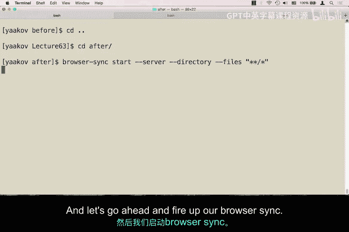
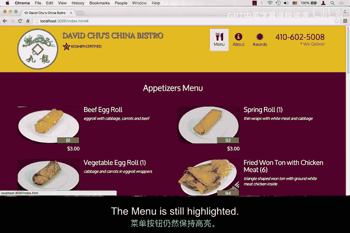

# Web开发者的HTML, CSS, and Javascript：P104：通过JavaScript切换激活按钮样式 🎯


在本节课中，我们将学习如何使用JavaScript动态切换导航按钮的激活状态，以提升单页面应用（SPA）的用户体验。我们将修复一个常见的界面问题：当用户浏览不同页面内容时，导航栏的“高亮”指示未能正确更新。

---

## 概述

在上一节中，我们几乎完成了David Cho China Bistro网站的开发，但还存在一个小问题。具体表现为：当用户点击进入“菜单分类”页面时，导航栏中的“菜单”按钮并未像预期那样被高亮显示。这是因为我们的网站是单页面应用，页面切换时不会重新加载整个HTML，导致原本通过HTML `class` 属性设置的激活状态（`active`）无法自动更新。

本节我们将编写一个JavaScript函数 `switchMenuToActive`，其核心逻辑是：
1.  **移除**当前可能处于激活状态的按钮（如“首页”按钮）的 `active` 类。
2.  **添加** `active` 类到目标按钮（“菜单”按钮）上。

我们将通过操作DOM元素的 `className` 属性来实现这一功能。

---

## 问题复现与思路分析

首先，让我们在浏览器中查看问题。当网站加载后，默认“首页”按钮处于激活状态。点击“菜单”按钮进入菜单分类页面后，内容区域发生了变化，但导航栏的“菜单”按钮并未高亮，而“首页”按钮的高亮状态依然保留，这会给用户造成困惑。


问题的根源在于，`active` 类是通过CSS定义按钮高亮样式的。在传统的多页面网站中，每个页面会单独加载，其对应的导航按钮在HTML中直接写有 `active` 类。但在我们的单页面应用中，页面内容通过JavaScript动态切换，我们需要手动更新导航按钮的激活状态。

因此，我们的解决方案是：在加载菜单分类页面内容时，调用一个JavaScript函数来更新导航栏按钮的CSS类。

---

## 代码实现详解

现在，让我们回到代码编辑器，看看如何具体实现 `switchMenuToActive` 函数。

### 第一步：移除首页按钮的激活状态

首先，我们需要找到ID为 `nav-home-button` 的首页按钮元素，并移除其 `class` 属性中的 `active` 类。

以下是实现此步骤的代码：

```javascript
// 获取首页按钮当前的class属性字符串
let classes = document.querySelector('#nav-home-button').className;
// 使用正则表达式全局替换掉‘active’类名
classes = classes.replace(/active/g, '');
// 将处理后的class字符串重新赋值给元素
document.querySelector('#nav-home-button').className = classes;
```

**代码解释**：
*   `document.querySelector(‘#nav-home-button’)` 通过ID选择器精确获取首页按钮的DOM元素。
*   `.className` 属性用于获取或设置元素的 `class` 属性值，它是一个由空格分隔的字符串。
*   `.replace(/active/g, ‘’)` 使用正则表达式 `/active/g` 匹配字符串中所有出现的“active”字样（`g` 表示全局匹配），并将其替换为空字符串，从而移除它。

### 第二步：为菜单按钮添加激活状态

接下来，我们需要为ID为 `nav-menu-button` 的菜单按钮添加 `active` 类。在添加之前，最好先检查它是否已经拥有这个类，避免重复添加。

以下是实现此步骤的代码：

```javascript
// 获取菜单按钮当前的class属性字符串
let classes = document.querySelector('#nav-menu-button').className;
// 检查‘active’类是否不存在
if (classes.indexOf('active') === -1) {
    // 如果不存在，则在原class字符串后追加一个空格和‘active’
    classes += ' active';
    // 将新的class字符串重新赋值给元素
    document.querySelector('#nav-menu-button').className = classes;
}
```

**代码解释**：
*   `indexOf(‘active’)` 方法用于在字符串中查找子串。如果找不到，则返回 `-1`。我们用它来判断 `active` 类是否已存在。
*   `+= ‘ active’` 是 `classes = classes + ‘ active’` 的简写，它在原有类名字符串末尾追加一个空格和“active”。添加空格是为了正确分隔多个类名。

---

## 功能测试与验证

函数编写完成后，我们需要在适当的时机调用它，例如在加载菜单分类页面内容的Ajax请求成功之后。

让我们启动开发服务器并测试效果。刷新页面后，点击“菜单”按钮：



现在可以看到，“菜单”按钮成功被高亮显示。即使我们进一步点击某个具体的菜单分类，查看该分类下的所有项目，“菜单”按钮的高亮状态依然保持。



反之，当我们点击“首页”按钮返回主页时，`switchMenuToActive` 函数（或类似的针对首页的函数）会被调用，将高亮状态切换回“首页”按钮。

至此，导航栏的状态指示功能已完全实现。


---

## 总结

在本节课中，我们一起学习了如何通过JavaScript动态管理DOM元素的CSS类，以实现交互式界面状态反馈。我们重点掌握了：

1.  **问题识别**：在单页面应用中，导航状态需要手动同步。
2.  **核心操作**：使用 `element.className` 属性获取和设置类名，结合 `String.replace()` 和 `String.indexOf()` 方法进行类名的移除与添加。
3.  **实现步骤**：
    *   移除旧激活按钮的 `active` 类。
    *   为新激活按钮添加 `active` 类（添加前先做检查）。
4.  **最终成果**：网站导航栏现在能正确反映用户的当前位置，提供了清晰的视觉指引。

这个功能的完成标志着我们网站的核心交互已经全部实现。接下来，只需补充“关于我们”和“获奖信息”等页面的静态内容，整个网站就可以准备部署上线了。


