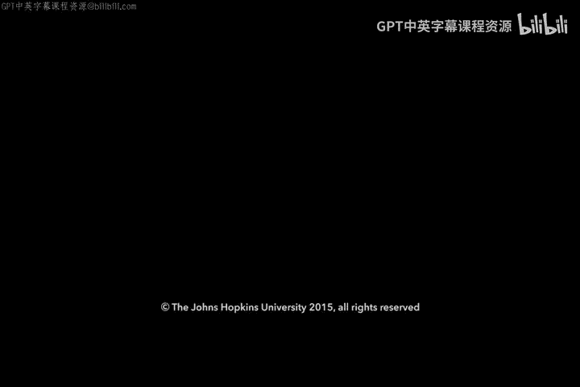

# 约翰霍普金斯大学《Web开发者的HTML, CSS, and Javascript》中英字幕 - P105：39_课程总结.zh_en - GPT中英字幕课程资源 - BV1WzY6z9EUd

You've made it， you've completed the course congratulations and thank you for sticking with me through this journey I hope you enjoyed it and learned a ton so where do you go from here if I may suggest the next course in this specialization which is single page web applications with Angular JS。

Angular， which is backgged by Google is one of the most popular front end frameworks today。

 and there's a reason for that you can accomplish so much functionality with so little code。

 so check out the courses and enroll。The entire Johns Hopkins team worked very hard to produce this course and deliver it to you in the best way possible。

 so if you like the course I'd like to ask you to take a few minutes of your time and give this course a five star rating。

 it would mean a lot to us。Finally， keep in touch， follow me on Twitter， connect on LinkedIn。

 and join a special Facebook page we created just for the front end courses of this specialization the links to all of these things are below this video。

😊，Thank you for watching and all the best to you。

