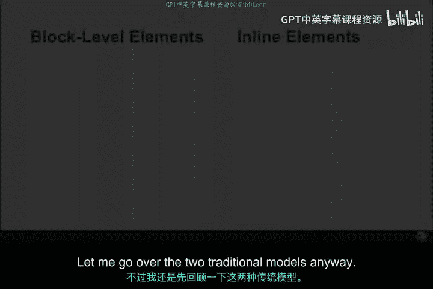
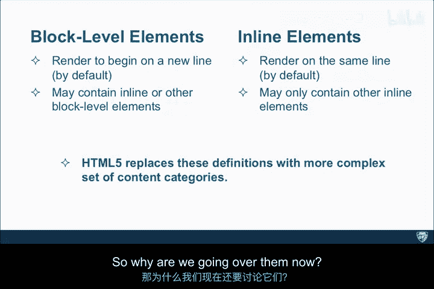
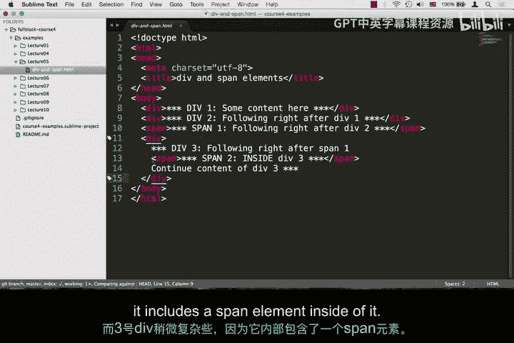
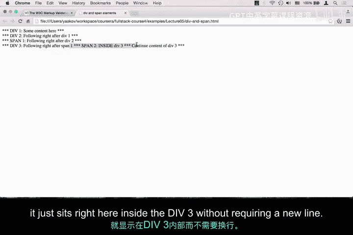
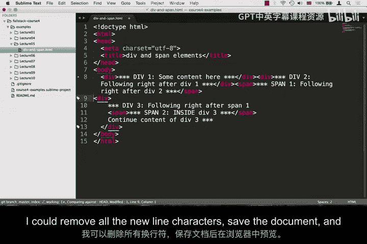
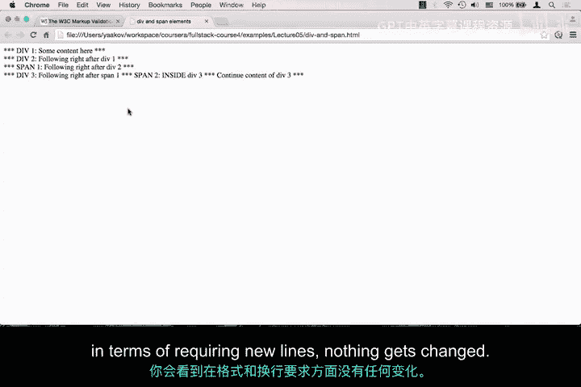
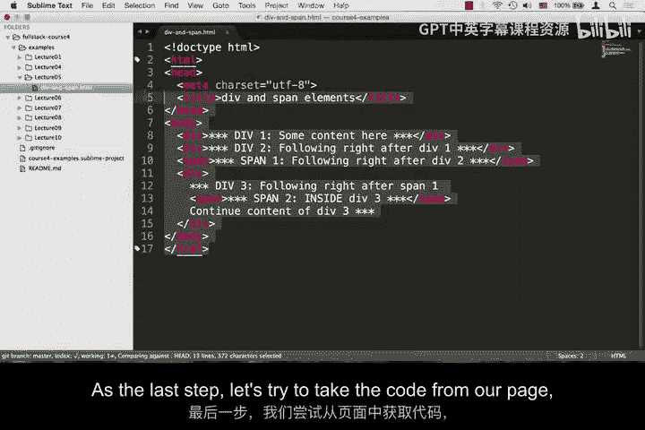
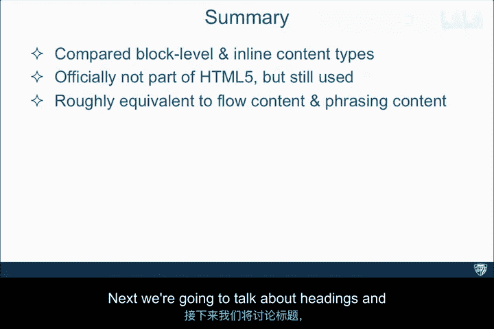
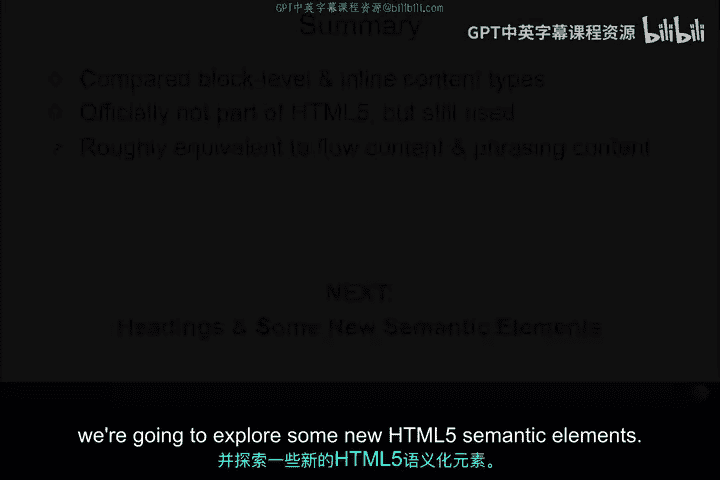

# 约翰霍普金斯大学《Web开发者的HTML, CSS, and Javascript》中英字幕 - P10：9_第5讲 HTML内容模型.zh_en - GPT中英字幕课程资源 - BV1WzY6z9EUd

。

The term content model refers to the default behavior the browser applies to the elements belonging to that content model and to the nesting rules of those elements。

 in other words which elements are allowed to be nested inside which other elements。

Prior to HTML5 specification， HTML elements were either block level or inline elements HTML5 split these two content models into seven models。

 so things got a bit more complicated。Let me go over the two traditional models anyway and I'll explain in a moment why I'm doing that so all elements fall into basically two categories under the traditional content model structure。

 either block levelve elements or inline elements block levelve elements render to begin on a new line by default you could change that with CSS but we're not talking about CS at this point yet so what that means is is every time you specify a block levelve element in HTML the browser will automatically place that element on a new line in the flow of the document。

Block level elements are allowed to contain in line or other block level elements within them。

 this is in contrast to inline elements which render on the same line by default again you could change that but by default。

 it renders on the same line， which means if you put a whole bunch of in line elements next to each other。

 they will all be going on on the same line as if there is no new line character present。

Inline elements also have a restriction that they can only contain other inline elements。

 in other words， an inline element cannot have as part of its content， a block level element。

Now I told you that HTML5 really replaces these definitions with more complex set of content categories so why are we going over them now Well the reason we going over them now is because this distinction between block level elements and inline elements remains pretty practical because it aligns very well with still existing CSS rules so even though HTML5 came up with new content model names and new subcategories and just new way to break them down at the end of the day you could still look at all of these as far as your coding is concerned as block level elements and inline elements and obviously it's a little bit of an oversimplification but it works and just to be kind of complete block level elements roughly translate into the new HTML5 category of flow content and inline elements roughly translate into the HTML HTML5 category of phrasing content so let's go look at some code that will demonstrate these concepts to demonstrate the。

😊。

between block level elements and inline elements， we're going to take a look at an HTML document called div and Sp that HTML It's located in the examples lecture 05 folder。

😊，Perhaps the most generic elements in each category are the div and the span elements。

 and these are the elements we're going to introduce in this document。

The div stands for division and a span element stands for span。

 The development is your most generic block level element。

 and the span element is your super generic inline element。

 So let's go over this document real quick。 We have a couple of divs following one after the other diviv 1 and divff2 Then there's a span element that follows divff2 and the number three div is a little bit more complex in that it includes a span element inside of it。

 So let's take a look at what this looks like in the browser。😊。

So you can see that diviv1 element is all by itself on its own line， and so is divff 2 element。

 all by itself in its own line。 Now， the span 1 was a tag。

 an element that that followed directly after diviv2。

 and even though span is an inline element since diff 2 requires that it be on its own line。

 it pushes the next inline element to its own line as well。 and this is exactly what happens with D3。

 even though span is an inline element technically speaking。

 the next tag shouldn't really go anywhere， but right behind span 1。

 but since D3 is a block level element， it requires its own line。

 so it gets pushed to the next line to be by itself。

 Now the span 2 tag it sitting inside the D3 and since it's an inline element。

 it doesn't cause any more formatting and it just sits right here inside the D3 without requiring a new line。

😊。

So just so there is no confusion， the new line characters that follow the div tags make absolutely no difference to the HTML page and how it renders。

 I could remove all the new line characters， save the document and preview it in the browser again。

 and as you could see in terms of formatting and in terms of requiring new lines。

 nothing has changed。

As the last step， let's try to take the code from our page， copy it。

 and validate it in the W3C validator。

As you can see， the page is valid， but what happens if I go ahead and right inside our validator。

 add another div tag right inside the span tag with some content and I'll close a div tag and let's check the page。

And now you could see it's complaining that elementD not allowed as a child of span element in this context。

 and it's telling you the context in which div element may be used is flow content。

 and content model of span element is phrasing content。

 and again phrasing content roughly translates into inline content and flow content roughly translates into block level content。

I'll provide a couple of URLrs for you to explore a little bit further into different categories of the HTML5 content models。

 but I'd like to demo one real quick and that is the W3C kinds of content section where it basically lists the seven types of content that the HTML5 defines what's cool about this page is that you could roll over different parts of this graphic and you could see all the different elements that belong to this particular HTML5 content model category。

So to summarize， we compared block level and inline content types and which we know are not part of the official HTML5 specification。

 but they're still used quite often in literature and just in regular coding。

 and roughly they're roughly equivalent to flow content and phrasing content respectively。Next。

 we're going to talk about headings and we're going to explore some new HTML5 semantic elements。

