# 约翰霍普金斯大学《Web开发者的HTML, CSS, and Javascript》中英字幕 - P12：11_第7讲 列表.zh_en - GPT中英字幕课程资源 - BV1WzY6z9EUd

。

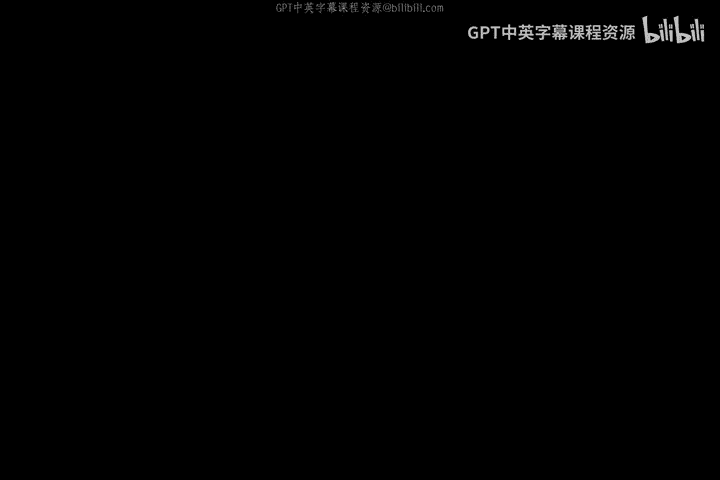

In this lecture we're going to talk about HTML lists Now lists are an incredibly useful HTML structure that allows you to group related content。

 If you think about it， we as you know regular people we think of things in terms of lists to do lists。

 shopping lists so on and listen so therefore it only natural that lists。😊。

Appeal to us as an organization tool， let's go ahead and jump straight into the code and take a look as to how to implement these lists in HTML。

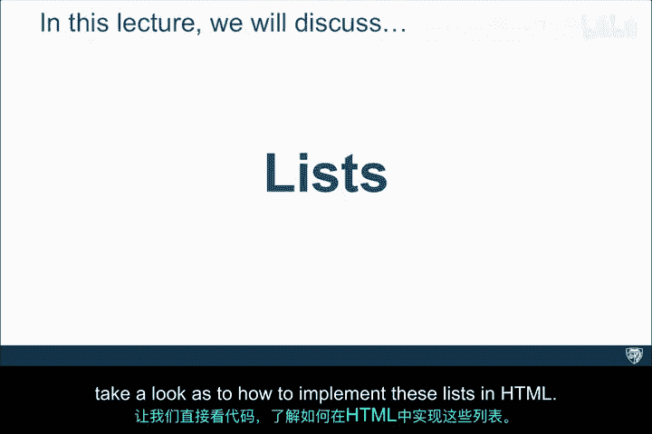

Okay so I'm in sublime text and I'm looking at the document called unordered lists before that HTML and the document is located。

 the file is located in the examples lecture07 folder and as you can see here we have a list here in front of us a my typical dinner shopping list milk donuts cookies some different types of cookies and then obviously at the end peptabymal So we would like to do is produce a bulleted list in our HTML document So if you look at the page right now the way it looks in the browser is you can see there is no list is just match bunch of spaces in between them and the reason that is as I told you before。

 all the different new line characters or any other separated type of characters like tabs。

 extra spaces they're really all ignored by the browser and only one space is honored and since typically a shopping list is not something you need to buy in order we can use an unordered list for this example so the way you create an unordered list as you specify a UL unordered list UL tab。

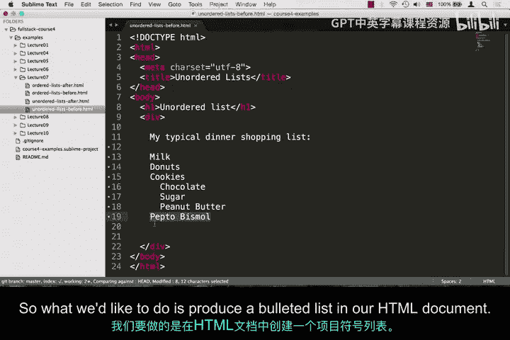

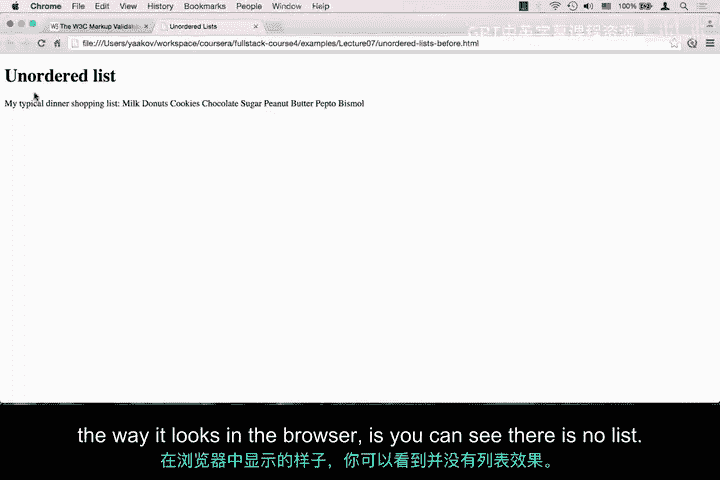

Aro your entire content and every item within the list is an L tag， otherwise known as list item。

 so let's go ahead and indentist and surround every one of these items with an L tag。

When we get to the cookies item， we could see that the cookies item contains more than just the word cookies。

 it actually contains its own list inside of it， which means the content of our AI should really expand not just the cookies but expand all the way to chocolate。

 sugar and peanut butter。And it also means that we need to create another unordered list inside our cookies item。

Let's go ahead and indent this and we'll surround each one of these items in an L as well。

Last but not least， Peptobysmal is supposed to be surrounded with an L tag as well。

 and that list item really belongs to our original unordered list。

 so let's save the document and let's refresh and view it in the browser and here we go we have our unordered list。

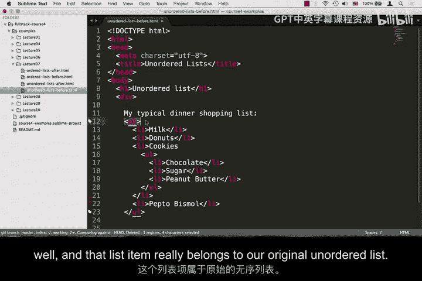

As a last step， let's make sure that we actually wrote HTML that is valid and will'll cut and paste the HTML into the W3C validator。

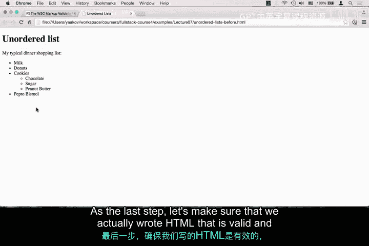

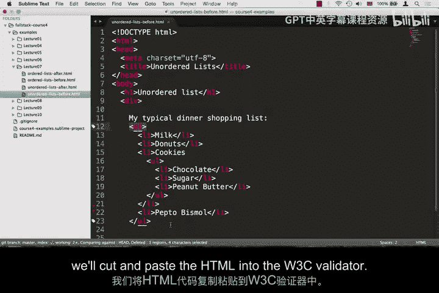

As you could see， our HTML page is valid。But let's see what happens if I take one of the items in my unordered list and simply remove the L tags around it in this case I remove the L tag around the peptobysmal list item。

If we check it again。We see that the HTML that was written is now invalid and the reason is it says text not allowed inside UL in this context。

 and what it's telling you is that the only thing is allowed inside a UL element is an AllI element。

 anything else is not allowed。

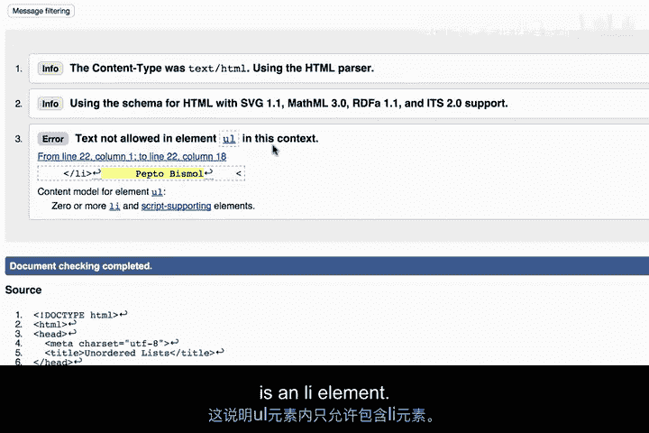

There are lists out there that absolutely require some ordering to it For example。

 I'm looking at ordered lists before that HTML in the same folder examples lecture 07 and here there's a very important procedure called oro cookie eating procedure and it's important that this procedure is followed step by step without mixing up step1 and step2 so as you can see in terms of our HTML the only difference that our UL tag got replaced within OL tag which stands for ordered list but the LI items are exactly the same。

And the way we treat a sublist within an ordered list is also exactly the same as we treated it within the unordered list。

 so for example， here we have make a double Oreo， which is a list item that has its own step by step instructions and it does appear inside an OL which is ordered list inside the AI item so this item right here contains an ordered list inside of it。

 let's take a look what this page looks like in the browser。

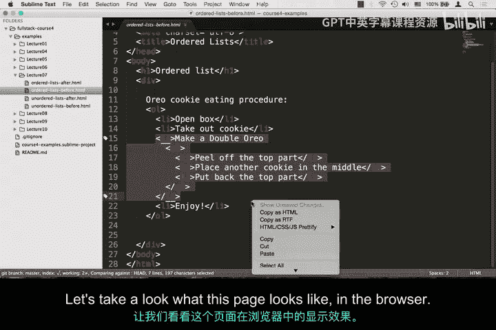

And here's our ordered list， our Oo cookie eating procedure Open box take out cookie。

 make a double Oreo has its own list， which is peel off the top part。

 place another cookie in the middle and put back the top part and a fourthho one is enjoy Wow there's so many things you're learning in this course In summary lists provide a natural and commonly used grouping for content very often lists a use for structuring navigation portions of the web page。

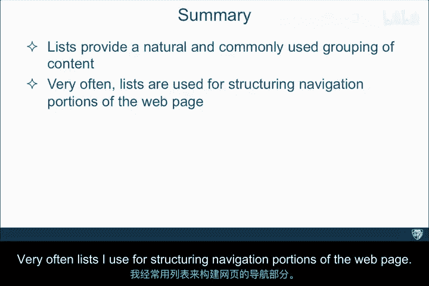

Next， we're going to talk about HTML character entity references。

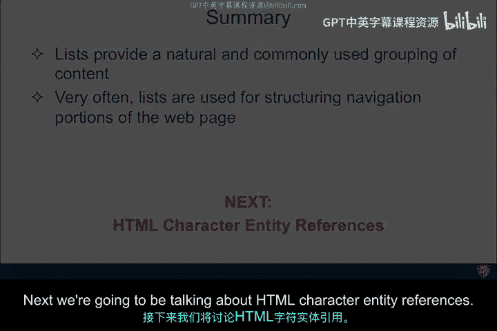