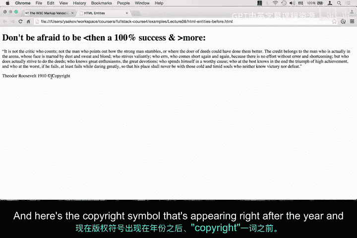
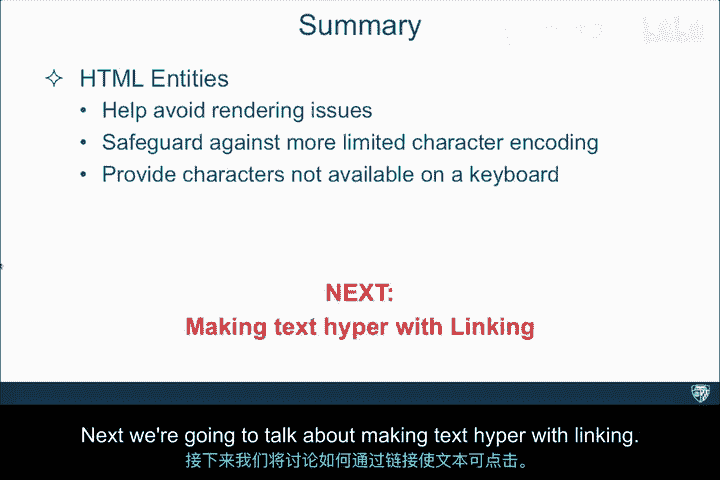
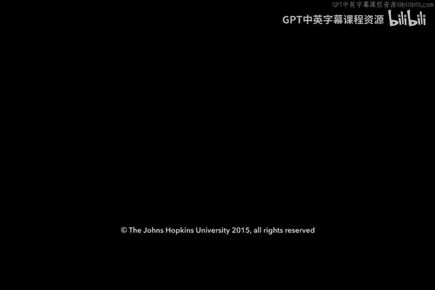

# 约翰霍普金斯大学《Web开发者的HTML, CSS, and Javascript》中英字幕 - P13：12_第8讲 HTML字符实体引用.zh_en - GPT中英字幕课程资源 - BV1WzY6z9EUd

。

There are many applications for HTML character entity references， however。

 in this lecture I will concentrate only in a particular problem that the entity of references can solve for us。

Since HTML uses certain characters for its syntax， we need a way to differentiate between those characters as HTML and those same characters as content if we want the browser to interpret special HTML characters as regular content。

 we need a way to escape them In other words we need a way to tell the browser not to interpret them as HTML。

Specifically， there are three characters that should always be escaped to make sure they don't cause rendering issues either right away or down the line。

And these characters are the following the less than character。

 the greater than character and the amperscent instead of using the less than character。

 you should use the HTML entity which is starts with Mpers and then followed by LT semicolon so if you put in your HTML M percent LT semicollon what the browser will interpret this as a less than character and similarly for the greater than character it's M percent GT semicollon and for the M percent it is。

😊，M percent AMP semicollon So let's take a look at some HTML to see this concept in action。

Okay so we're looking at a document called HTML entities before that HTML which is located in the examples lecture 08 folder and this document contains a quote from one of the US presidents Theodore Roosevelt。

 which happens to be one of my favorite quotes of his and a very weird looking heading one content。

 so we can take a look at it it says don't be afraid to be then the less thans sign then 100% success and percent greater than more and semicolon so let's take a look at what this looks like in the browser。

As you can see our heading doesn't really didn't really do so well it says don't be afraid to be more and there's a whole bunch of words missing here Well the reason this is going on is because the browser is interpreting this left angle bracket as a beginning of a tag and then it looks at the word then it doesn't quite understand what kind of a tag that is and basically skips just about everything between the left angle bracket and the right angle bracket and just says the word more so we could fix that very easily with substituting the less than angle bracket with the HTML entity reference。

And once we're at it， we might as well substitute the other two characters。

 the m percent and the greater then。We'll save the document， go reload our web page。

 and you can see the entire headinging one tag content is displayed on the screen。

In reality HTML contains a whole ton of different HTML entity references and obviously we're not going to be able to go through most of them。

 however one particularly common one is the copyright symbol and the main reason why we would use an HTML entity reference for it is because it's not really very readily found on any keyboards out there however we could very easily put that in so let's go ahead and put it right here after the year and the copyright entity reference is just1 percent copy semicoln so let's save it and reload it in our browser and here's the copyright symbol that iss appearing right after the year and before the word copyright。

There's another HTML entity reference that is very commonly used。

 and unfortunately a lot of time misused as well。Let's say， for example。

 that in the last sentence here that ends timid souls who neither know victory nor defeat。

 Let's say we wanted the word victory no defeat， never to wrap always stay the same So what do I mean by that let me pull the browser make it a little bit less wide and as you could see the word victory no defeat is split up into different lines。

 let's say I didn't want that for whatever visual reason I wanted the word victory no defeat to always stay the same so if it's going to wrap。

 it should either either not rap at all or wrap all Well the way you do that is with a non-breaking space So in the way you use it is n be S semicollon nonbreaking space removing all spacing between the words。

😊，So now let's take a look what it looks like in the browser， we'll go ahead and refresh it。

 and now you'll see that the words victory no defeat as we squeeze the browser and make it a little bit less wide。

 they will either both drop to the next line or they will stay on the sign line。

 but they will not be separated anymore。😊，But let me caution you about misuse of this entity reference A lot of people use the entityity reference if they want to make a space between let's say the word critic in the word who and they will put a few spaces。

 let's say they need a use spaces in it and if I now refresh the browser I see and now got a few spaces between the word critic in the word who and that's a total misuse of this entity reference if you ever wanted to have spaces or extra spaces between some words in a text what you would do is you would probably wrap around some text in a span tag and then apply some margin in this case left margin to the span tag to remove it further from the word critic but you should never use the non-breaking space HTML entity reference for that purpose。

Let me show you another HTML entity reference that is very commonly used and it's especially useful when somebody is trying to write an HTML based email since the email clients are notorious for using a much more limited character set than UTF8 some of the characters sometimes get messed up Let me show you what I mean Let's go to the webp page and instead of viewing this webpage in UTF8 will change the encoding to something more limited like Windows 1252。

And if you notice some of the quotes became these very weird characters。

 so how do we solve that Well， the way we could solve it is by using an HTML entity reference of quote。

😊，And if we preview this in the browser again and let's refresh the browser。

 and now there are quotes， maybe they're not the same type of curly quotes as before。

 but they're quotes nevertheless。So in summary， we looked at HTML entities and they help avoid rendering issues and especially with those three characters that HTML can try to render instead of thinking of it as content we also saw that sometimes you could safeguard with these HTML HTML entities safeguard against more limited character set incodings and you could provide characters not available in the keyboard for example。

 like we provided the character of copyright that was at the end of the document that certainly is not on any of the keyboard and I've seen。

 but you could still display that character using HTML entities。Next。

 we're going to talk about making text hyper with linking。😊。

