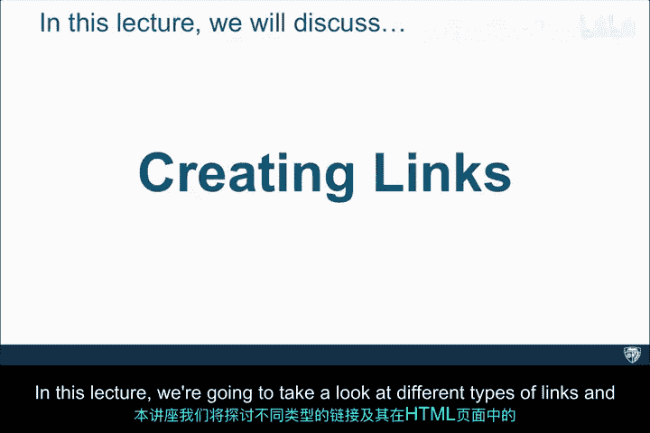
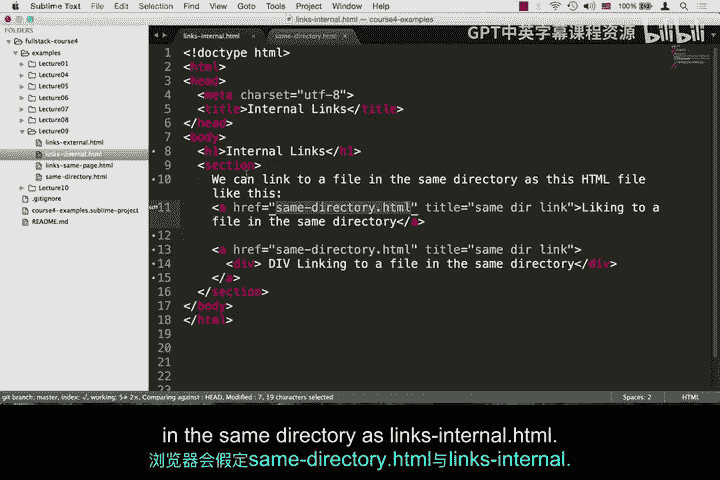
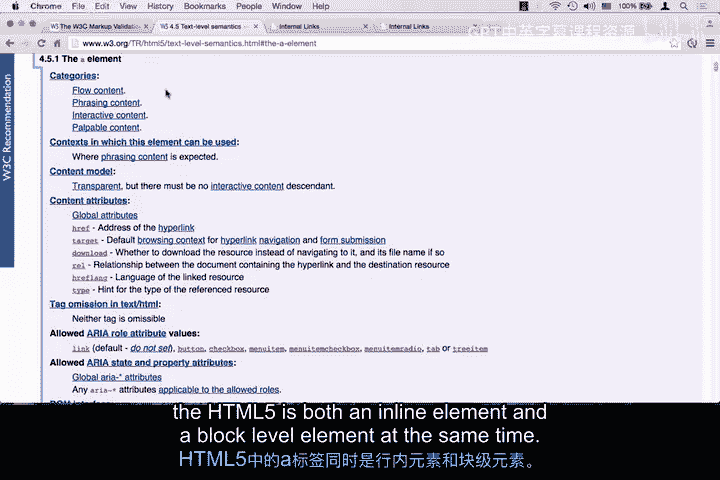
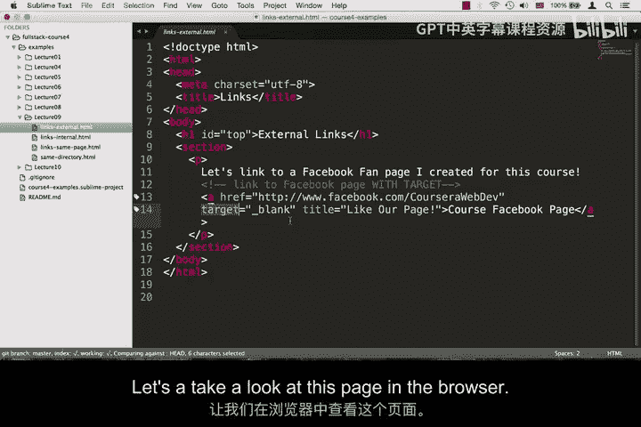
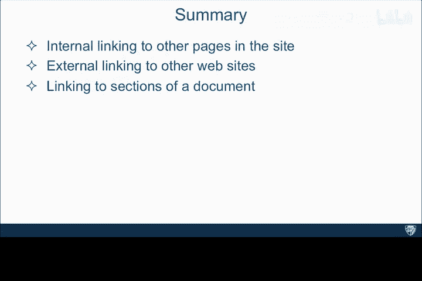
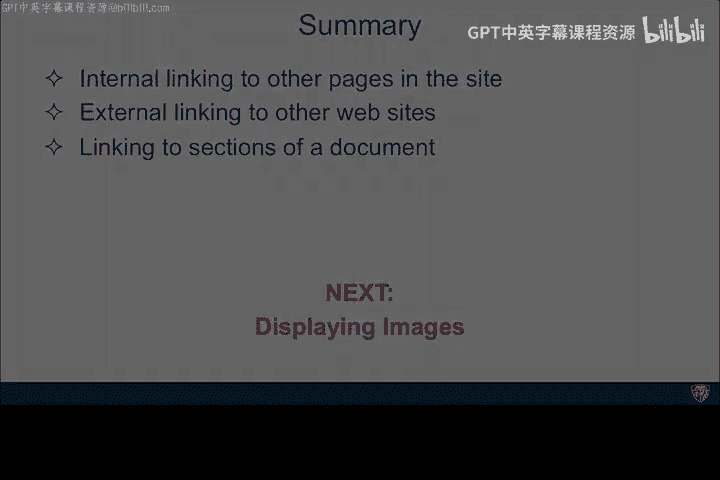

# 约翰霍普金斯大学《Web开发者的HTML, CSS, and Javascript》中英字幕 - P14：13_第9讲 创建超链接.zh_en - GPT中英字幕课程资源 - BV1WzY6z9EUd

。

Links are pretty much what makes the web what it is in this lecture we're going to take a look at different types of links and how you could create them in your HTML page。

😊。

So the first type of links that we're going to take a look at are internal links here I'm looking at the file code links internal。

 HTML and it's located in the examples lecture 09 folder and here we have a couple of links we're going to take a look at Now the way you create links is by specifying an A element with an attribute HR and HR stands for hyperpertext reference。

The value of HR can either be a relative or an absolute URL in our case here。

 since we're discussing internal links which are links that point to internal web pages of the web application。

 the links we showing are all relative URL links however we could still have an even absolute URL links as long as they point again to the same web application that we're in Since we're providing no directory information the browser will assume that same directory that HTML is a file that lives in the same directory as links internal at HTML it's also a very good idea to always specify a title attribute for the a tag the title attribute is used by the screen readers that help the visually impaired people get through the web page the content in between the opening and closing a tags is the content you are going to see in the web page when it is served and on which youre available to click to go。

To the Hf that the A tag is configured with note the second example of our a tag in this example。

 we're surrounding a div tag with our anchor tag In other words。

 this div tag is going to be the content of our link on which we're going to be able to click Let's go ahead and see what this looks like in the browser。

😊，Okay， so here's our internal links page and we have a couple of links。

 one it says linking to a file in the same directory and the other one is the diviv that's the Atag surrounding the div tag that says diviv linking to a file in the same directory and if we click that we're going to go to this same dash directly that HTML page which basically just provides a link back to our original page what's interesting to note here is that the first link linking to a file in the same directory is clearly an inline tag since it's not forcing itself to go to a new line。

But yet in the second case， div linking to a file in the same directory we're surrounding the div tag with our a tagag So what's going on here are we using a block level element。

 the div inside an inline element Well it turns out things are a little bit more interesting let's take a look at the a tag as defined in the W3C specification if you take a look closely the atag is both a flow content and a phrasing content In other words to map it back to the HTML4 days the a tagag in HTML 5 is both an inline element and a block level element at the same time and this is what allows us to take the a tag and surround a div tag inside of it the authors of the HTML5 specification realize that there are a lot of times where you would like to be able to click on a whole region and a most common occurrence of that is that when you have a logo or some sort of a company name。

😊。

In the top left corner for example， of your web page people expect to be able to click on that and be able to go to the front page of the company prior to HTML5。

 people had to use all kinds of tricks in order to achieve that effect because the ATag was only in an inline tag and you weren't really able to wrap the Atag around the div tagag。

Next， let's take a look at an example of an external link， here are in sublime text again。

 and looking at the file called links external。htm。

 which is again located in the examples lecture 09 folder。

And this document basically contains just a single link。

There's really nothing super special about external links other than their Hf value usually starts with Hp call on slash because it's usually the case that external links are hosted on a different domain name that your website。

 However， theres one feature of the a element that would like to demonstrate that is quite often used in conjunction with external links。

 and that is the target attribute。 target attribute when it's set to the value underscore blank forces the browser to open this page and a new tab or a new window。

 The reason that sounds advantageous is because nowadays， unfortunately。

 people have a very short attention span。 And if you take them from your website to a different website it is very good chance that they will never come back to your site and usually you don't want them to leave your site completely。

 So targetrg equals underscore blank is very useful。😊，In that regard。

 let's take a look at this page in the browser。

And here's the page in the browser and if we click this link Coursair Facebook page。

 it will open a new tab and we'll load the Facebook page pointed to by that link。Coincidentally。

 this is a Facebook page I created for the two courses I'm teaching on Coursera。

 which is at Facebook。com/courserawebdev， so please like this page and follow it as I'll be posting some optional but interesting and relevant material。

Another type of link that is extremely important to know about is a fragment identifier。

 so here I'm in again in sublime text in links' same page that HTML that is located in examples lecture 09 folder and as you could see the links that I have set up here all have a very specific format in their HF attribute it's a pound followed by some name like section 1 section 2 and so on。

😊，Now what these links are pointing to is a section of our page Now you can identify a section a couple of different ways you can have an any tag that has an ID with that section name notice that the section name does not contain the pound sign only the link to that section contains the pound sign that's one way to identify a section within the page Another way is if we scroll down all the way to the bottom of the page is to create an anchor tag with a name attribute and name the section very similarly to the way you name a section ID The way you refer to these sections is exactly the same you put a pound in front of the name of the section and stick that value in the HRF attribute of an anchor tag so let's take a look at this document in the browser。

😊，And here's the document， as you can see， we have six different links and if we click on any one of these links。

 it will take us to the section of the page that is marked with that particular ID。😊。

If we scroll all the way down， we even have a back to the top link which basically points to all the way to the top now the top is right here and if you look at the code and scroll all the way up。

 we have an H1 tag that has an ID with top which allows us to scroll all the way to the bottom of the page。

 see that link and jump right back to the top。What's really neat about fragment identifiers is that if if you click on one and you have them in your URL。

 you could copy and paste this URL and send it to a friend as a bookmark and when they pasted into their browser they will be taken to this page and jumped straight to the section that was pointed to by the fragment identifier now I am on my local hard drive and I'm not on a server so obviously sending this link that points to my local hard drive is not going to do any good but if we're in a server this link with the section identifier would have taken anybody anywhere with a connection to the internet to the proper page and to the proper section of that page。

While fragment identifiers are very useful in order to jump the different parts of the same page。

 recently they've become even more important as their use for navigation within the Sp or single page applications。

 and Sp single page applications have become extremely popular。

 so knowing how fragment identifiers work is an important step。

 towards being able to code single page applications。So to summarize。

 we learned about internal linking to other pages within the same site。

 external linking to other web pages and don't forget the target equals underscore blank so you could open up the external link in a separate tab and we also talked about linking to sections of a single document and being able to pass around those type of links to others that they'll be able to jump straight to the section of the document that you want them to。

Next， we're going to talk about displaying images。

