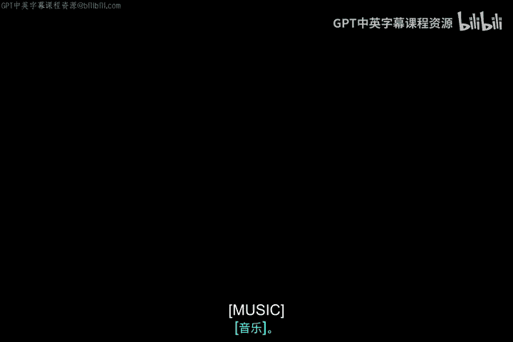
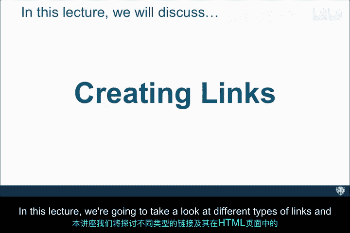
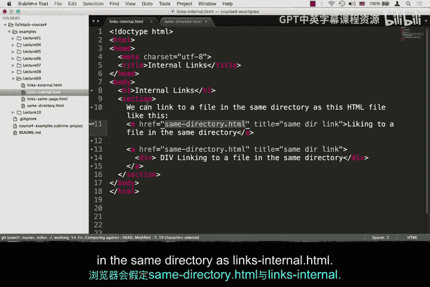
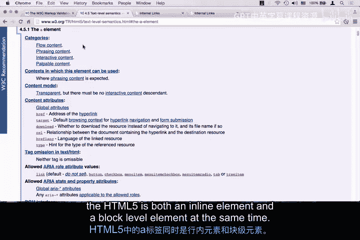
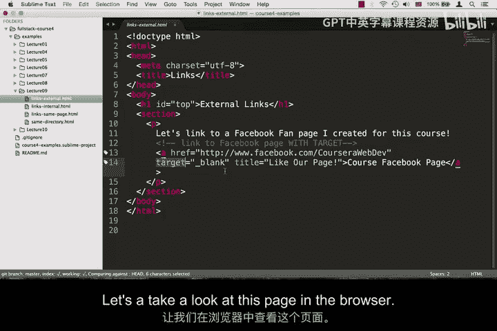
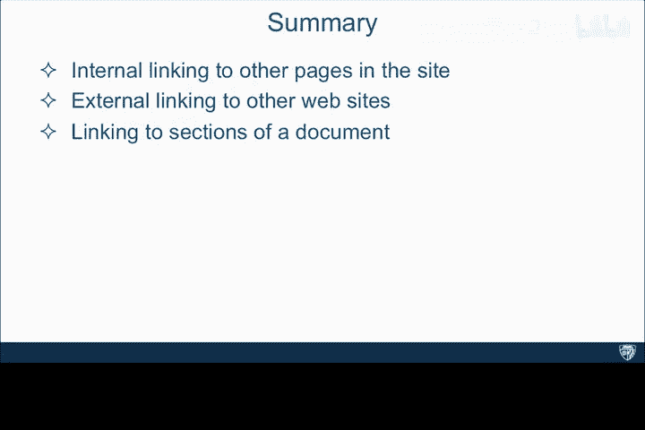
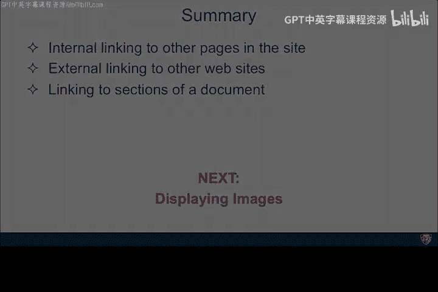

# Web开发者的HTML, CSS, and Javascript：第9讲：创建超链接 🔗

在本节课中，我们将学习超链接。超链接是构成万维网的核心元素。我们将探讨不同类型的链接，并学习如何在HTML页面中创建它们。

## 内部链接

首先，我们来看内部链接。内部链接指向同一网站或Web应用程序内的其他页面。

创建链接的方法是使用`<a>`元素，并为其设置`href`属性。`href`代表“超文本引用”。其值可以是相对URL或绝对URL。对于内部链接，我们通常使用相对URL。

以下是创建内部链接的要点：

*   `href`属性值指向目标文件。如果不提供目录信息，浏览器会假设目标文件与当前HTML文件位于同一目录。
*   始终为`<a>`标签设置`title`属性是一个好习惯。`title`属性会被屏幕阅读器使用，帮助视障用户浏览网页。
*   位于`<a>`标签开始和结束标记之间的内容是网页中显示并可点击的部分。

在HTML5中，`<a>`标签既是流内容也是短语内容。这意味着它可以同时作为内联元素和块级元素使用。因此，我们可以将`<a>`标签包裹在`
`这样的块级元素外面，从而创建一个可点击的整个区域。这在创建可点击的Logo或公司名称区域时非常有用。

## 外部链接

接下来，我们看看外部链接。外部链接指向其他网站或不同域名的页面。

外部链接的创建方式与内部链接类似。其特殊之处通常在于`href`值以`http://`或`https://`开头。

`<a>`元素有一个常用属性`target`。当`target`属性值设置为`_blank`时，浏览器会在新标签页或新窗口中打开链接页面。这有助于防止用户完全离开你的网站。

## 片段标识符

另一种极其重要的链接类型是片段标识符。它用于链接到同一页面内的特定部分。

片段标识符链接的`href`属性格式为`#`后跟一个名称，例如`#section1`。

要标识页面中的一个部分，有两种主要方法：

1.  为任何标签（如`
`、`<h2>`等）设置一个`id`属性，其值与链接中的片段名（不含`#`）相同。
2.  使用一个带有`name`属性的`<a>`标签来命名该部分。

当用户点击这样的链接时，页面会自动滚动到对应的部分。片段标识符的URL可以被复制和分享，其他人打开该URL时会直接跳转到指定的页面部分。这在单页面应用程序的导航中变得尤为重要。

## 总结

本节课我们一起学习了如何创建超链接。我们了解了三种主要类型：指向同一站点内其他页面的内部链接、指向其他网站的外部链接（可使用`target="_blank"`在新标签页打开），以及链接到同一文档特定部分的片段标识符。掌握这些链接的创建方法是构建可导航网页的基础。

接下来，我们将讨论如何显示图像。