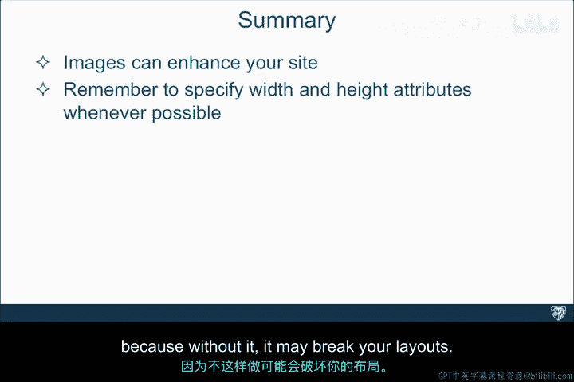
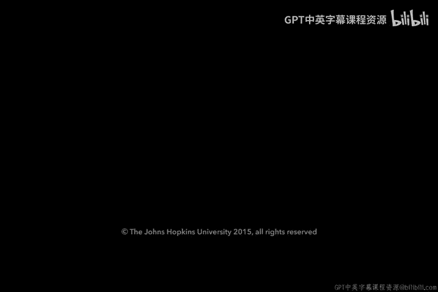

# 约翰霍普金斯大学《Web开发者的HTML, CSS, and Javascript》中英字幕 - P15：14_第10讲 图像显示.zh_en - GPT中英字幕课程资源 - BV1WzY6z9EUd

。

Perhaps nothing enhances a website better than strategically placed images。In this lecture。

 we will learn how to include images in your HTML documents。😊，Okay so we're looking at images。

htm which is located in the examples lecture10 folder and you may recognize this file from a few lectures ago where this is a famous quote from Theodore Roosevelt and by the way I apologize and made a typo before Theodore Roosevelt is spelled with an E so for you eize out there who notice that I misspell Theodore I apologize it was just a typo anyway our task here is to display an image right before the quote itself and we actually have a couple of images here and since I want to just start with one let me comment this one out and at the same time show you what an HTML comment looks like and it's pretty simple it starts with a less than bracket exclamation point dash dash and then it gets closed with a dash dash right angle bracket and what will happen when you load this page into the browser is that the browser will completely ignore this comment and will not render it。

So let's take a look at the image tag that we wanted to discuss。

The image is displayed in HTML using this IMG tag which is just short for image and the source attribute of the IMG tag is a URL that points to some image file now this URL is no different than the HRF attribute that you've seen with the regular link a tag it could be a relative URL or it could be an absolute URL even one that contains an external link next will specify the width and the height of the image while not absolutely required it's a really good idea to always specify the width and the height and I will demonstrate to you in a few minutes why that is and also the oldt tag which is used by screen readers that help people with visual impairment let's save the document and take a look at it in the browser。

As you could see this is the image that we included in our HTML The interesting part here is it appears as if it's another character within our text which should right away tell you that an IMG tag as an inline element if it weren't the image would be on its own line pushing everything behind it onto a new line next let's take a look at the other image tag and uncommented so we could use it within our page and you could see this is an external link pointing to some image on the web let's save the file and preview it in the browser again。

Let's reload it。 as you could see， we get this image of， I think ants crawling on a blade of grass。

 It's very often the case that you use images as sort of these anchors within your visual layout of your page and if this image is take time to load the page might appear jumpy So this is actually the primary reason why you would want to use the width and the height of the image you want to tell the browser to reserve the space and the visually partition your page such that it knows that there should be something going on in there。

 even if it takes time to load it。 So let's simulate what would happen to our layout if we removed the width and the height from this image let's go ahead and save it。

 go to our web page and instead of just reloading it since our internet or at least my internet is pretty fast here。

 I'm going to simulate internet being very slow and we'll see how the fact that this paragraph and this paragraph is visually separated。

😊，by this image is not necessarily going to happen right away and we'll see some jumping well the way we're going to accomplish that is by bringing up the Chrome developer tools and I'm on the Mac so I'm going to press option command I and if you're in Windows I believe it's control option or control alt I。

😊，And I'm going to go to the network tab and if you notice here there is a throttling setting here and it says no throtdling what I'm going to change that to the lowest possible setting and now I'm going to go ahead and reload the page and watch what happens in terms of this space between the Theodore Roosevelt and the actual quote so let's go ahead and reload the page。

😊，And notice how it jumped。 The first there was Theodore Roosevelt was right next to the quote。

 and then once the image loaded， it jumped in。 And the reason that happened was is because the browser did not upfront know how large the image was going be even worse if you're relying on the image to give some sort of a visual layout to your page。

 And for some reason the image did not load。 for example， the URL could be broken。

 So let me go ahead and break it just by removing a couple of letters from the URL。

 And if URL is broken， this is what you're going to get。

 if you don't specify the width and the height of the image。

 Let's go back to our page and let's click reload and there we go。

 if we relied on a specific amount of space between。😊，The quote and the footer of this page。

 while we can no longer see that space since the image did not load。 however。

 if we go back and undo this and still break the URL。

 yet specifying the width and the height of the image， let's go back and reload the page。

You'll see that even though the image is not loading。

 the visual spacing and the visual layout remains correct as we intended it to be。So to summarize。

 images can truly enhance your website， especially if you use them correctly。

 and remember to always specify width and height of the image tag whenever possible。

 because without it， it may break your layouts。

