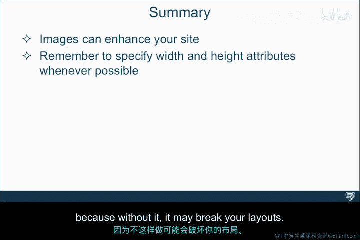
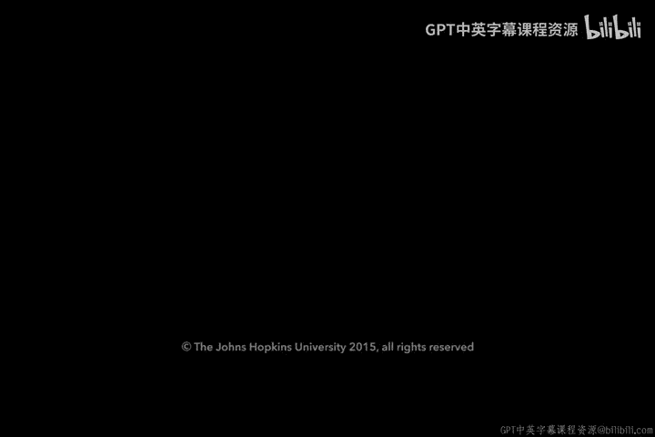

# HTML, CSS, and Javascript for Web Developers：P15：第10讲 图像显示


## 🖼️ 概述

在本节课中，我们将学习如何在HTML文档中插入图像。图像是增强网站视觉效果的关键元素，我们将了解其基本语法、属性以及最佳实践。

## 📝 图像基础语法

上一节我们介绍了课程概述，本节中我们来看看如何在HTML中使用图像标签。

图像在HTML中通过``标签显示。该标签使用`src`属性来指定图像文件的URL。这个URL可以是相对路径，也可以是包含外部链接的绝对路径，这与之前学过的`<a>`标签的`href`属性类似。

以下是``标签的基本结构：

```html

```

## 🔧 图像标签属性详解

了解了基础语法后，我们进一步探讨``标签的几个重要属性。

*   **`src`**：这是必需的属性，用于指定图像资源的路径。
*   **`width` 与 `height`**：这两个属性用于定义图像的显示尺寸。虽然技术上不是必需的，但强烈建议始终指定它们。
*   **`alt`**：此属性为图像提供替代文本。它对于辅助技术（如屏幕阅读器）至关重要，能帮助视觉障碍用户理解图像内容，同时在图像无法加载时也会显示。

## 🧪 实践：在页面中添加图像

现在，让我们通过一个例子来实践。我们有一个包含西奥多·罗斯福名言的HTML页面，任务是在引文前添加一张图片。

首先，我们使用一张本地图片：

```html

```

保存文档并在浏览器中查看，可以看到图像像文本中的一个字符一样显示在引文旁边。这直观地表明``标签是一个**行内元素**。

接下来，我们尝试使用一张来自网络的外部图片：

```html

```

## ⚠️ 指定宽高的重要性

在网页视觉布局中，图像常作为锚点。如果图像加载缓慢，页面可能会因为不知道预留多少空间而出现跳动。

以下是未指定图像宽高时可能引发的问题：

1.  **布局跳动**：浏览器在图像加载完成前不知道其尺寸，导致内容重排。
2.  **布局失效**：如果图像因链接失效而无法加载，为其预留的视觉空间将消失，破坏页面布局。

我们可以通过浏览器开发者工具模拟慢速网络来观察第一种情况。即使图像未加载，只要指定了`width`和`height`，浏览器也会预留出相应的空间，保持布局稳定。

```html
<!-- 即使此图片链接失效，布局空间仍会保留 -->

```

## 📚 总结

本节课中我们一起学习了如何在HTML中使用图像。

*   图像通过``标签插入，其`src`属性指向图片资源。
*   `width`和`height`属性对于维持稳定的页面布局至关重要，应尽可能指定。
*   `alt`属性提供了必要的文本描述，兼顾了可访问性和用户体验。





正确使用图像可以极大地提升网站质量，而遵循上述最佳实践能确保你的页面在各种情况下都能保持良好的结构和外观。