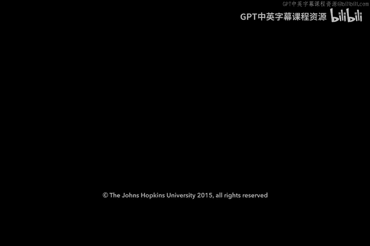

# 约翰霍普金斯大学《Web开发者的HTML, CSS, and Javascript》中英字幕 - P16：15_模块1总结.zh_en - GPT中英字幕课程资源 - BV1WzY6z9EUd

You've completed module1 Good work。 Keep going to moduleule2 Moule 3 is when we start coding a real website for a real client。

 but to get the most fun out of it， we need the foundation of module1 and2 so keep going it will be fun I promise Oh and if you want to give us a five star rating already Who am I to stop you。

