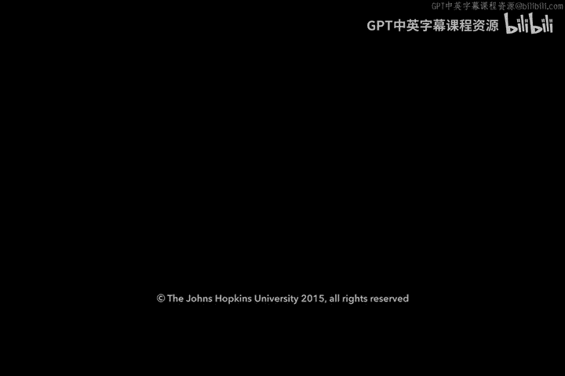

# Web开发者的HTML, CSS, and Javascript：P16：模块1总结 🎉

在本节课中，我们将对模块1的学习内容进行回顾与总结，并展望后续的学习路径。

## 概述

你已经完成了模块1的学习，做得很好。模块1为我们后续的编程实践奠定了重要的基础。接下来，我们将继续进入模块2的学习，而模块3则会开始为一个真实的客户编写一个真实的网站。为了从中获得最大的乐趣，我们需要模块1和模块2的基础知识作为支撑。请继续前进，我保证这会很有趣。

## 学习回顾与展望

上一节我们完成了模块1所有知识点的学习，本节中我们来总结一下收获并了解接下来的学习安排。

以下是模块1的核心要点回顾：

*   我们学习了Web开发的基本概念与工作流程。
*   我们掌握了HTML的基本结构、常用标签及其语义。
*   我们初步接触了CSS，了解了如何为HTML元素添加样式。

掌握了这些基础知识后，我们便为后续更深入的学习做好了准备。

## 后续学习路径

现在，你已经准备好进入下一个阶段。

以下是接下来的学习模块：

*   **模块2**：我们将深入学习CSS的布局、选择器以及响应式设计等核心概念，例如使用 `flexbox` 或 `grid` 进行页面布局。
*   **模块3**：我们将综合运用HTML、CSS和JavaScript，开始动手为一个真实的客户构建一个功能完整的网站。

请保持学习的劲头，一步步扎实前进。

## 总结

本节课中我们一起学习了模块1的总结。我们回顾了HTML与CSS的基础，并明确了模块2和模块3的学习目标。持续学习是掌握Web开发的关键，每一步积累都至关重要。

如果你已经想给我们一个五星好评，我怎么会阻止你呢？继续加油吧！