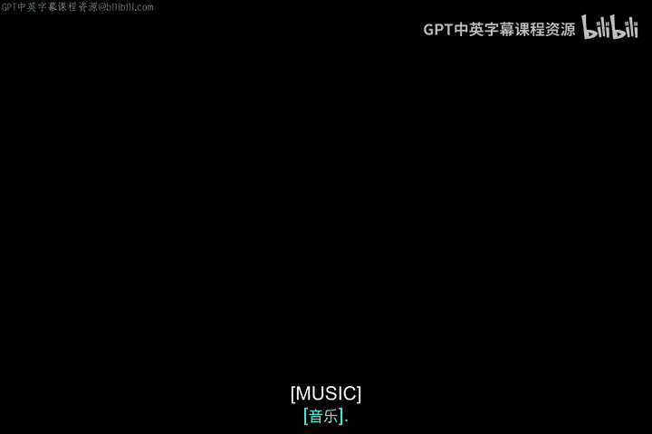
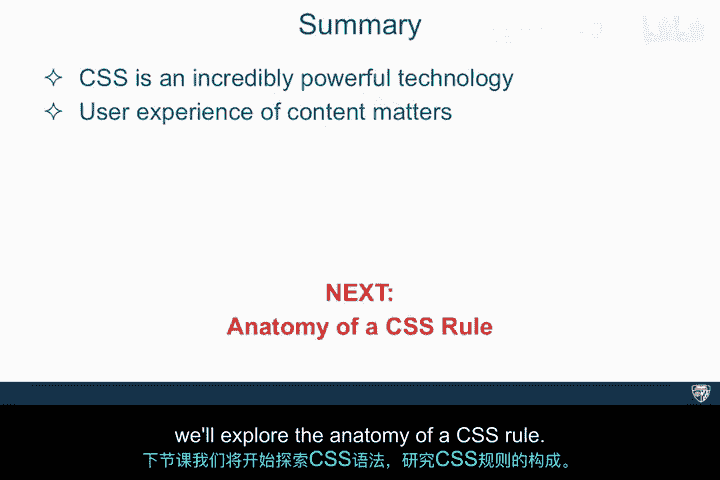

# 约翰霍普金斯大学《Web开发者的HTML, CSS, and Javascript》中英字幕 - P17：0_第11讲 CSS的强大功能.zh_en - GPT中英字幕课程资源 - BV1WzY6z9EUd

。

I mentioned before that on the web content is king。 It's all about content。

 and we spoke about the fact that HTML defines the structure of that content。

 So if all you wanted was raw content， you could take your HTML files。

 upload them to a server and you're done。 however， that would be a huge mistake because while content is king。

 how users absorb and relate to that content largely depends on our experience of consuming the presentation of it if there was a lot of noise around me it could barely hear me the content of the course would be the same but the experience consuming the presentation of that content would be quite different to use the house analogy。

 nobody likes to live in a house without nicely painted drywall covering inulation and support beings it's the difference between feeling sheltered from outside elements and feeling at home。

😊，The point I'm trying to make is when it comes to a real worldorld website structure alone is just not enough。

 it's not good enough to just leave a scaffold in a server site framework provided out of the box to see the data you need to style your content in a way that's pleasing and useful to the user the use of color。

 positioning， size among other things is all part of that。

Cascading style sheets or CSS is the technology that provides the styling capability CSS is an incredibly powerful technology。

 It can take the same HTML structure and present it in such drastically different ways that you would never even guess that out underlying structure of the content are exactly the same ones let me show you a website that doesn't only illustrate this point but should also amaze you quite a bit as well。

😊，So the website I wanted to show you is csZengarden。

com and the idea of this website is simple designers and web developers from all over the world get to submit their own designs for the website csZgarden。

com so they get to redesign the website itself CSsgar。

com there's only one catch they cannot change any of the HTML the HTML stays exactly the same and the CSS file or files is what they provide so the only thing they change is the styling they don't change the structure or the content of the HTML at all in any shape of form so the website then goes ahead and showcases designs on CSsZengarden。

com and they have over 200 designs submitted now and hosted on this website so what I want to do is just to give you an appreciation or what styling can do to a website to the same content to the same。

😊，Htl structure is to demo and just basically showcase a couple of these designs to you so what I did was I preoped a few of them in a few tabs in my browser and I want to show you so this is the same website this is the website you're looking at it's the HTML and custom CSS for this particular for this particular looks so let me just scroll up and down to show you what that looks like。

😊，And let's go to。This one， so this is again the exact same website。

 the only difference is the CSS styling that got applied to it。This is the same website again。

With different CSS styling applied to it now granted。

 the designers are also able to apply their imagery as well， but the layout。

 the styling is so drastically different than from the original one。And there's again。

 over 200 different websites or different styles， different designers that submit a different style。

 so you could certainly go take a look。And this one is very creative。

 it's actually made in a form of a comic book or comic and the text is real。

 it's selectable so this is still the same exact HTML and this one probably will blow you away look at this it's so cool there's actually animations going on it's all done with CSS and again it's exactly the same HTML structure and exactly the same content you just see different styles applied to them。

Is this need or what。So the point of the short lecture was that CSS is an incredibly powerful technology that can not only style your content。

 but also create a particular user experience that you would want your users to have。😊。

And the second point was that user experience over your content matters right remember the difference between listening to something that you could barely hear and listening to something that you actually enjoy I can understand so user experience of content matters so let's left is to figure out how to write CSS code so next we'll start exploring the syntax of CSS and we'll explore the anatomy of a CSS rule。

😊。

