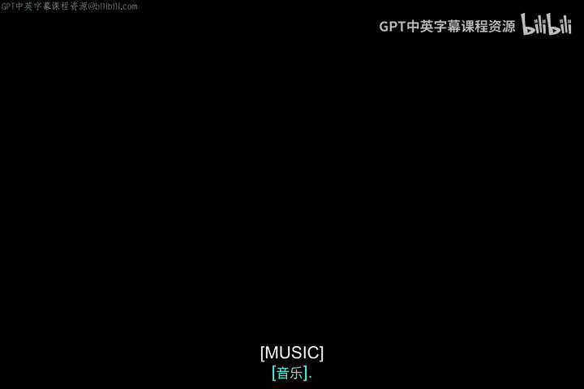
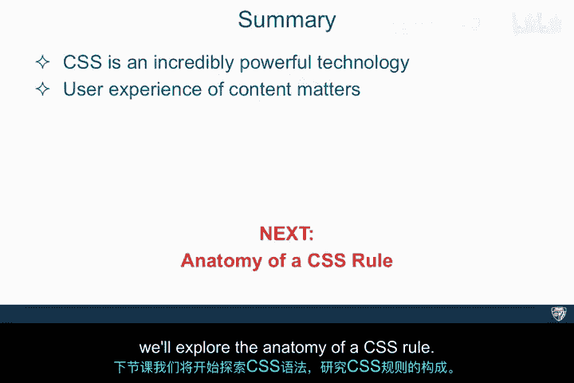
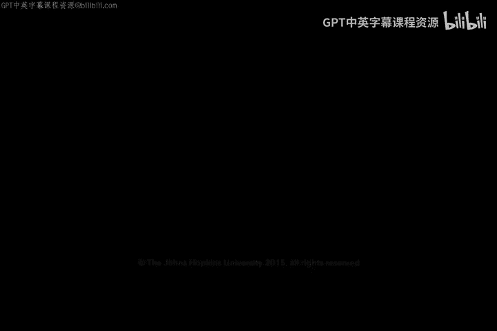

# Web开发者的HTML, CSS, and Javascript：P17：CSS的强大功能

在本节课中，我们将要学习CSS（层叠样式表）技术的重要性。我们将探讨为何仅靠HTML结构不足以构建出色的网站，以及CSS如何通过改变内容的视觉呈现来极大地影响用户体验。

---

我之前提到过，在网络上，内容是王道。一切都关乎内容。

我们讨论过HTML定义了该内容的结构。

如果你只想要原始内容，你可以获取你的HTML文件，将它们上传到服务器，然后就完成了。然而，这将是一个巨大的错误，因为虽然内容是王道，但用户如何吸收和理解该内容，很大程度上取决于我们消费其呈现方式的体验。如果我周围有很多噪音，你可能几乎听不到我，课程的内容是相同的，但消费该内容呈现方式的体验将大不相同。

用房子来类比，没有人喜欢住在没有漂亮粉刷的石膏板、绝缘层和支撑梁的房子里。这就像是感觉只是躲避外部元素和感觉像在家里的区别。

我想说明的观点是，在现实世界的网站中，仅有结构是远远不够的。

仅仅在服务器上留下一个框架，提供一个开箱即用的网站框架来展示数据是不够的。你需要以对用户来说既美观又有用的方式来设计你的内容。颜色的使用、定位、大小以及其他方面都是其中的一部分。

层叠样式表（CSS）是提供样式化能力的技术。CSS是一种极其强大的技术。

它可以采用相同的HTML结构，并以如此截然不同的方式呈现，以至于你甚至猜不到其底层内容结构是完全相同的。让我向你展示一个网站，它不仅说明了这一点，而且应该也会让你感到相当惊讶。

我想向你展示的网站是CSS Zen Garden。这个网站的理念很简单：来自世界各地的设计师和Web开发人员可以为网站CSS Zen Garden提交他们自己的设计。他们可以重新设计网站本身。只有一个限制：他们不能更改任何HTML。HTML保持完全不变，他们提供的是CSS文件。所以他们唯一改变的是样式，他们完全不改变HTML的结构或内容。

然后，该网站会在CSS Zen Garden上展示这些设计。目前他们已经收到了超过200个设计，并托管在这个网站上。所以我想做的就是让你体会一下，样式化能对同一个网站、相同的内容、相同的HTML结构做些什么。我将演示并展示其中的几个设计。

我预先在浏览器中打开了几个标签页，我想展示给你看。这是同一个网站，你正在看的这个网站，是应用了特定外观的HTML和自定义CSS。让我上下滚动一下，展示它的样子。

让我们看看这个。这又是完全相同的网站，唯一的区别是应用了不同的CSS样式。

这又是同一个网站，应用了不同的CSS样式。当然，设计师也能够应用他们自己的图像，但布局、样式与原始版本相比是如此截然不同。

同样，这里有超过200个不同的网站、不同的样式、不同的设计师提交的不同风格，你当然可以去看看。

这个非常有创意，实际上是以漫画书的形式制作的，文字是真实的，可以选中，所以这仍然是完全相同的HTML。

这个可能会让你大吃一惊。看这个，太酷了，实际上有动画效果，这全部是用CSS完成的。再次强调，这是完全相同的HTML结构和完全相同的内容，你只是看到了应用在它们上面的不同样式。

这难道不酷吗？

所以，这节简短讲座的重点是，CSS是一种极其强大的技术，它不仅可以为你的内容添加样式，还可以创造你希望用户拥有的特定用户体验。

第二点是，内容之上的用户体验很重要。记住，听一些几乎听不清的东西和听一些你真正能理解并享受的东西之间的区别。所以，内容的用户体验很重要。

剩下的就是弄清楚如何编写CSS代码。接下来，我们将开始探索CSS的语法，并研究CSS规则的构成。

---

本节课中，我们一起学习了CSS在Web开发中的核心作用。我们了解到，HTML提供了内容的结构，而CSS则负责内容的视觉呈现和用户体验。通过CSS Zen Garden的例子，我们看到了相同的HTML结构如何通过不同的CSS样式呈现出完全不同的视觉效果，这充分证明了CSS的强大能力。最后，我们明确了下一步将开始学习CSS的具体语法和规则构成。