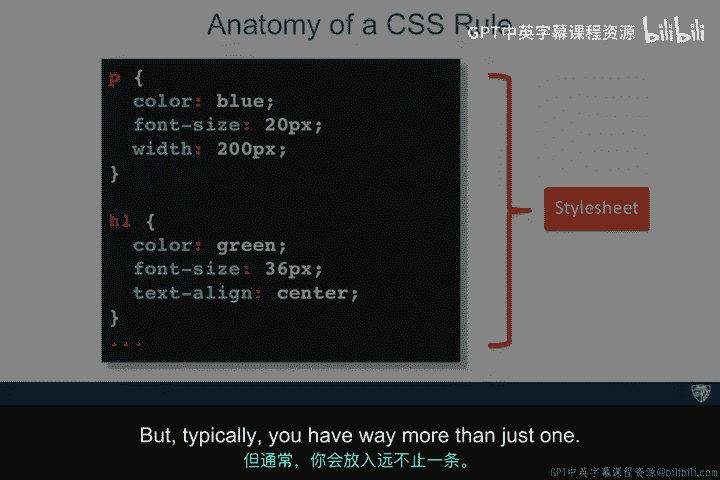
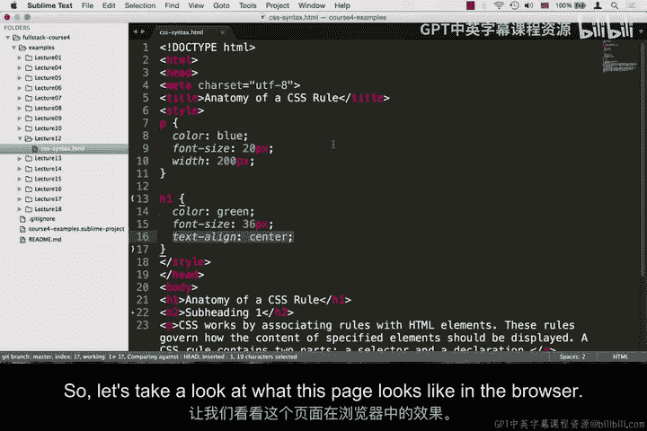
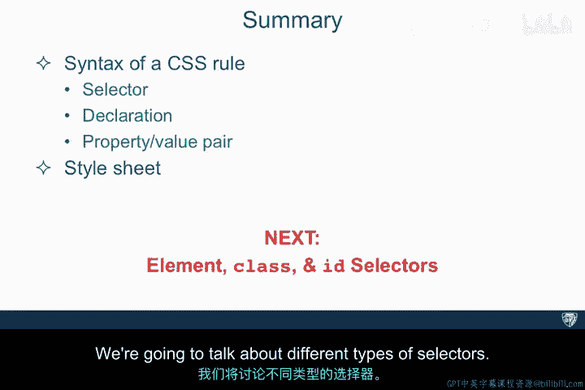
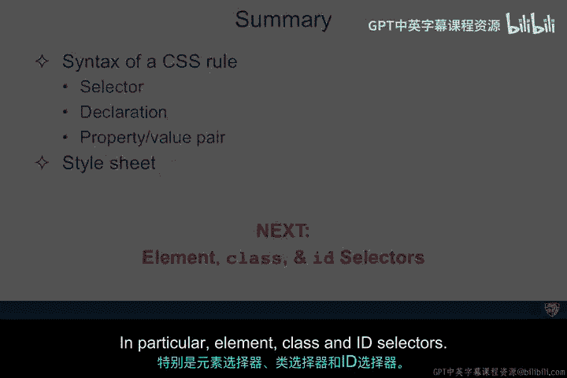

# 约翰霍普金斯大学《Web开发者的HTML, CSS, and Javascript》中英字幕 - P18：1_第12讲 CSS规则结构解析.zh_en - GPT中英字幕课程资源 - BV1WzY6z9EUd

。

CSS works by associating rules with HTML elements， these rules govern how the content of specified elements should be displayed and while styling an entire web page could be a pretty complex process。

 defining a simple CSS rule is fairly straightforward so let's go over that。

A CSS rule consists of a selector in this case it's a P the paragraph tag。

 which is basically saying that whatever rules I'm about to give should apply to the content of every single paragraph tag in the entire HTML page the selector is followed by open andclo curly braces inside those braces we have the CSS declaration。

 and it consists of two parts the property and the value property name is something that's predefined by a CSS specification and for every property there is a set number of predefined values。

 or in case of numerical values set number of type of numerical values that is pre fine now every property in the value is separated by a colon and is terminated by a semicolon not technically speaking a semiconlon is not a requirement but it's a best practice and should always always use it。

Now as I told you， a CSS rule can consist of several declaration， for example， in this case。

 we are specifying that the contents of the paragraph tags in our HTML page should have a particular color。

 a particular font size， and also be a particular width， meaning the paragraph itself。

 the content should take up 200 pixels。Now the collection of these CSS rules is what's called a style sheet now technically speaking。

 you don't have to have anything in the style sheet to be called a style sheet an empty style sheet it technically is a style sheet as well。

 but it's just not very useful one， so obviously you would probably have at least one CSS rule in there。

 but typically you have way more than just one。

Okay， here I am in sublime text and I'm looking at a file called CSs syntax。html。

 and it's located in the examples lecture 12 folder。

Let me give you a quick rundown of the structure of the HTML that we have So in this HTML document we have a heading H1。

 a couple of H2s and a couple of paragraphs in between signified by the P paragraph tag and what we want to do is give these elements some custom styling so I'm going to place the styling our style sheet straight in the head section of our HTML document Now in later lecture we'll talk about where CSS styles should really go for a real worldorld website but for now for convenience sake we'll just put it straight in the head part of the document So here we see a paragraph tag that's being targeted and we're going change its color to blue font size to 20 and with 200 which means it will contain an area of the screen that's 200 pixels wide our heading one tag H1 we're going give it a color of green we'll bump up its font size a little bit and we'll also tell it to align itself in the middle of the screen so let's take a look at what。

😊。

This page looks like in the browser。As you can see our H1 tag is in the middle of the screen and it's green and the two paragraphs that we have are blue and only take up around 200 pixels and already right away you could see the power of CSS will only specified the paragraph tag once and yet every paragraph in the document is style exactly the same so it affords us consistency and also efficiency in writing CSS code Now I do want to point out one quick but important thing if you take a look at this subheading one and then subheading 2 you can see that it is bold and it's a little bit bigger than the regular text would be Now where did that style come from I certainly never specified what kind of styling to apply to essentially what is an H2 tag Well that styling came from the browser itself Every browser comes with some default styles that it applies to different HTML elements and H1 H2 and so on and different other elements。

Very commonly styled by the browser itself so a lot of times it's your job to really reset or overwride these styles and put the styles in that you would like your webage to have So to summarize women over the syntax of a CSS rule who talked about the selector part declaration part and the property value pair we' also talked about combining the CSS rules into one to create a style sheet next we're going to zero in on one part of the CSS rule declaration and that is the selector we're going to talk about different types of selectors in particular element class and IDD selectors。

😊。

