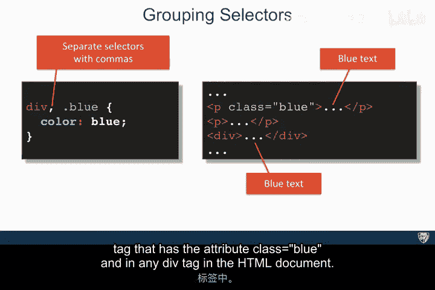
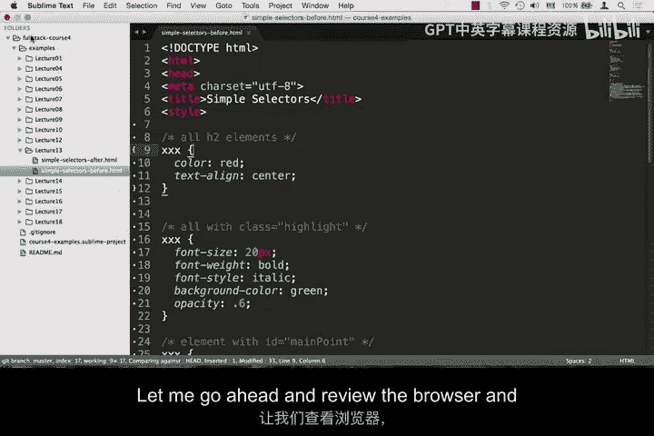
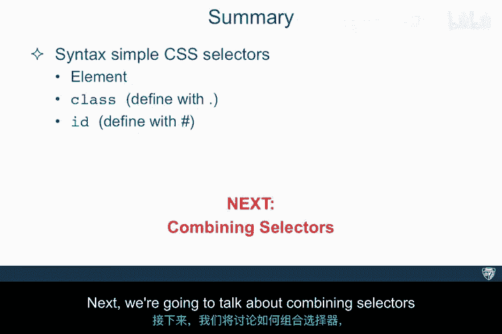
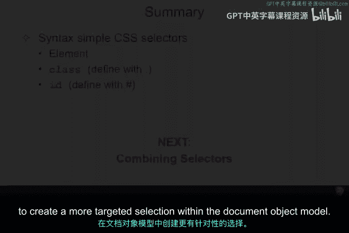

# 约翰霍普金斯大学《Web开发者的HTML, CSS, and Javascript》中英字幕 - P19：2_第13讲 元素、类与ID选择器.zh_en - GPT中英字幕课程资源 - BV1WzY6z9EUd

。

CSS selectors are used to determine which HTML element or set of elements to apply the CSS declarations to the browser uses its selector API to traverse the DOm or document object model and pick out the elements matching the selector now crafting a selector is a great skill to have and not only for styling using CSS。

That's because a lot of JavaScript libraries out there use the browser selector API to attach behavior and data to HTML elements much in the same way that CSS applies style to those elements in this lecture we're going to talk about three different types of selectors。

 element class and ID selector。First the element selector。

 the element selector is just you specifying the element name， for example， in this case。

 P for paragraph says that every paragraph in our HTML document should be colored blue。As an example。

 if we specified P paragraph and color blue， that means every paragraph in the HTML document will have its content text be blue。

 obviously this doesn't really affect any other elements that contain text in them。

 for example we can have a development that contains text。

 but that text will not be affected by our CSS rule that specifies that the paragraph tag should have content text colored blue。

Next is the class selector and the class selector is specified with a dot and the name of the class。

 in this case again， we're creating a blue class， a blue CSS class that will color whatever targets with the color blue。

The class selector does require a little bit of a change to your HTML document in that each element that you want that class applied to has to have a attribute class equal to the class name so in this case we have a P the paragraph tag and the div tag both have the attribute class equals blue and therefore their content or their text content will be colored blue notice that a different paragraph that is not marked with attribute class equals blue is completely unaffected by this note the difference in between the way you define a class and in the way you use the class you define the class always with the dot in front of the name that cannot be any space between the dot and the name of the class in case no space between the dot and the word blue however when you use the class you don't use the dot in its name you just use this name so here we have the paragraph tag with class equals blue without the dot in front of it。

😊，The last type of selector we're going to take a look at in this lecture is the ID selector the way specifying an ID selector is by specifying the value of an ID of an element within your HTML document preceded by a pound sign so the name is a value of some ID within our HTML document so for example if you have a div with ID equals name and then you specify your CSS rule with a selector pound sign name the CSS declarations for that pound sign name will apply to the content of the development with its ID value name note that obviously everything else in the HTML document is completely unaffected by this Similarlyly in the way you define a class selector versus user class selector the ID selector is defined with a pound sign followed by the value of an ID within your HTML document and again you cannot have any space between the two but when you use it the pound goes away it's just the actual value of the。

😊，INow in order to write more efficient rules， CSS allows us to group several selectors into one CSS rule here we have two selectors grouped togetherDiv and the selector div for the development in the selector class blue grouped into one since they both share the same CSS declaration and you could see in our HTML the blue color text will appear in the paragraph tag that has the attribute class equals to blue and in any di tag in the HTML document so let's take a look at an example of using these selectors。

Okay so here I am in sublime text and I'm looking at the file simple selectors before that HTML and it's located in the examples lecture 13 folder。

 let me go ahead and reveal the browser and we'll even close the sidebar so we could see the browser and the code at the same time so let's scroll down and take a look at what our HTML structure is like so if you take a look at the left side of the screen which is the sublime text in the right side of the screen you could see that we have the H1 tag right here which is this heading we have a couple of H2 headings which are called subheading1 subheading 2 we view paragraphs a couple of those paragraphs have a class attribute set to highlight and the last thing here in the page we have a div that has a span inside of it with an ID attribute equal main point so let's go ahead and scroll up and take a look as to what we'd like to do here so first of all want all H2 element。

To be color red and align in the center So in order to do that。

 we have to substitute these Xxx with some sort of selector well this is very easy。

 that's just the H2 element selector that's all it is so once we do that and we save it and refresh our browser。

 we could see that both H2 headings became red and centered。

Next we want to affect every single element that has an attribute whose class is equal highlight Well in order to do that we have to define the highlight class and so what we're going to do here is apply a bigger font size we'll make it bold italic the background of the entire element should turn green and also we're going to turn that passage down a little bit from one one would be 100% and 0。

6 is 60% so we define a class selector is by saying dot highlight and here's our class selector notice there is no space between the dot and the highlight so if we go ahead and refresh so we have two paragraphs here that had their styles affected by that and that is because if you scroll down we have a couple of paragraphs both with class equals highlight。

😊，Next， let's see we need to have the element with ID equal main point so the way we specify an ID selector is by saying pound sign and the name of the ID which is main point and the upper and lowercase letters here do matter and again there is no space between the pound sign and the word main point so if we go ahead come over here and refresh we could see that the span that surrounded the words ID equals main point became red and it became a little bit of a bigger font size and theac is turned down and the font is bold last we wanted to take all elements that are P and element H1 and we want to group their style such that we don't have to specify them separately so the way we do that is very simply by saying P comma H1 so we grouped the styles for the P element and the H1 element into1 so every P element now and every H1 element should now turn its color to blue。

And Allance center。So we'm going to go ahead and save this document to refresh the browser。

And here we go every P element and every H1 which there's only one here turned blue and aligned in the center。

 So one thing to notice here is that out of all the selectors， the element selector。

 the class selector and the ID selector the ID is the least reusable one and that makes sense right since by HTML rules a particular ID attribute value can only appear once in document。

 So for example， the span with ID attribute equals to main point。

 I can't really reuse the value main point as an ID for any other element in this HTML document。

So as you plan your styles， it's good to keep this in mind and not basically rely on assigning IDs to every single element in the entire HTML document。

 because that way your CSS will not be very efficient。

 you have to write specific rules for every element and you won't really be able to generalize and reuse your CSS styles very easily。

😊，In summary， we spoke about the syntax of simple ACSS selectors。

 we spoke about the element selector， the class selector that you remember to define with a dot right in front of the name without the space and the ID selector that you define with a pound sign right before the value of the ID and HTML page again without the space in between Next we're going to talk about combining selectors to create a more targeted selection within the document object model。

