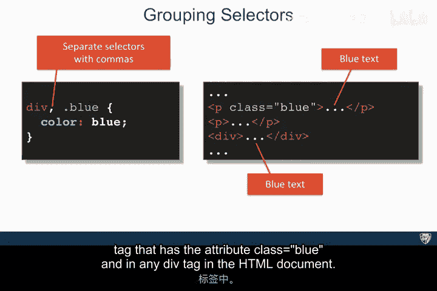
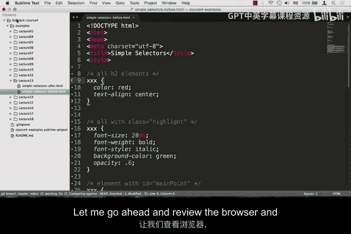
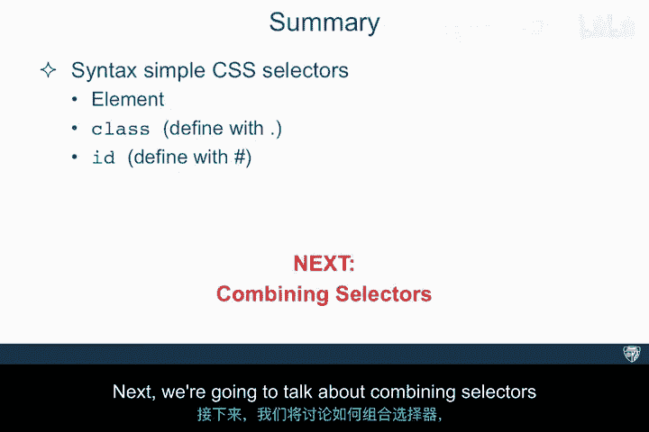
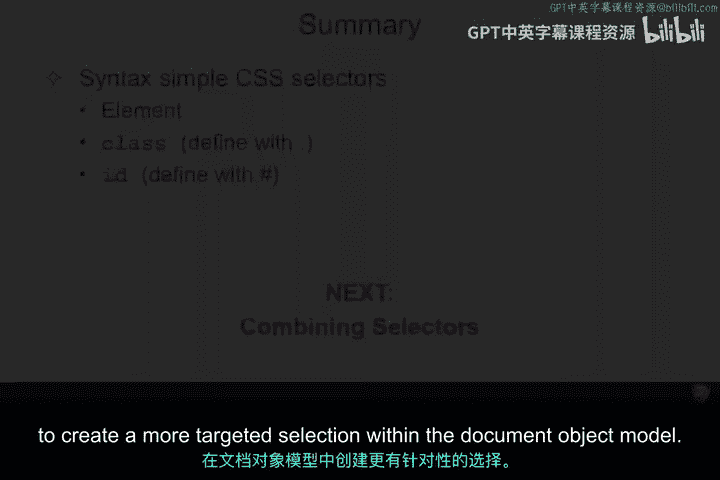

# Web开发者的HTML, CSS, and Javascript：P19：2_第13讲 元素、类与ID选择器

## 概述
在本节课中，我们将要学习CSS选择器的三种基本类型：元素选择器、类选择器和ID选择器。我们将了解它们各自的语法、用途以及如何在实际的HTML文档中应用它们来精确地控制样式。

---

## 元素选择器
元素选择器是最基础的选择器，它通过HTML元素的标签名来选取元素。

**语法**：`element { property: value; }`

例如，规则 `p { color: blue; }` 意味着文档中所有的段落（`
`标签）文本都将显示为蓝色。这个规则不会影响其他包含文本的元素，例如`
`标签。

---

## 类选择器
上一节我们介绍了元素选择器，本节中我们来看看类选择器。类选择器允许你为具有相同`class`属性值的多个元素定义样式，提供了更高的复用性。

**语法**：`.classname { property: value; }`

以下是使用类选择器的关键步骤：
1.  在CSS中，使用一个点号（`.`）后跟类名来定义样式规则。
2.  在HTML中，为需要应用该样式的元素添加 `class="classname"` 属性。

例如，CSS规则 `.highlight { background-color: yellow; }` 将应用于所有 `class="highlight"` 的HTML元素。

**注意**：定义类时，点号和类名之间不能有空格。在HTML中使用时，只需写出类名本身，不需要加点号。

---

## ID选择器
我们已经了解了可以复用的类选择器，现在来学习ID选择器。ID选择器用于选取具有特定`id`属性值的**唯一**元素。

**语法**：`#idvalue { property: value; }`

以下是使用ID选择器的关键步骤：
1.  在CSS中，使用一个井号（`#`）后跟ID值来定义样式规则。
2.  在HTML中，为需要应用该样式的元素添加 `id="idvalue"` 属性。

例如，CSS规则 `#main-point { font-weight: bold; }` 将仅应用于 `id="main-point"` 的那个HTML元素。

**注意**：根据HTML规范，一个ID值在整个文档中只能出现一次。因此，ID选择器的可复用性最低，通常用于选取特定的单个元素。

---

## 选择器分组
为了编写更高效的CSS，我们可以将多个共享相同样式声明的选择器分组在一起。

**语法**：`selector1, selector2, selector3 { property: value; }`

例如，规则 `h1, p, .intro { color: gray; }` 会将所有`<h1>`、所有`
`以及所有类名为`intro`的元素的文本颜色设置为灰色。

---

## 总结
本节课中我们一起学习了CSS的三种基本选择器：
*   **元素选择器**：通过标签名选取元素，例如 `p`。
*   **类选择器**：通过类名选取元素，定义时使用 `.classname`，具有高复用性。
*   **ID选择器**：通过ID值选取唯一元素，定义时使用 `#idvalue`，复用性最低。

我们还学习了如何通过逗号分隔来**分组选择器**，以提高代码效率。记住，在定义类和ID选择器时，点号或井号与名称之间不能有空格。合理地使用这些选择器是构建样式表的基础。在接下来的课程中，我们将学习如何组合这些选择器，以实现更精确的目标元素选取。