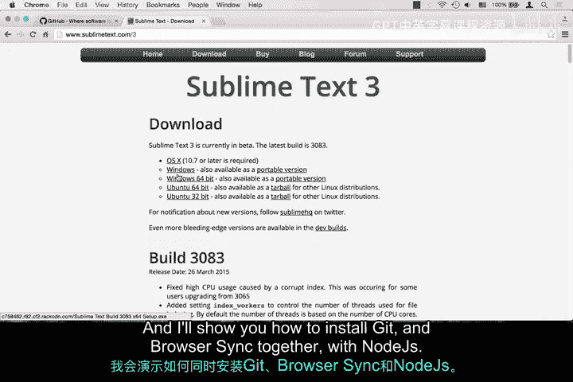

# 约翰霍普金斯大学《Web开发者的HTML, CSS, and Javascript》中英字幕 - P1：0_开发环境配置 第1部分.zh_en - GPT中英字幕课程资源 - BV1WzY6z9EUd

Yeah。

In this lecture， we're going to go over how to set up your development environment。

So what tools are you going to need for this course。

 and number one is you're going to need to sign up for an account on Github。com。

Number two is we're going to heavily rely on the Google Chrome browser so we definitely download and install that and the Google Chrome browser already comes with what's called CDt or otherwise what's known as Chrome developer tools and we're going to be using them pretty extensively as well you need a code editor so the recommended code editor that I' be at least using will be sublime text3 now I'll show you in a minute how to download it and install it but somelime text3 technically still in beta release。

 but it's been in beta at least for years and it's second fact the developer of sublime says that that is the recommended one to download and use so it's not a problem to use it even though it's beta。

 There are a couple of other code editors that would recommend looking at one is visual studio code that's a pretty new editor。

 another one is brackets， brackets io but sublime is extremely fast and very well support it in terms of thirdpart plugins and so on so。

Definitely would recommend that。We're going to also need Git and we'll talk about Git a little bit more and we're also going to need this tool called browser sync and you'll see how we're going to use that。

 and in order to install browser sync， we're going to need to install No Gs so we're going gonna split up the selection in two lectures one I'm going show you a couple of kind preliminary things and this is I'm just going show you on this machine right here and I'm going to split up a part two into one will be for Windows and what will be for Mac show you installations of Git and browser sync and node JS so the first thing is I am going to go ahead and skip how to install Google Chrome browser really hoping you know how to install a browser by yourself you'll just either Google for it or if maybe you're using it already and there's nothing really to install in terms of Chrome developer tools they already come together with every Chrome browser download so there's really nothing to do there in terms of signing up for Github we're going to use Github extensively throughout the course and。

have to do is sign up by giving username your email create a password and you're good to go there's really nothing nothing much to it The third thing you're going to need is that I least I'll show you in part two of this lecture is sublime text so go ahead and sublime and go ahead and search。

Can think and type at the same time。 Sublime text3 If you misspelled that that's excellent。

 Okay here we go。 So sublime text3， hopefully you'll spell it properly and you go ahead and click make sure you do sublime text3。

 not just sublime text is you gonna end up on sublime text2 web page So if you click on sublime text3 you'll see that you have a bunch of downloads here for Mac for Windows or for Windows 64 bit version a or for Linux So you can basically pick whatever flavor you'd like。

 you download it double click it or drag and drop whatever depending depending on which operating system you're on there's really nothing much for me to show you there other than you know this is the page where you download the installer and you're really good to go Okay so I'm going to wrap up part one of this lecture and part two this lecture we're gonna split it again into one being Windows another being Mac and I'll show you how to install git and browse thing together with no Js。

