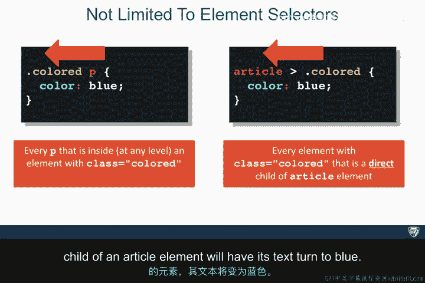
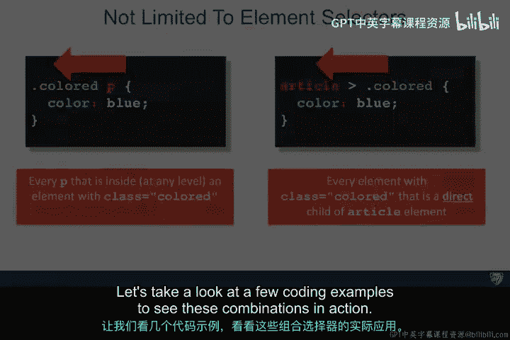
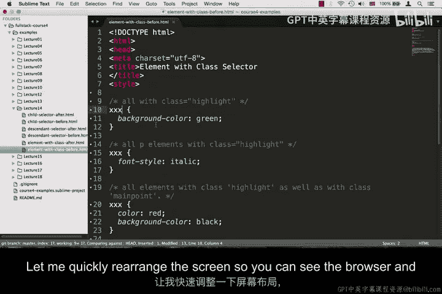
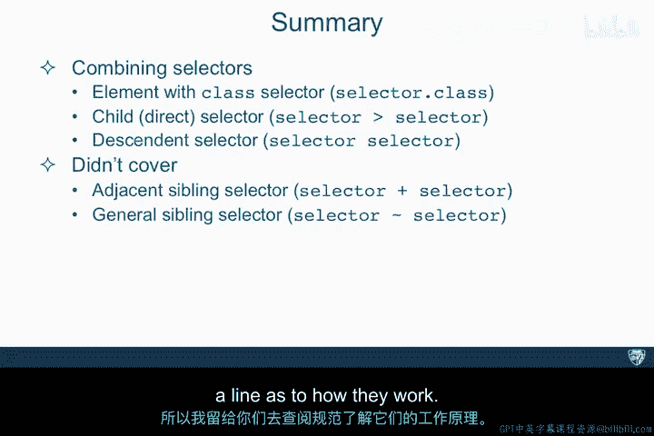
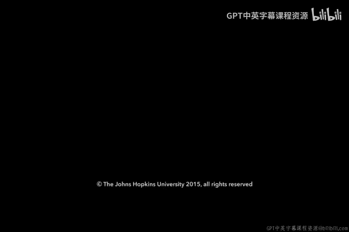

# 约翰霍普金斯大学《Web开发者的HTML, CSS, and Javascript》中英字幕 - P20：3_第14讲 组合选择器.zh_en - GPT中英字幕课程资源 - BV1WzY6z9EUd

。

Combining selectors is a very powerful technique that allows you to more precisely target dumb elements。

In this lecture， we're going to take a look at some of the most common ways of combining CSS selectors。

The first one is element with class selector， as you can see here。

 we have a P element followed immediately without any spaces by a dot big， which is a class selector。

 and what this expresses it that I want to target every P element that has an attribute class equal to big。

No lack of space between the element and the class definition If you do put a space。

 it will mean a completely different combination so make sure that if you want an element that has a class assigned to particular value that there is no spaces between the first selector and the second selector in this case between the P element selector and the dot big class selector。

And as an example here you can see on the right that P with a class equals big will get to text size 20 pixels。

 as opposed to all the other elements that have a class equal to big will not get that same 20 pixel font size styling。

 this technique is pretty commonly used when you have a CSS class definition that applies to different elements but when it's applied to a particular element。

 you would like to styling to slightly change。Next type of combination of selectors is a child selector and its syntax is pretty straightforward It's a selector followed by a right angle bracket followed by another selector and the way you read these combinations is from right to left and in this case what we're trying to do is target every P element that is a direct child of an article element so in this example you could see that the P element that is a direct child of an article element will get the styling of color blue applied to it as opposed to a regular P element that will obviously be unaffected。

 but also a P element that is inside an article element but not a direct child of it so theres a div element that's contained within the article element and only then is the P element contained within the div so since the P element is not a direct child of the article in the second case its font styling is unaffected。

😊，Another type of selector is a descendant selector and the syntax of it is selector， space。

 another selector， and just like before you read it from right to left so in this case what we're trying to do is target every P element that is inside at any level of an article element。

 which means that even if it's not a direct child， even if it's deep down as long as one of its parents in its ancestry is an article。

 this rule will apply。So for example， in this case it is a direct child of an article and the text will turn blue。

 in this case it's going to be completely unaffected because it's not inside of article element altogether。

 and in this case it will still turn blue that even though it's not a direct child element since were using a descendant selector combination。

 the P element is still technically inside the article even though it's not a direct child and will have its text turned blue。

Now I want to point out that these selector combinations aren't limited to element selectors。

 even though that's what I've used in the examples。

 so for example we could have a dotcolored space P and that will mean again reading it from right to left that every P element that is inside at any level of an element with class equals colored will have its text color turned to blue and the case of on the right we're using a direct child selector to say that every element with the attribute class equal to colored that is direct child of an article element we'll have its text turned to blue let's take a look at a few coding examples to see these combinations in action so I'm in sublime text and I'm looking at a file called element with class before that HTML and it's located in the examples lecture 14 folder let me quickly rearrange the screen so you can see the browser and the code editor better。

Okay so you can see we have a pretty simple H document。 Let's take a look at the structure。

 We have an H1 tag whose classes highlight We have a couple of paragraph tags one just a regular paragraph tag and another one has a class highlight applied to it and we have a div tag that has actually two classes apply to it called main point and highlight and notice the way you apply multiple classes to an element is just by listing them in the class attribute with a space between them。

 Okay so let's go ahead and write some select the rules so the first one we want to do is want to target everything with class highlight well that's very easy we've done that before that's just dot highlight we'll save that and we'll preview the difference in the browser and we see that everything with a class highlight does in fact have the background color turned to green next we'll look at all P elements with class highlight Well we've done as before so we need to do all P element but we can't put a space we just have to put dot highlight right。

😊，After that which will mean all P elements that have a class highlight assigned to them and we want to turn them into italic so let's save that and refresh the browser and we could see that the P element that has a class equal to highlight did in fact turn italic Next we'll combine two class elements In this case we want all the elements with class highlight as well as with class main point if both of those classes get applied to the same element we want that element to turn red and its background color to turn black so the way we could specify that it's just to say that highlight dot main point that is to say that an element that has highlight class and also has a main point class assigned to it should be colored red and background black let's go and refresh this and sure enough the last element on the page to div that has both class assigned to it has its styling affected in the way we want it next。

 let's take a look at the file called child selector before that HTML Let's go ahead and quickly examine。

😊，It's HTML structure it has a couple of section tags The first section tag has an H2 tag called subheading1 at div tag and inside the div tag we have the article tag in the second section we have an article tag that is a direct child of this section tag and the subheading 2 which is an H2 element is sitting outside of the section tag altogether so let's take a look as to what we need to do here in the first rule we want to target any article element which is a direct child of a section element in other words。

 any article element whose immediate parent is a section element well we've done this before in examples so at that section with a right angle bracket to say immediate child and its immediate child should be article so we save that and refresh the browser we see that the styling is only applied to the article that is direct child of the section but the article that is not direct child of a section sitting inside the div is unaffected the next target is any H2 element which is a direct。

Child of a section element In other words， any H2 element whose immediate parent is a section element。

 So again， the idea is similar。 itss section and its direct child should be H2 so any H2 that is direct child of a section element let's save that and refresh and since subheading one is a direct child of the section element that is the only element that gets our styling rule apply to it next。

 let's take a look at the file called descendant selector before that HTML。

 let's quickly examine its HTML structure we have a couple of unordered list here The first unordered list is sitting inside the section element and the second unordered list is sitting inside the article element so let's take a look at our CSS rule what we want to do is want to target all li elements that are inside of a section element that is no matter how deep they are in the element tree underneath the section element we want the style of color green applied。

it so that sounds like we need to use a descendant selector and the way we do that is to say section space and li and as you can see this selector combination should target this first list and even though U separates the li elements from the section element the style should still apply since we used a descendant selector combination so let's go ahead and refresh the browser and you could see that all the li elements of the first list turn green just as we expected so to summarize we looked at different ways of combining selectors we looked at element with class selector which is a selector without a space followed by class definition we looked at child direct selector which is a selector with an angle bracket followed by another selector and we looked at a descendant selector which is a selector with a space followed by another selector and notice that I'm using the word selector and nonely element just to remind you that it doesn't have to be an element it could be any selector that is using a。

😊，With another selector there are a couple of combination selectors that we did not cover for example。

 one is adjacent selector and another one is general siblinglink selector Now these selector combinations are a little bit less common than the other ones that I showed you so I'll leave it up to you to look it up in the specification or online as to how they work Next we're going to talk about pseudoclass selectors。

