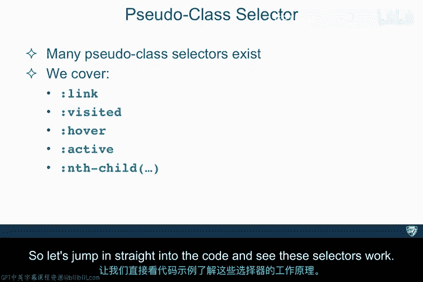
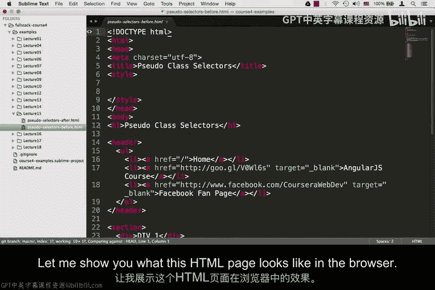
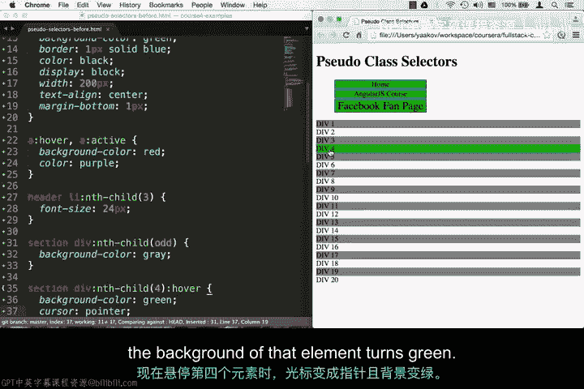
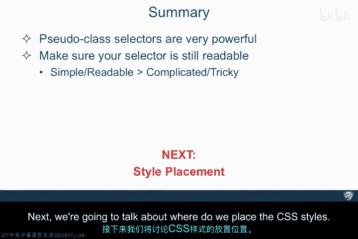

# 约翰霍普金斯大学《Web开发者的HTML, CSS, and Javascript》中英字幕 - P21：4_第15讲 伪类选择器.zh_en - GPT中英字幕课程资源 - BV1WzY6z9EUd

。

Sud class selectors address targeting of either structures that can be targeted by simple combinations of regular selectors or targeting the ability to style based on user interaction with the page for example。

 we would want the styling of an element to change if the user hovers or moves their mouse over that element。

The way you specify pseudo class selector is by specifying some selector that we already know about with a colon and a predeeffin fine pseudo class name Now there are many pseudo class selectors that exist in this lecture we're going to cover five of them the first four link visited hover and active are pretty basic and is used very。

 very often the last pseudoclass will cover anth childil is a fairly powerful pseudoclass and can get pretty complicated。

 but its basic uses are fairly straightforward as we will see。

 so let's jump in straight into the code and see how these selectors work。😊。

Okay， so in sublime text， I'm looking at the file called pseudo selectlectors before that HTML that is located in the examples lecture 15 folder。

 and let me show you what this HTML page looks like in the browser。

So this page has a header and in the header we have an unordered list which has a bunch of links as you can see it's showing up as a regular list with bulleted points followed by a section which has a whole bunch of divs and each one is named div1 div23 all the way to div 20 and the first thing I'd like to do is I'd like to style this unordered list as a menu it's a pretty common practice to take an unordered list and style it as a menu so let's go ahead and take this unordered list and style it as a bunch of menu buttons。

 The first thing we want to do is target these list items so the way we're going to do this is by using our descendant selector by saying header li and we'll turn off the bullet points by saying list style none and if we refresh the page we now see that the bullet points when away the next task is to style the links that are sitting inside the li elements and to make them look like buttons however styling links is not exactly as straightforward as styling a regular element。

Because links have states and these states can be expressed using our pseudo classes so let's go ahead and do that so here we're targeting two states one is A's being a link that it is and another one a visited and this is very often the practice that you group together these two and what basically that means is well link is at the way it is link and visit it means that HTML allows that after you click a particular link that a different style can be applied that link that an uncpped link in our case however we don't want to differentiate between the two so we'll style them both together okay so let's start by removing the underline that is the default styling for every link once we save that and refresh we see that underline is gone so let's set some other styles we'll set the background color to green border one pixel with solid meaning solid versus dash or something like that and blue and we'll set the color of the text inside these links to black。

😊，Let's go ahead and refresh the page and here we see we have a blue border。

 it's a green background and the color is black。Now I spoke to you before about the fact that the a element is both sort of an inline element and a block level element however that's only as far as inclusion of other elements inside of it is concerned as far as this default display it's actually displayed as an inline element Well we don't want that for our buttons we want them to be block level element I could change that very quickly by just saying display block and once I say display block and refresh you could see that the block level elements do what they always do try to fill up all the space they possibly can within that line so I'm going to have to constrain that a little bit。

 let's go ahead and give it a width of 200 pixels。😊。

We don't want our button to be that wide and we want to align the menu items to be center and we'll also separate the different menu buttons from from each other by giving it a margin bottom of one pixel so let's go ahead and refresh that。

😊，And now we see we have three little nice buttons in our menu。

 however we're not done because what we would like to do is on the user hovering over these buttons besides changing the cursor to a pointer。

 I'd like to have some sort of interaction in the style and kind of show the user that they' are hovering over these buttons so in order to do that I have to define two more states of the link。

 one is a hover and the other one a active。😊，Now hover is what exactly what it sounds like is when the user hovers over the element in this case。

 the A element an active is that state when the user actually clicks an element but hasn't yet released his click so he presses the mouse button down but hasn't yet released the button in our case we don't want to differentiate between the hover and active so we'll keep them grouped together let's set the background color to red and the color of the text to purple we'll save it and previewed in our browser So now when I roll over you could see that the color of the background changes to red and the color of the font is changing to purple even though con with red it's kind of actually looking blue Now these buttons still retain their link behavior so if I click on this link I will go to the Facebook page that happens to be the F page that I created specifically for the courses that I'm teaching on Cosera which is this course and the next one which is an Angular JS as a side note。

 please go to this page。😊，Like it you'll be able to follow the latest updates and I'll be posting some optional material that might be interesting to you that's related to web development and please sign up for the mailing list that I'll be able to notify you when some new interesting material comes out obviously all is completely optional and its simplest form theth childil pseudoseor allows you to target a particular element within a list for example I'd like to target this Facebook fan page link and I'd like to make it bigger just so you remember to click on it and like the page so let's take a look at the HTML where it's located it's located in the header section and there's a URL and there's three liI elements in here the Facebook link is the third one in the list so I could go over to my style and I could say that I want to target the li element that is inside the header element and I want it to be anth childil number three so that's the third link and now I could target and say for example font size to be。

😊，24 pixels。 so I'll make it a little bit larger。 So if I refresh the page。

 you'll see that only the third link， the third menu button became bigger。

 the rest of them said exactly the same。 but the nth childil pseudo selector can do much more fun stuff than that。

 For example， we have a list of divs here that looks pretty dull。

 So what I'd like to do is like to make it look like a list。

 and what I want is that every odd member of this list should get its background color to be gray。

 So the I could achieve that is by targeting the div inside the section and I'll specify the nth childild again。

 and instead of specifying the numbers13 and so on。

 I could specify odd And if I do that and say background color gray and refresh my page all of a sudden I have a list that looks looking much。

 much easier to read than before。 And by the way， just like regular selectors can be combined pseudo selectors can be combined as well。

 For example， if I would like to have the fourth element in this。😊。

have a different hover behavior since right now nothing really changes when I hover over the fourth element in the list I'd like to have that change。

 so let's go ahead and target again section div and target the end childil this time I want the fourth child to be targeted。

 but I want to specify that its's hover behavior should be different so I'm going to target the hover behavior part and I'm going to change its background color to green and it's cursor to pointer so let's go ahead and refresh the page and now when I hover over number four the cursor turns the pointer and the background of that element turns green。

I'm sure by now you see how powerful selectors can be。

 especially using the pseudoclass selectors one quick word of warning though make sure your selector is still readable。

 these things can get very complicated very quickly and if you make it such that other developers and you in a month or so can't really understand fairly easily what you're targeting this can become a bit of a maintenance nightmare so simpler readable it's definitely preferred to complicated and tricky you might be able to impress people with it but it's certainly not very good coding practice to make this super complicated。

Next， we're going to talk about where do we place the CSS styles。

 what is the best place to place it and what the differences between those places are。

