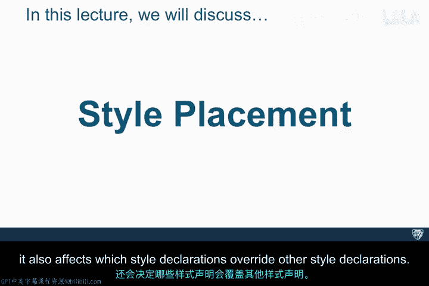
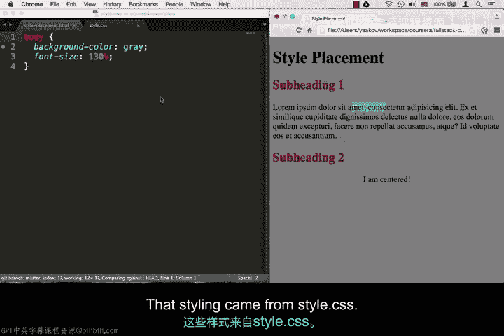
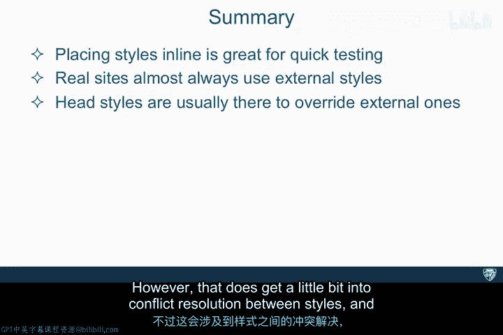

# 约翰霍普金斯大学《Web开发者的HTML, CSS, and Javascript》中英字幕 - P22：5_第16讲 样式放置.zh_en - GPT中英字幕课程资源 - BV1WzY6z9EUd

。

Your choice for placing styles in one versus another place doesn't only affect how reusable the styles are。

 but it also affects which style declarations override other style declarations let's jump into the code and take a look at an example so I'm in sublime text and I'm looking at the file called style placement that HTML let me go ahead and quickly rearrange the screen so you could see the browser and the code editor at the same time so here's our HTML document and so far we've been specifying all of our styles inside the style tag that sits inside of the head tag of our HTML document and in this case we're specifying that every HTML2 and our HTML document should have the color。

 the text color maroon as you could see the subheadings the H2s are in fact maroon however。

 there are other places that you could specify a CSS style for example you could specify a CSS style directly on the element by providing the style attribute and the CSS styles that should apply to that style。

The only thing that's missing from these styles is the target and it's for a good reason since we're inside the elements so we don't really need a target anymore but the style declarations are exactly the same as before and they're also terminated by semicollonons and you could put here more than one just keep terminating them with semicollons In this case。

 this I am centered content is textal center and as you could see in the page it is in fact getting centered in the page this is called inline styling and as you might have guessed this is the least reusable way of styling elements there is so for example if you wanted to style something similarly within the same page you would literally have to copy and paste the styles somewhere else in order to achieve that for that reason this is the least preferred method of styling and you should really try to stay as far away from this as possible I personally suggest that you only use this for some very quick testing just to see what the style would look like the st and location that we usually used in this class。

😊，Is a little better than an inline style It's better because I could specify classes and target multiple elements with my selectors here。

 However， what happens if I have multiple pages in my website and I want them to look consistent which means specifying the styles inside the head tagag of one particular H page is really not going help me with the others that means I really need some sort of other way to specify styles that are external to the HTML page and kind of link them back in into my HTML page well this is what external style sheets are all about and you can see that we're specifying one here with a tag called link and we are telling the browser that it's the style sheet and its location usually familiar Hf attribute In this case we're specifying it to be a relative URL so style that CSs better live in the same directory as our style placement that HTML file and in fact it does and this is what it looks like Ex style sheets are just。

😊，Styleles with list of CSS rules， there's no particular tags that have to surround any of this So as you could see in this style that CSS we're specifying that the entire body。

 meaning the entire viewport its background color should be gray and the font size should be 130% of whatever the default font size is and if you look to our page you could see that the fonts are a little bit bigger than usual and certainly the background is gray that styling came from style that CSS。

While we will continue in the class to use this style tag inside the head tag。

 so it's a little more convenient to showcase the styles in a real worldord website。

 you almost always want all your styles to be external to your HTML page which means writing your styles inside some style that CSS external file is actually the way to go to summarize placing styles in line is great for quick testing but try to avoid that if you actually coding a realworld website real worldorld websites almost always use external style sheets which means you take all of your styles and you place them in an external file and then you link it back in into usually several HTML pages that technique doesn't only reuse your CSS styles but also promotes consistent look throughout your entire website and on top of that since you externalize your CSS styling into one file each subsequent page in your website will not have to redownload the。

Assess styles over and over again while we use the heads styles for just demonstration purposes in the real world they're usually used to overwride some external ones。

 however even that practice is a little bit questionable if you're trying to overwrite styles that are external to your HTML page and you have no control over it's better to create your own external CSS file and then specify it below the external CSS file that you have no control over however that does get a little bit into conflict resolution between styles and that is exactly what we're going to talk about next。

