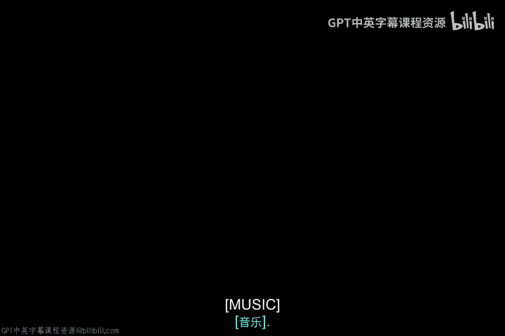
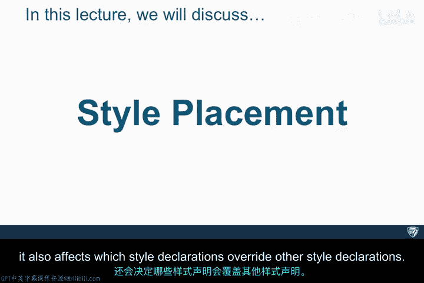
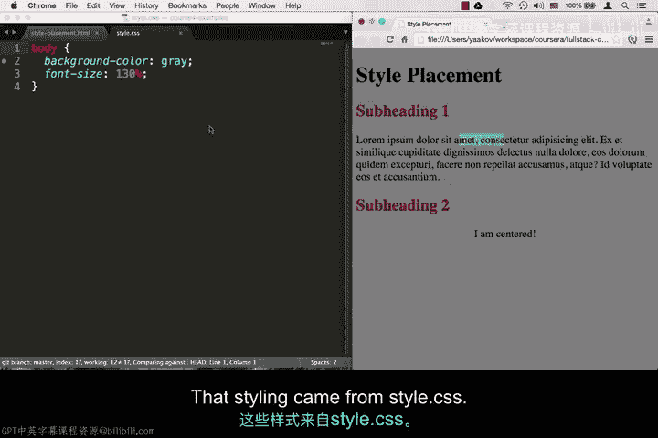
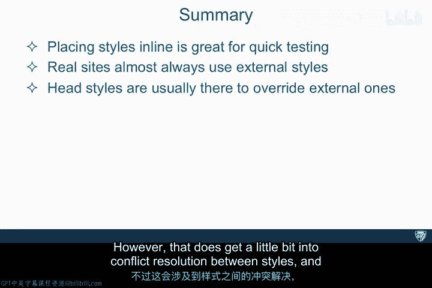
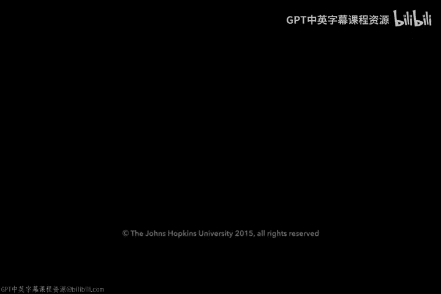

# HTML, CSS, and Javascript for Web Developers：5_16：样式放置



在本节课中，我们将要学习CSS样式可以放置的不同位置，以及每种方式的优缺点。理解样式放置的位置不仅影响样式的可重用性，也决定了样式声明的优先级。

## 概述

CSS样式可以通过多种方式应用到HTML元素上。我们将探讨三种主要方法：内联样式、内部样式表和外部样式表。每种方法都有其特定的使用场景和影响。



## 内联样式

上一节我们介绍了样式放置的基本概念，本节中我们来看看第一种方法：内联样式。

内联样式是直接在HTML元素的`style`属性中编写CSS规则。这种方式的特点是缺少选择器，因为样式直接应用于该元素本身。样式声明的格式与常规CSS相同，每条声明以分号结尾。

以下是内联样式的一个例子：
```html
<p style="text-align: center;">这段内容居中</p>
```
在这个例子中，`<p>`元素的文本被设置为居中对齐。正如你在页面中看到的，它确实在页面中居中了。

内联样式是**可重用性最低**的样式方法。例如，如果你想在同一个页面中为另一个元素应用相同的样式，你必须将样式代码复制粘贴到另一个元素上。因此，这是最不推荐的样式方法，应尽量避免使用。个人建议仅将其用于快速测试，以预览样式效果。

## 内部样式表

接下来，我们看看第二种方法：内部样式表，这也是我们在课程中常用的方法。

内部样式表是将CSS规则写在HTML文档`<head>`部分的`<style>`标签内。这种方法比内联样式更好，因为我可以在这里指定类选择器，并用选择器同时为多个元素设置样式。

然而，如果我的网站有多个页面，并且我希望它们看起来一致，那么在一个特定HTML页面的`<head>`标签内指定样式，对其他页面是无效的。这意味着我需要另一种方法来指定**独立于HTML页面外部**的样式，并将其链接回我的HTML页面。

## 外部样式表

这正是外部样式表的作用。你可以看到我们在这里使用了一个名为`<link>`的标签来指定它。



我们告诉浏览器这是一个样式表，并通过`href`属性指定它的位置。在这个例子中，我们指定了一个相对URL，因此`style.css`文件应该与我们的`style-placement.html`文件位于同一目录下，事实上它确实存在。

外部样式表就是**一个包含一系列CSS规则的文件**，周围不需要任何特定的HTML标签。正如你在`style.css`文件中看到的，我们指定了整个`body`（即整个视口）的背景颜色应为灰色，字体大小应为默认字体大小的130%。如果你看我们的页面，会发现字体比通常稍大，并且背景确实是灰色的，这些样式都来自`style.css`。

## 总结与最佳实践

本节课中我们一起学习了CSS样式放置的三种方式。

在课程中，为了更方便地展示样式，我们将继续使用`<head>`标签内的`<style>`标签。然而，在现实世界的网站开发中，你几乎总是希望将所有样式都放在HTML页面**外部**。这意味着将你的样式写入一个外部的`style.css`文件是正确的方法。

总结来说：
*   内联样式适用于快速测试，但在实际编码真实网站时应尽量避免。
*   真实世界的网站几乎总是使用**外部样式表**。这意味着你取出所有样式，将它们放置在一个外部文件中，然后通常将其链接回多个HTML页面。
*   这种技术不仅能重用你的CSS样式，还能促进整个网站外观的一致性。
*   此外，由于你将CSS样式外部化到一个文件中，网站中的每个后续页面都无需反复重新下载相同的样式。





虽然我们为了演示目的使用了内部样式（`<head>`中的样式），但在现实中，它们通常用于**覆盖**某些外部样式。然而，即使这种做法也有些值得商榷。如果你试图覆盖你无法控制的、来自HTML页面外部的样式，更好的做法是创建你自己的外部CSS文件，并将其指定在（你无法控制的）那个外部CSS文件**之后**。不过，这就会涉及到样式之间的冲突解决规则，而这正是我们接下来要讨论的内容。