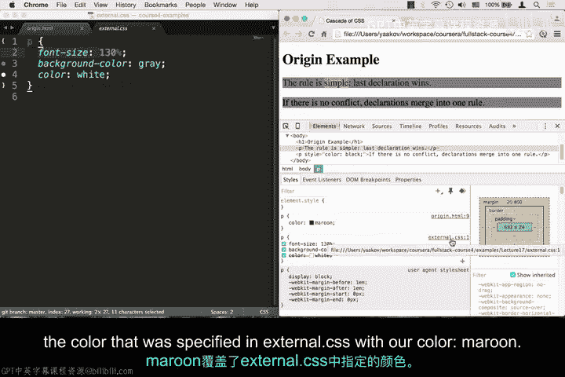
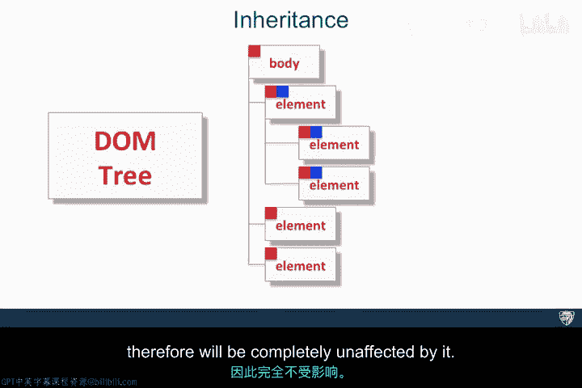
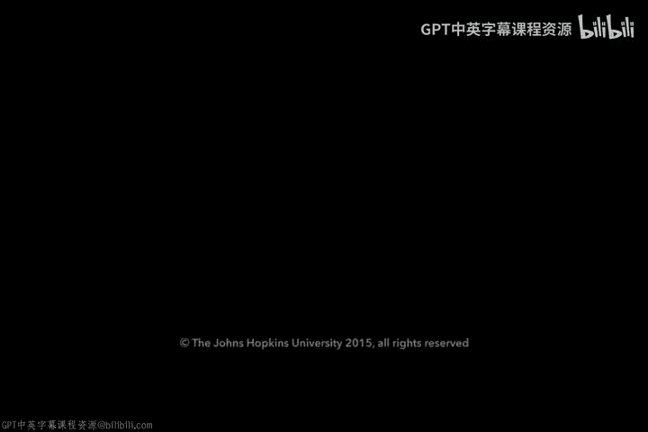

# 约翰霍普金斯大学《Web开发者的HTML, CSS, and Javascript》中英字幕 - P23：6_第17讲 第1部分 样式冲突解决.zh_en - GPT中英字幕课程资源 - BV1WzY6z9EUd

。

Cascading is a fundamental feature of CSS It's an algorithm defining how to combine properties values originating from different sources as the name itself suggests cascading style sheets。

 in other words， the cascade algorithm is at the core of understanding in using CSS the cascade combines the importance origin specificity and source order of the applicable style declarations to determine exactly which declaration should be applied to any given element and if there is a conflict。

 how to resolve that conflict in other words how to tell which CSS rule wins。😊。

There are a lot of terminology and concepts surrounding the cascading algorithm， however。

 I believe to have a working knowledge of the cascading algorithm。

 you should understand these four concepts and these are origin or origin precedes merge as well as inheritance and specificity So let's tackle the first two origin and merge when two declarations are in conflict。

 In other words they specify the same property for the same target origin precedences rule kicks in and it's a very simple rule。

 and the rule is the last declaration wins Now when trying to figure out what the last declaration is you have to remember that HTML is processed sequentially that means top to bottom So as you see the declarations happen。

 the lower and the page they are， the more precedence they have and also for precedents think of external CSs as declared at the spot where it's linked to so usually it's declared in the head somewhere but there are。

😊，The other styles that are declared in the head and to figure out which one was declared last。

 imagine that the entire contents of an external CSS file were cut and pasted straight into the head portion where that external CSS is declared。

😊，When different CSS declarations do not conflict that is they still target the same element but the CSS properties with which they target that element are different there's even a simpler rule and that is the declarations merge so a declaration for for example font size and declaration for color since there are two different properties when they're targeted to the same element even if they're targeted from two different origins they will merge into one and the element will get both the font size and the color let's take a quick look at an example of that in code okay so here I am in sublime text and I'm looking at origin that HTML that is located in the examples lecture 17 folder let me go ahead and hide the sidebar so we could see the file a little bit better so to go over the structure of our HTML in the head we have a link that links our external that CSS which is also located in the same folder as this file and you can see that file is right here。

😊，It specifies that every P every paragraph tag should have font size increased to 130%。

 the background will be gray and the color of the text will be white Now right after that we have a style tag again still in the head that overrides the P element and says that the color that is the text color should be maroon Now when we get to the actual viewable content we have a couple of paragraphs here the first one is just a simple paragraph and the second one is a paragraph where we've declared an attribute style and specified color of the text to be black so let's take a look at the first paragraph you could see that the background of the paragraph is gray and the text color is maroon Now how do we get this gray and maroon well let's take a look we first declared external CSS that's the first thing that comes in the HTML file so remember I told you to think about it as if we basically took these contents and pasted them straight into the spot so basically we've declared。

The font size to be increased， the color should be background color should be gray and the color。

 the text color should be white。 However， right after that we turned around and overwritten that with another color declaration and said that the color in fact should be maroon and that's really the last thing that we could see as far as the text color over paragraph tag and that is why this paragraph right here does in fact have its text color maroon that is because the last declaration of that color one the second paragraph however。

 has its text color black because the very last declaration of the text color is black so therefore the text color is black so that's our origin precedence rule in action。

 however， unlike the color property， we have other properties here which are the background color and the font size that are still being applied to both paragraphs and that's our example of emerge In fact if we right click on this paragraph and go ahead and the element we could see that the first paragraph does in fact have。

The color maroon and it's coming from origin。htm line 9。

 that's our style tag inside our head section， but you can see that it's showing you that other things apply as well that background color is gray and the font size is 130 and the Chrome developer tools are clearly showing you here that we've overriden the color that was specified in external do CSS with our color maroon and that's why you see the color crossed out here。

The next concept we're going to take a look at is inheritance and that's a pretty simple concept the basic idea is is that you have the document object model tree and if you specify some CSS property on some element。

 all the children and grandchildren and so on and so on of that element will also inherit that property without you having to specify the property for each and every element。

 so for example if I specify one property on a body tag。

 every element that is a child of a body tag or even a child of a child of a body tag and so on will inherit that property。

 Similarlyly if I specify a property on some element within my HTML page。

 every child and grandchild and so on of that element will also inherit that property but obviously no parents of that element will inherit that property and therefore be completely unaffected by it so let's take a look at what inheritance looks like in code while inheritance in CSS。

Is a pretty simple concept to understand It happens to be a very powerful technique as well。

 It allows me to specify one rule and have all the children of the target element inherit that rule let's take a look at inheritance that HTML which is also located in the same folders as the previous file it's a very common practice to specify some declarations for the body tag and the reason is obvious body is the top element in our HTML as far as the viewport is concerned in it I can specify some rules for the entire HTML document and then using our cascade origin precedent overwrite some specific rules a little bit lower down the line while keeping everything else very consistent so here in our example as you could see I specify that any text appearing in our document should be color red and I also specified that everything should be aligned center and which is very common to specify one font that will be consistent throughout the entire HTML document in this case Helvetica then what I did was I specified a particular color of the text。

Just for paragraphs and even though each paragraph will inherit color red。

 we're here to overwride that with color blue Last in the H2 tag here a little bit lower to the bottom I'm using again the origin precedence rules to overwrite the text color to green for this particular subheading2 and as you could see our H1 here in the browser is read and so is the first H2 and they're read even though I never specified H1 or H2 to be red I just said that anything inside the body color should be read and you notice that every single block level element here is centered and the reason it's centered is because I specified again on the body that the text align should be centered same goes for fun family it's Helvetica throughout the entire document again I never specified text align or font family for every single element in the page but I did specify it for the parent element the body tag so as you could see this is pretty powerful。

Okay， so since this lecture is getting a little too long。

 I'm going to split it up and we'll finish specificity in part two。😊。

