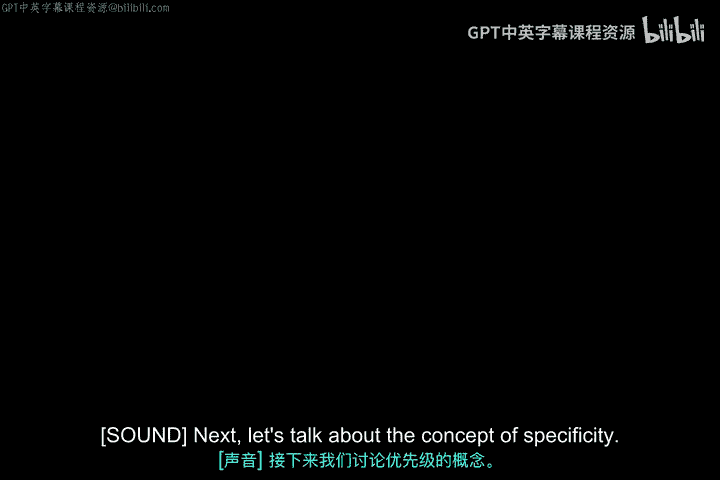
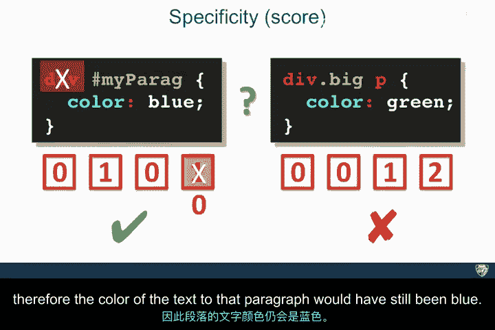
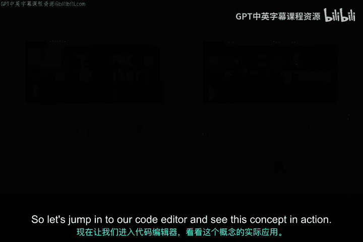
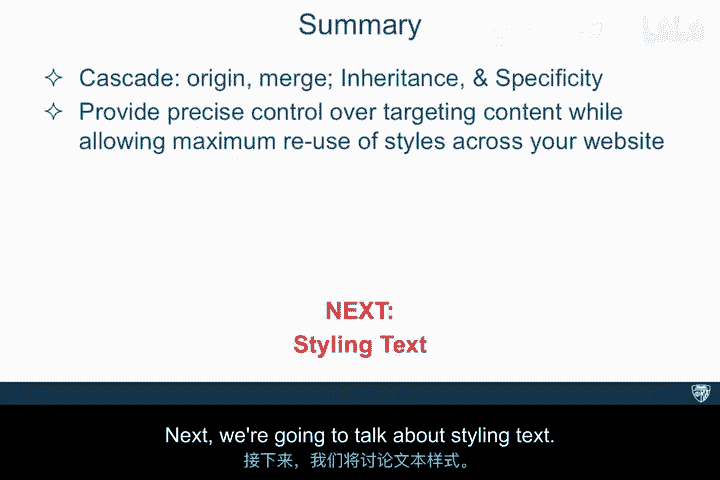
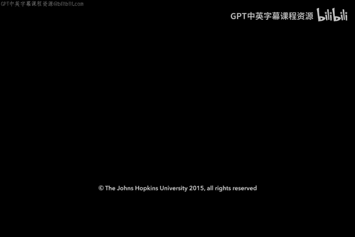

# 约翰霍普金斯大学《Web开发者的HTML, CSS, and Javascript》中英字幕 - P24：7_第17讲 第2部分 样式冲突解决.zh_en - GPT中英字幕课程资源 - BV1WzY6z9EUd

。Next， let's talk about the concept of specificity Now specificity also has a pretty simple rule and that is most specific selector combination wins while this is a pretty simple sounding rule。

 I would say that forgetting about the concept of specificity and how it's implementeded in CSS is what tripps up developers most often。

 let me show you a pretty straightforward technique that will let you figure out which selector combinations are most specific than others。

You can think of specificity of your selectors as keeping a score the selectors with the highest score win In other words。

 the selectors with the highest score would be considered the most specific。

It's easier to calculate the score if you arrange the types of things that affect the score from left to right with the left being the highest value of specificity。

 then simply take your CSS rule and fill in the number of times you see a particular type of selector being used in its proper location the number that's created is your final score so let's take a look at our four boxes on the screen the most specific targeting that exists in CSS doesn't actually use any selectors at all and that is the style attribute on an element and that happens when you define your CSS declarations straight on the element using the style attribute and that makes perfect sense right since specifying the style attribute is like pointing to an element with your finger and saying that one there's nothing more specific than that and that is why the style attribute is the most left box next in specificity value comes the ID then the class or pseudo class and then the number of elements that are used in your selector combination so if we take a look at this example。

which says H2 style equals color green， we see that we're using the style attribute。

 which means this box gets a1 and the rest of them get a zero and this is pretty much the highest score a thousand0 that you can get。

Taking a look at a different selector， for example div P and color green。

 you see that it's not defined inside of a style attribute so that gets a zero。

 there's no ID selector that that gets a0， there's no class definition selector either so that gets a zero。

 but there's two elements here we're using a descendant combination of selectors div and P so therefore the number of elements that we have is2 that's why the last box gets the number two。

😊，So let's see how this would work if you had to compare and see which one of the selector combinations would win So if you're targeting a particular paragraph tag and in one case you're targeting it with a set of selectors that are shown on the left side of the screen and in other case you're targeting it with set of selectors that are shown on the right side of the screen which one would win in other words the color of the text of that paragraph would it be blue or would it be green well let's quickly calculate those scores the one on the left is not using the style attribute so we know that gets a0 it does use an ID attribute so that gets a1 there is no class so that's a0 and the number of elements is one so that gets a1 so the final score of the left is 101 on the right Likewise we're not using the style attribute so that gets a0 we're not using an idea attribute so that gets a0 again we're using one class so that gets a1 and we're using two elements so that gets a two so the score is 101 versus。

😊，12So obviously the one on the left wins and the text color where a paragraph will be blue。

 not green looking at the score on the left and the selectors that we've chosen to get that score。

 we could see that we really could have won this selector battle by not specifying the div there to begin with we could have just expressed it with an ID selector and still would have won this battle and therefore the color of the text of that paragraph would have still been blue So let's jump into our code editor and see this concept in action so here we're in sublime text and we're looking at specificity that HTML and this is a pretty simple document。

 all it has is really one paragraph tag and it's sitting inside of a header tag with class navigation if you look at the styles that are specified for this document we have two competing styles one is trying to make the text color blue and the other one is trying to make the text color red obviously as you could see on the right side in the browser the text color and Z being blue Why is that。

😊。

Well keeping in mind what we just learned the specificity rule here is what's in play。

 Both rules have one class so that gets us a 10 However。

 the first rule has two elements specified and the other one only one so this gets a score of 12 and this gets a score of 11 so this rule wins there's normal more concept Id like to show you and it is a concept of overriding all these rules taken all with the exclamation point important here we have a third way to define this paragraph tag and its color its text color to be green and this time I'm going to define it with the word exclamation point important and exclamation point important basically says it doesn't matter what the specificity is I want to override everything and make this property the way I'm defining it so here we're defining the color being green so if we refresh the browser even though this is a much less specific rule then this one this is just gets a score of one and this remember。

😊，2 since we specified important our color of the text will turn green Now I want to warn you about using this exclamation point important while very tempting to skip understanding all these cascading rules and specificity rules and just slap important everywhere whenever things don't work out this will very quickly on a real worldorl project become a maintenance nightmare where you'll be overriding one important declaration with another important declaration and you'll basically start working out your own system where gigantic mess will be your most important rule so avoid using important unless you absolutely have to In summary in this lecture we spoke about the cascading algorithm the origin。

 the origin precedence how the declarations merge as well as inheritance and specificity the cascading algorithm provides pretty precise control over targeting content while allowing you maximum reuse of styles across your website and that is basically what makes CSS so powerful。

We're going to talk about styling text。

