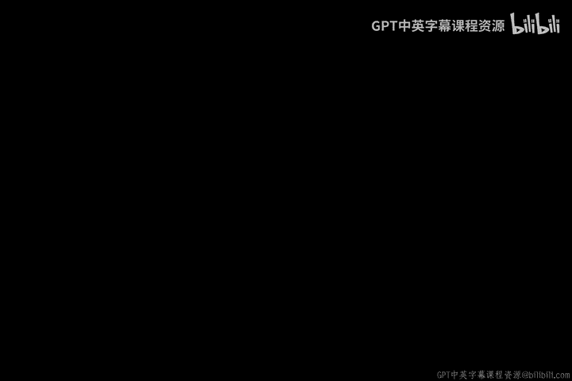
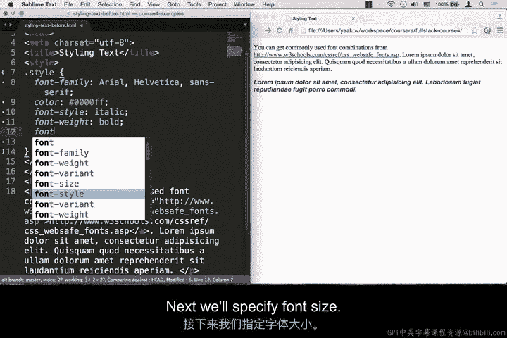
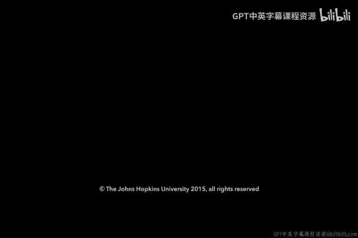

# 约翰霍普金斯大学《Web开发者的HTML, CSS, and Javascript》中英字幕 - P25：8_第18讲 第1部分 文本样式设计.zh_en - GPT中英字幕课程资源 - BV1WzY6z9EUd

Yeah。

There are a ton of CSS properties that affect the way text is displayed I'm not going to attempt to cover every single one of them instead we'll take a look at a few that illustrate the concepts behind their stylings let's jump straight into the code editor and take a look。

Okay， so I'm in sublime text and I'm looking at the file called Styling text before that HTML let me quickly rearrange the screen so you could see the browser and the code editor at the same time Okay so the first thing we want to do here is we have a class called style and we're applying this class to the second paragraph in our HTML file we have two paragraphs here the second one is what we're applying this to as you could see in the browser there's a couple of paragraphs that are being shown and both of them at the moment have the default styling from the browser so our task here is to style the second paragraph just to see a comparison。

So the first one we want to do usually is specify font family， so font family is the property name。

And the value for font family could vary。 In fact， I provided you here a link right straight in the HTML page and well go ahead and click that link it basically gives you commonly used font combinations So what you usually put in the font family is the value use combinations of font fonts and the reason you put not just one font but a few font is because when you specify font family in this way you're relying on the client's computer relying on the user's computer to have that font installed and it's possible that a particular font will not be installed on the user's computer so you want to provide some options and at the very least you want to provide whether you want a serif type of font or San serif type of font because every computer will have some sort of default serif San serif font and just in case you don't know the difference between serif and San serif serifs are the fonts that not only have the lines but also have a bit of an embellishment at the end of each line so as you could see there is this little squiggglelies at the end of each line I opposed a San。

If they're just very straight lines personally， I prefer this particular font combination。

 so I'll copy it and paste it right here， give it a semicolon and let's go back let's save the file and refresh and now you see that now we have aerial most probably as the font for our paragraph next let's change the color Now you've seen me use color multiple times already but the truth matter is while it's probably okay to use red green blue predefined color names in testing for real websites you would want to use a hexedadecimal value for a particular color and whatever color you want to have is something that obviously is up to you so I'll this color and this is a hexadecimal value and the way this color specified is the first two numbers is red second two numbers is green and the last two numbers is blue FF being the highest blue value so basically it's the same RGB specification that a lot of colors。

😊，specified as except it's expressed in hexadecimal so let's save it refresh as you can see now it turned blue Now there are various shortcuts for specifying colors and I'll let you look it up yourself but needless to say if you specify a six digit hexademal color it's certainly good enough the property font style is the one that specifies whether or not you want something to be italic or normal and we'll give it an italic to just change it a little bit well save it refresh and now you see the font turned italic next thing is font weight Now font to weight could be specified from basically normal to bold and you could also specify it using number so if I specify all the way to 800 900 and bold 900 will be pretty bold if I save it and refresh it will be pretty bold but in practice people just use the word bold is a pretty fine keyword so that's also good enough and about equals 900 anyway next we'll specify a font size and we'll give it a 24 pixel。

😊。

And this will obviously give it a little bit of a bigger font size than it is right now as you could see right there just about every browser out there has a default font size of 16 pixels and that should give you an idea as to what an unstled text would look like and by ons styleled I mean the one that has the browser default styling applied to it now don't confuse this with points these are pixels points are used in print when you do Microsoft word or something like that but not on screen on screen you use pixels pixels are what's considered absolute unit of measurement for size however they do have a bit of a relative component to them pixels are relative to the viewing device for low DpiI or low dots per inch devices one pixel is one device pixel dot of the display for printers and high resolution screens one pixels implies multiple device pixels point is higher DpiI devices will give you sharper text because for every pixel that it's drawing it's actually drawing。

Multiple pixels on the device with all that said， pixels is still considered an absolute unit of measurement。

 We'll talk about relative units of measurements as far as font size is concerned in just a little bit。

 but for this short segment let me just show you a couple of more text properties that you might want to know about there's another one called text transform and it allows you to basically control how you text looks capitalize it lowercase if I capitalize for example。

 save it and refresh you could see that every word now gets capitalized but there's more there's lower casing I could have the entire text get lowercase or I could get the entire text get uppercase and let's leave it that way another useful property is text align and what it allows you to do it allows you to either center right justify left the text within its block level element for this one let's go ahead and write justified it refresh and here we go。

😊，We'll continue this lecture with Part two and we'll speak about relative fontchising。

